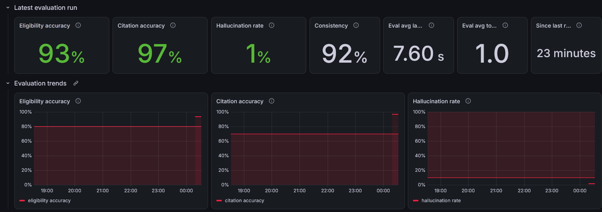
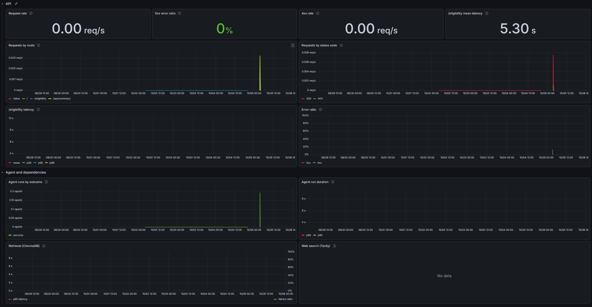

# ScholarLens

Students often don't know which scholarships or grants they actually qualify
for: eligibility rules are buried in long PDFs and program pages, and keyword
search either misses real matches or confidently returns wrong ones.
ScholarLens takes a student's basic information (income, state, GPA, major,
and so on) and determines which programs they may qualify for, showing the
exact rule behind each result, so the answer is auditable rather than a
black box.

## Evaluation results

The agent is scored against 25 hand-labeled student profiles, each with the
expected verdict, program, and rule. This run used the deployed production
backend on 2026-10-05 (UTC), `gemini-3.8-flash` with `gemini-embedding-001`,
each profile answered 3 times (75 answers):

| Metric | Result | Target | |
| --- | --- | --- | --- |
| Eligibility accuracy: the verdict matches the label | 93.3% | above 80% | met |
| Citation accuracy: the quoted rule and program match the knowledge base | 97.0% | above 70% | met |
| Hallucination rate: a claim of eligibility with no citation, or a quoted rule found nowhere in the knowledge base | 1.4% | below 10% | met |
| Consistency: the same verdict across the 3 repeats | 92.0% | none | |

Mean latency was 7.6 s per answer with 1.01 tool calls. Of the 6 answers that
missed: 3 were `calgrant-a-meets-gpa` returning "partial" instead of
"eligible", 2 were Gemini requests that ran past their deadline and returned no
answer, and 1 quoted a rule found nowhere in the knowledge base. Rerun it with
`python -m app.evaluation` (see Deploy for running it in production).



## Repo layout

```
frontend/   Next.js (App Router, TypeScript, Tailwind), the SaaS client
backend/    FastAPI + Pydantic AI, the API and Agentic RAG engine
infra/      Deployment / observability config (Docker Compose, env templates)
```

## Quickstart

### Frontend
```bash
cd frontend
npm install
npm run dev            # http://localhost:3000
```

### Backend
```bash
cd backend
python -m venv .venv
# Windows: .venv\Scripts\Activate.ps1   |   macOS/Linux: source .venv/bin/activate
pip install -e ".[dev]"
uvicorn app.main:app --reload   # http://localhost:8000  (docs at /docs)
```

### Operations view (`/ops`)

`/ops` is a password-protected page for maintainers. It shows traffic trends for
the last 6 hours (request rate, 5xx ratio, `/eligibility` latency, tool calls),
the latest and recent evaluation runs against their targets, and ingestion
health. The evaluation and ingestion sections read the backend's own status
files. The trends come from Grafana Cloud.

To enable it:

1. Generate one long random token and set it as `OPS_API_TOKEN` in both
   `backend/.env` and `frontend/.env.local`. The frontend sends it server-side
   only, so the browser never sees it.
2. Set `OPS_USERNAME` and `OPS_PASSWORD` in `frontend/.env.local`. `/ops` asks
   for them through the browser's login prompt, and returns 503 while either is
   unset.
3. Optional, for the trend charts: set `GRAFANA_PROMETHEUS_URL`,
   `GRAFANA_PROMETHEUS_USER`, and `GRAFANA_PROMETHEUS_TOKEN` in `backend/.env`.
   The comments in `backend/.env.example` say where to find them. Without
   them, the page says the trends are not configured and shows everything else.

The shared password has no rate limiting or lockout yet (feature 18), so use a
long one.

### Deploy

The backend runs on Railway as one always-on service, and ChromaDB runs embedded
on that service's volume. The frontend runs on Vercel. Both serve HTTPS. Keep
every secret in the platform's env vars, never in the repo.

**1. Backend on Railway.** Create a project from this GitHub repo with one
service deploying from `main`, then set it up:

- Settings: root directory `backend`, config file `/backend/railway.toml`. The
  config path is absolute because Railway does not resolve it from the root
  directory. That file sets the Dockerfile build, the `/health` check, and
  restart on failure.
- Keep 1 replica. The rate limits live in process memory and embedded Chroma
  allows one process.
- Add a volume mounted at `/data`. Volumes are created from the project canvas
  (Ctrl/Cmd+K, or right-click the canvas), not from the service settings. Do
  not mount it over `/app/data`, which holds the bundled corpus.
- Generate a public domain.
- Keep Under Attack Mode off (service Settings, Edge). When it is on, the edge
  answers every non-browser request, including `/health`, with a plain-text
  `rate limited` 429 that never reaches the app.
- Variables: `GOOGLE_API_KEY`, `TAVILY_API_KEY`, `OPS_API_TOKEN`,
  `FRONTEND_ORIGIN` (set in step 3), `CHROMA_PERSIST_PATH=/data/chroma`,
  `INGESTION_STATUS_PATH=/data/ingestion-status.json`,
  `EVALUATION_RUNS_PATH=/data/evaluation-runs.jsonl`, and
  `FORWARDED_ALLOW_IPS=*`. Optional: the `GRAFANA_PROMETHEUS_*` values for
  `/ops` trends.

`FORWARDED_ALLOW_IPS` is read by uvicorn itself. Railway's edge replaces any
`X-Forwarded-For` the client sends and puts the real client IP first. With
`*`, uvicorn takes that first entry, so the per-IP rate limits apply to real
visitors. If the variable is unset, every visitor shares one limit.

**2. Ingest the corpus once.** Run ingestion inside the running service. It
reads the bundled corpus from `/app/data/programs`. `railway ssh` needs an SSH
key registered with Railway; the CLI offers to register your local key on first
use.

```bash
railway ssh -s <backend-service> -- sh -c "cd /app && python -m app.ingestion"
```

Then restart the service (latest deployment's menu, Restart) so the API reopens
the rebuilt collection. Repeat both whenever `backend/data/programs/` changes.

To run the evaluation against production, start it in the background inside the
service so a dropped SSH session does not lose it (the run is recorded only when
it finishes), then follow the log:

```bash
railway ssh -s <backend-service> -- sh -c "cd /app && EVALUATION_REPEATS=3 setsid nohup python -m app.evaluation > /data/evaluation.log 2>&1 < /dev/null &"
railway ssh -s <backend-service> -- tail -n 30 /data/evaluation.log
```

It appends to `/data/evaluation-runs.jsonl`, which the AI quality dashboard and
`/ops` read. Do not redeploy or restart the service during a run. Three repeats
of the 25 profiles make 75 agent runs, all billed to the Gemini key.

**3. Frontend on Vercel.** Import the repo with root directory `frontend` and
set these variables:

- `NEXT_PUBLIC_API_URL`: the full Railway origin including the scheme, such as
  `https://<service>.up.railway.app`. Without `https://` the browser treats it
  as a relative path and every check 404s on Vercel. It is inlined at build
  time, so a change needs a redeploy.
- `OPS_USERNAME`, `OPS_PASSWORD`, `OPS_API_TOKEN`: the token must equal the
  backend's.

Then set the backend's `FRONTEND_ORIGIN` to the Vercel production origin
exactly, such as `https://scholarlens.vercel.app`, with no trailing slash.
Railway stages variable changes, so deploy them for the backend to pick up the
new origin. Vercel preview deployments are not allowed by CORS.

**4. Production telemetry (Grafana Cloud).** The backend sends traces, metrics,
and logs straight to Grafana Cloud's OTLP gateway, with no collector in
production. In Grafana Cloud, open your stack, then the OpenTelemetry tile, and
generate a token; the tile shows the values below. Set them on the Railway
service:

- `OTEL_EXPORTER_OTLP_ENDPOINT`: the gateway URL ending in `/otlp`, such as
  `https://otlp-gateway-prod-us-east-0.grafana.net/otlp`. The app adds
  `/v1/traces`, `/v1/metrics`, and `/v1/logs`.
- `OTEL_EXPORTER_OTLP_HEADERS`: `Authorization=Basic%20<base64 of instanceID:token>`.
  Use `%20`, not a space, after `Basic`. It is a secret, so keep it in Railway
  only. To build it yourself:
  `python -c "import base64,getpass; i=input('Instance ID: '); t=getpass.getpass('Token: '); print('Authorization=Basic%20' + base64.b64encode(f'{i}:{t}'.encode()).decode())"`
- `OTEL_RESOURCE_ATTRIBUTES=deployment.environment=production`, which tells
  production data apart in Grafana.
- Optional: `OTEL_METRIC_EXPORT_INTERVAL`, the metric export interval in
  milliseconds (60000 when unset).
- Optional: `GRAFANA_PROMETHEUS_URL`, `GRAFANA_PROMETHEUS_USER`, and
  `GRAFANA_PROMETHEUS_TOKEN` for the `/ops` trend charts (see Operations view
  above). These are a separate read-only login.

Spans, metrics, and logs are scrubbed the same way as locally. If Grafana
Cloud is unreachable or the token is wrong, requests are unaffected; the
backend only logs OTel's "Failed to export" warnings to Railway's log view.

### Docker (local dev)
```bash
docker compose -f infra/docker-compose.yml up
```
Brings up the FastAPI backend, ChromaDB (persistent volume), and an
OpenTelemetry Collector together. The frontend still runs separately via
`next dev`.

The backend traces each request (API, agent, LLM calls, retrieval, web search)
and sends spans to the collector, which prints them
(`docker compose -f infra/docker-compose.yml logs otel-collector`). Spans carry
timings, models, token counts, and error types, never student input.

Metrics go to the same collector, which serves them in Prometheus format at
<http://localhost:8889/metrics>. The backend exports every 60 seconds; set
`OTEL_METRIC_EXPORT_INTERVAL=5000` (milliseconds) on the backend for faster
local checks. Metric labels only ever take fixed values, never student input.

The backend's own log lines also go to the collector, which prints them next to
the spans. Each one carries the same allowlisted fields and correlation ID as the
stdout JSON line, plus the code location and the trace ID of its request. An
exception is recorded by type only, never its message or stacktrace; the stdout
line also keeps the traceback frames, which the export leaves out.

Compose points the backend at the collector's OTLP/HTTP receiver
(`http://otel-collector:4318`). For a backend you run on the host, set
`OTEL_EXPORTER_OTLP_ENDPOINT=http://localhost:4318`. An older `:4317` (gRPC)
value no longer works.

| Metric (Prometheus name) | What it measures |
| --- | --- |
| `http_server_duration_milliseconds` | Request count, latency, and status code per route (`/health` excluded) |
| `scholarlens_agent_duration_seconds` | Agent run duration by outcome: `success`, `timeout`, `tool_unavailable`, `error` |
| `scholarlens_llm_requests_total` | Model requests made by completed agent runs |
| `gen_ai_client_token_usage` | Input and output tokens per model response (from Pydantic AI) |
| `scholarlens_tool_calls_total` | Tool calls by tool name |
| `scholarlens_retrieval_duration_seconds` | ChromaDB retrieval latency by outcome |
| `scholarlens_web_search_duration_seconds` | Tavily search latency by outcome |
| `scholarlens_ingestion_*` | Last ingestion run: success, finish time, chunk count |
| `scholarlens_evaluation_*` | Latest evaluation run: accuracy, citation accuracy, hallucination rate, consistency, latency, tool calls, run time |

The ingestion and evaluation gauges are read from `data/ingestion-status.json`
and `data/evaluation-runs.jsonl`; a gauge is absent until its file exists.

To also send a local backend's traces to Grafana Cloud Tempo, its metrics to
Grafana Cloud's Prometheus, and its logs to Loki, copy `infra/.env.example` to
`infra/.env`, fill in your stack's OTLP credentials, and add the override.
Production sends its own telemetry directly (Deploy, step 4).

```bash
docker compose -f infra/docker-compose.yml -f infra/docker-compose.grafana.yml up
```

#### Dashboards

Two Grafana dashboards live in `infra/grafana/dashboards/`:

- `service-health.json`: request rate, 5xx ratio and 4xx rate, `/eligibility`
  latency, agent outcomes and duration, and ChromaDB and Tavily latency and
  failures.
- `ai-quality.json`: the latest evaluation run, evaluation trends against the
  targets (eligibility above 80%, citation above 70%, hallucination below 10%),
  tool calls, LLM requests, and token usage.



The AI quality dashboard for the latest production run is shown under
Evaluation results at the top of this file.

To import one, open Grafana Cloud, go to Dashboards > New > Import, and upload
the file. Pick your stack's Prometheus data source in the "Data source" drop-down
at the top of the dashboard. Importing a file again replaces the existing copy.
The panels fill from production (Deploy, step 4), or while a local backend runs
with the Grafana override above. Use the "Environment" drop-down to choose
which: `production` (the default), `local`, or All. Production sets
`deployment.environment=production` itself; the Grafana override's collector
labels everything else `local`.

A few things to know when reading them:

- The evaluation panels show the latest run. The backend re-reads it at every
  metric export and Grafana Cloud's Prometheus (Mimir) stores each sample, so a
  trend line is flat between runs, steps when
  `python -m app.evaluation` finishes, and has gaps while the backend is down. A
  quality stat with no value means the run could not measure it (for example, no
  hallucination judgement); it is never shown as 0.
- Prometheus `rate()` cannot see the first sample of a new series, so the first
  request with a new status code or failure outcome after a backend start does
  not show up in rate panels. Later ones do.
- The dashed line on `/eligibility latency` marks 30 s, where the slow-latency
  alert below fires on p95.

#### Alerts and operations

`infra/grafana/alerts/scholarlens-alerts.yaml` holds the production alert rules
in Prometheus rule format. Every rule only looks at
`deployment_environment="production"`, so local runs never alert.

To load them, open Grafana Cloud, go to Alerting > Alert rules, and use "Import
to Grafana-managed rules" with the YAML file. If your stack does not offer a
file import, create each rule by hand with its query, pending period ("for"),
and severity label from the file. Grafana-managed rules notify the stack's
default contact point, which emails the stack owner; use "Test" on the contact
point to check delivery. Every rule returns no data while things are healthy,
so if a rule shows "No Data", set its "Alert state if no data" to Normal.

| Alert | Fires when | First checks |
| --- | --- | --- |
| `ScholarLensMetricsMissing` | No production metrics for 15 minutes | Railway service status, `GET /health`, Railway logs for "Failed to export" |
| `ScholarLensServerErrors` | 3 or more 5xx responses in 15 minutes | Requests by status code, then the failing trace in Tempo and its Loki lines |
| `ScholarLensAgentFailures` | 3 or more agent runs end in `timeout`, `tool_unavailable`, or `error` in 15 minutes | Agent runs by outcome, Retrieval and Web search panels, a failing trace |
| `ScholarLensProviderRateLimited` | Gemini refuses a run with a rate limit or quota error | Gemini quota and billing in Google AI Studio |
| `ScholarLensSlowEligibility` | p95 `/eligibility` latency above 30 s for 15 minutes | The LLM, retrieval, and web search spans of a slow trace |
| `ScholarLensEligibilityAccuracyLow`, `ScholarLensCitationAccuracyLow`, `ScholarLensHallucinationRateHigh` | The latest production evaluation run misses its target | The failure categories and failing attempts printed by `python -m app.evaluation`, then rerun it |

Errors are counted rather than taken as a ratio, because at low traffic one
failed request out of three would trip any ratio. The missing-metrics alert
watches the ingestion gauge, which the backend exports every interval while
the ingestion status file exists (`INGESTION_STATUS_PATH`, `/data/ingestion-status.json`
on the production volume), even with no traffic. The quality alerts
keep firing until a passing evaluation run replaces the failing one. Like the
rate panels, the count alerts miss the first failure of a new kind after a
backend start.
