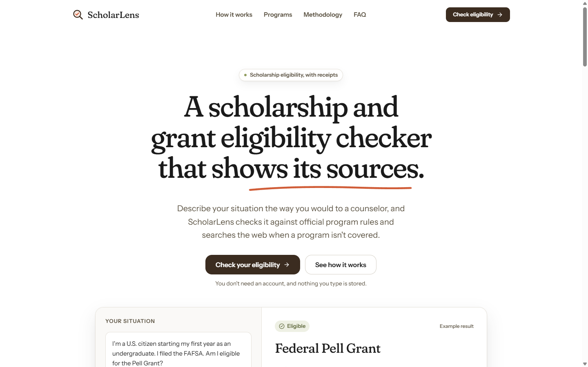
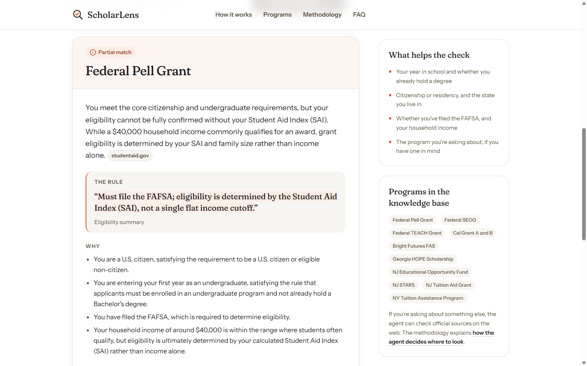

# ScholarLens

A scholarship and grant eligibility checker that shows its sources. Describe
your situation in plain words, and ScholarLens tells you which programs you may
qualify for, quoting the exact rule behind each answer and linking to the
official page it came from.

**[Live demo](https://scholar-lens-kappa.vercel.app)** ·
**[Technical guide](docs/readme-versions/README-2026-10-09.md)** ·
**[Design docs](design-docs/)**



## Overview

Financial aid rules are written for the people who run the programs, so a
student with a simple question often ends up reading long policy documents to
answer it. Keyword search misses real matches, and general-purpose chatbots
answer confidently without saying where the answer came from.

ScholarLens is an Agentic RAG application. A Pydantic AI agent reads a
knowledge base of official program rules, searches the web when a program
isn't covered, and returns a structured, cited verdict instead of an opaque
yes or no. It covers ten federal and state programs today, including the Pell
Grant, Cal Grant, NY TAP and Georgia HOPE.

## Features

- **Cited verdicts.** Every answer is eligible, partial match, or not eligible,
  with the rule quoted word for word and a link to the official source.
- **Reasons and missing information.** Each reason ties one fact about the
  student to one rule, and a rule that depends on something the student didn't
  mention is listed instead of guessed.
- **Grounded suggestions.** Other programs are suggested only when a tool
  returned their official page during the same check.
- **No accounts, nothing stored.** Prompts and tool payloads are kept out of
  logs and telemetry.
- **Measured quality.** A labeled evaluation set scores accuracy, citations,
  hallucinations and consistency, with results on a Grafana dashboard.
- **Production ready.** Per-visitor rate limits, timeouts on every external
  call, OpenTelemetry tracing, dashboards, and alert rules.



## How it works

### Architecture


The Next.js frontend on Vercel calls `POST /eligibility` on a FastAPI service
on Railway. The service runs the agent on Google Gemini with two tools:
`retrieve_program_rules`, which queries ChromaDB (embedded on a persistent
volume in production), and `search_the_web`, which calls Tavily. An ingestion
job chunks and embeds the program documents in `backend/data/programs/`.
Traces, metrics, and logs go to Grafana Cloud over OTLP.

### Request flow


The whole check runs inside a single 45-second budget. The model chooses the
tools, the agent runs them, and the model returns a typed `EligibilityResult`
that the API validates and grounds before responding.

### Agent decisions


- The knowledge base is always queried first; the web is searched only when
  the retrieved rules don't cover the question.
- An `eligible` or `partial` verdict requires a quoted clause and a matching
  source.
- Alternatives whose link no tool returned are dropped before the response.
- Over the rate limit returns `429` with `Retry-After`. A timeout, tool outage,
  or provider rate limit returns `503`, and a provider limit is retried once
  when the wait fits the time budget.

## Evaluation

28 hand-labeled student profiles, each answered 3 times (84 answers), run
locally on 2026-10-27 against the ingested knowledge base with
`gemini-3.8-flash` and `gemini-embedding-001`:

| Metric | Result | Target |
| --- | --- | --- |
| Eligibility accuracy: the verdict matches the label | 97.6% | above 80% |
| Citation accuracy: the quoted rule and program match the knowledge base | 93.9% | above 70% |
| Hallucination rate: eligible with no citation, or a rule not in the knowledge base | 0.0% | below 10% |
| Consistency: the same verdict across the 3 repeats | 92.9% | none |

Mean latency was 8.9 s per answer (8.4 s from the knowledge base, 12.8 s when
it searched the web) with 1.11 tool calls, at about Rs 0.47 of model usage per
answer. The citation misses all named the right program but quoted a different
clause of it than the label expects. Run it with `python -m app.evaluation`;
each run is appended to `data/evaluation-runs.jsonl` and shown on the AI
quality dashboard. The screenshot below is from the earlier production run on
2026-10-05.


## Tech stack

| Area | Tools |
| --- | --- |
| Frontend | Next.js 16 (App Router), React 19, TypeScript, Tailwind CSS 4, TanStack Query, Motion |
| Backend | Python 3.11, FastAPI, Pydantic AI, Pydantic Settings |
| AI and retrieval | Google Gemini (`gemini-3.8-flash`, `gemini-embedding-001`), ChromaDB, Tavily |
| Testing | pytest, Playwright, Ruff, ESLint, an evaluation pipeline |
| Observability | OpenTelemetry, Grafana Cloud (Tempo, Prometheus, Loki) |
| Hosting | Vercel (frontend), Railway (backend), Docker Compose for local development |

## Getting started

**Prerequisites:** Node.js 20+, Python 3.11+, Docker, a
[Google AI Studio](https://aistudio.google.com) API key, and a
[Tavily](https://tavily.com) API key.

1. **Configure.** Copy `backend/.env.example` to `backend/.env` and set
   `GOOGLE_API_KEY` and `TAVILY_API_KEY`. Copy `frontend/.env.example` to
   `frontend/.env.local`; its defaults point at the local backend.
2. **Start ChromaDB.**

   ```bash
   docker compose -f infra/docker-compose.yml up -d chromadb
   ```

3. **Install the backend and build the knowledge base.**

   ```bash
   cd backend
   py -3.11 -m venv .venv         # macOS/Linux: python3.11 -m venv .venv
   .venv\Scripts\Activate.ps1     # macOS/Linux: source .venv/bin/activate
   pip install -e ".[dev]"
   python -m app.ingestion
   uvicorn app.main:app --reload  # http://localhost:8000, API docs at /docs
   ```

4. **Run the frontend.**

   ```bash
   cd frontend
   npm install
   npm run dev                    # http://localhost:3000
   ```

To run the whole backend stack in Docker instead, with an OpenTelemetry
Collector, use `docker compose -f infra/docker-compose.yml up`.

### Configuration

All backend settings are environment variables, documented in
`backend/.env.example`. The ones you are most likely to change:

| Variable | Default | Purpose |
| --- | --- | --- |
| `GOOGLE_API_KEY` | none | Gemini chat and embeddings |
| `TAVILY_API_KEY` | none | Web search tool |
| `AGENT_MODEL` | `google:gemini-3.8-flash` | Model the agent runs on |
| `FRONTEND_ORIGIN` | `http://localhost:3000` | Allowed CORS origin |
| `RATE_LIMIT_PER_MINUTE` / `RATE_LIMIT_PER_DAY` | `5` / `20` | Per-visitor limits on `/eligibility` |
| `AGENT_RUN_TIMEOUT_SECONDS` | `45` | Budget for one whole check |
| `CHROMA_PERSIST_PATH` | unset | Use embedded ChromaDB at this path instead of the server |
| `OTEL_EXPORTER_OTLP_ENDPOINT` | unset | Send traces, metrics, and logs to an OTLP endpoint |

The frontend reads `NEXT_PUBLIC_API_URL` (the backend origin) from
`frontend/.env.local`.

### Development

| Task | Command |
| --- | --- |
| Backend tests (no keys or network needed) | `cd backend && pytest` |
| Backend lint | `cd backend && ruff check .` |
| Frontend lint | `cd frontend && npm run lint` |
| Frontend build | `cd frontend && npm run build` |
| Browser tests (stubs the API, starts its own server on port 3100) | `cd frontend && npm run test:e2e` |
| Rebuild the knowledge base | `cd backend && python -m app.ingestion` |
| Run the evaluation (uses the Gemini key) | `cd backend && python -m app.evaluation` |

The first browser test run needs `npx playwright install chromium`.

## Project structure

```
frontend/      Next.js app: landing page, eligibility checker, program pages, /ops
backend/
  app/api/         FastAPI routes, rate limiting, error envelope
  app/agent/       Pydantic AI agent and result models
  app/retrieval/   ChromaDB client
  app/tools/       Tavily web search client
  app/ingestion/   Chunking and embedding of program documents
  app/evaluation/  Labeled profiles, runner, and scoring
  data/programs/   Source documents for the knowledge base
infra/         Docker Compose, OpenTelemetry Collector, Grafana dashboards and alerts
design-docs/   Per-feature write-ups of how and why each part was built
docs/          Screenshots, the SEO baseline, and earlier README versions
```

## Documentation

- [Technical guide](docs/readme-versions/README-2026-10-09.md): deployment to
  Railway and Vercel, Grafana Cloud telemetry, metrics, dashboards, alerts, and
  the maintainer `/ops` page.
- [Backend README](backend/README.md): timeouts, retries, dependency pinning,
  and ingestion details.
- [Design docs](design-docs/): one write-up per feature, from the first
  endpoint to production observability.
- [SEO baseline](docs/seo-baseline.md): Lighthouse and on-page measurements
  before and after the SEO work.

## Contributing

Issues and pull requests are welcome. Before opening a pull request, run the
backend tests and lint, plus the frontend lint and build. Run the browser
tests too if you change the `/check` page. [AGENTS.md](AGENTS.md) describes the
coding conventions used across the repo.

## License

No license has been chosen yet, so the code is all rights reserved by default.
Please open an issue if you'd like to use it.

## About

ScholarLens is an independent project by
[Arkadipta Mojumder](https://github.com/arkaslittlemind). It isn't affiliated
with the U.S. Department of Education, any state agency, or any of the
programs it covers, and it isn't financial advice: it checks published
eligibility rules, not the chance of receiving an award.
