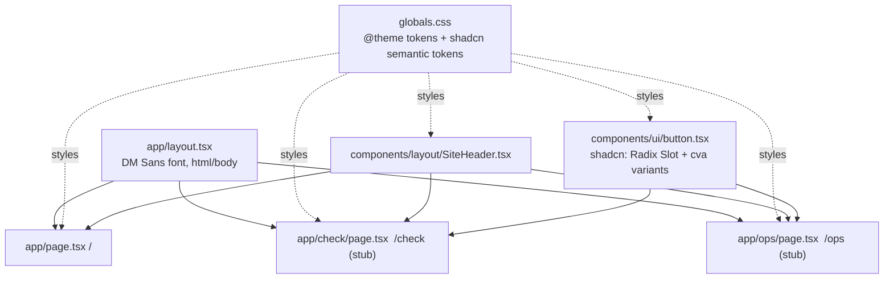

# 08 - Next.js app shell

## What

Feature 8 turned the frontend from "one landing page" into a small app with a
skeleton every later screen builds on:

- **Three routes exist:** `/` (the landing page), `/check` (the student flow),
  and `/ops` (the internal operations view). The last two were placeholder
  pages at this point.
- **shadcn/ui is installed** as the component system, with one component, the
  `Button`. Its colors are wired to ScholarLens's own "paper notebook" design
  tokens, not shadcn's stock gray theme.
- **A shared `SiteHeader`** replaced the header markup that was copy-pasted
  into the landing page, so all three routes share one header.

No product behavior shipped here. It is scaffolding: the boring, load-bearing
work that makes features 9 to 11 and 17 faster and consistent.

## Why

Before this, `frontend/` was a single `page.tsx` with hard-coded markup.
Building the eligibility flow (10) and the ops view (17) straight on top of
that would have meant:

- **Inventing styling per screen.** Every button would be a hand-rolled
  `<a>`/`<button>` with its own classes. Two screens later the buttons no
  longer match, and changing the brand color means hunting through every
  file.
- **Copy-pasted layout.** The header would be duplicated per page and drift.
- **No routes to link to.** The landing page's "Check your eligibility"
  button pointed at `/check`, which did not exist, so it went to a 404.

The cost of skipping a shell is paid later, in inconsistency and rework,
which is the worst time to pay it because real screens depend on the
mistakes.

## Key concepts

### Next.js and the App Router

**Next.js** is a framework on top of React. React draws UI from components;
Next.js adds what an actual website needs: routing (URL to page), server
rendering, bundling, and a production server.

The **App Router** is Next.js's routing system based on folders. The URL is
the folder path, and the page is a file named `page.tsx` in that folder:

```text
src/app/page.tsx          ->  /
src/app/check/page.tsx    ->  /check
src/app/ops/page.tsx      ->  /ops
src/app/layout.tsx        ->  wraps every page (fonts, <html>, <body>)
```

Adding a route means adding a folder, with no route table to edit. That's why
"add `/check` and `/ops`" was two small files.

### Server components vs client components

In the App Router, every component is a **server component** by default:

- It runs on the server (or at build time) and sends finished HTML.
- It ships no JavaScript for itself to the browser.

A **client component**, marked with `'use client'` at the top of the file, is
also sent to the browser as JavaScript so it can respond to clicks, hold
state (`useState`), and run effects.

The project rule (AGENTS.md) is "server components by default, `'use client'`
only when interactivity needs it". The stub pages and `SiteHeader` are server
components. Less JavaScript means a faster page, and a smaller surface where
bugs can happen. Feature 10 is where the first client component appears.

### Design tokens and CSS custom properties

A **design token** is a named design decision: "our ink color is `#000000`",
"cards have a 24px corner radius". Instead of writing `#ffda6e` in 40 places,
you name it once (`--color-sunshine-highlight`) and refer to the name.

In CSS these are **custom properties** (often called CSS variables):
`--name: value;` defines one and `var(--name)` reads it. Change the
definition and everything using it updates. ScholarLens's tokens come from
`project-requirement-docs/design.md`, a "warm paper notebook" system:

- cream paper background
- black ink
- graphite gray for secondary text
- yellow "sunshine" for the one primary action
- mint "signal" for positive state

### Tailwind CSS v4, CSS-first

**Tailwind** is a CSS framework of small utility classes such as `p-6`
(padding), `rounded-full`, and `text-graphite`, which you compose directly in
markup instead of writing separate stylesheets.

Tailwind v4 moved configuration *into CSS*: no `tailwind.config.js`. You
declare tokens inside an `@theme` block in
[`globals.css`](../frontend/src/app/globals.css), and Tailwind generates
matching classes. Declaring `--color-graphite` gives you `text-graphite`,
`border-graphite`, and so on. That's why the stub pages can say
`bg-cream-paper text-ink`.

### shadcn/ui: components you own

Most UI libraries are npm packages you import and can't easily change.
**shadcn/ui** works differently: its CLI **copies the component source into
your repo** (`src/components/ui/button.tsx`). You own the code and edit it
like any other file. The trade-off: no automatic upstream updates, but no
fighting a library's styling either.

Under the hood a shadcn component combines three pieces:

- **Radix UI primitives:** unstyled, accessible building blocks that handle
  keyboard focus, ARIA attributes, and similar behavior.
- **`cva` (class-variance-authority):** a way to define **variants**. One
  `Button` takes `variant="outline"` or `size="lg"`, and `cva` maps those
  props to the right Tailwind classes.
- **A `cn()` helper:** joins class names conditionally. Here it comes from the
  small `cn` npm package
  ([`lib/utils.ts`](../frontend/src/lib/utils.ts) re-exports it), instead of
  shadcn's usual `clsx` plus `tailwind-merge` pair.

### Semantic tokens: mapping shadcn onto our palette

shadcn components don't use your color names; they use **semantic** names
like `--primary`, `--background`, `--border`, and `--ring` (the focus
outline). A semantic name describes a *role* ("the primary action color"),
not a value ("yellow").

Feature 8's key decision was to point those roles at the paper-notebook
tokens instead of accepting shadcn's default neutral/dark palette:

```css
--background: var(--color-cream-paper);
--foreground: var(--color-ink);
--primary: var(--color-sunshine-highlight);
--accent: var(--color-mint-signal);
--border: var(--color-ink);
--ring: var(--color-mint-signal);
```

Now any shadcn component added later "speaks ScholarLens" automatically.

### `asChild` and the Slot pattern

A link styled as a button needs care. Wrapping a `<a>` inside a `<button>` is
invalid HTML, and putting button styles on an `<a>` by hand duplicates them.
Radix's **Slot** solves this. With `asChild`, `Button` renders *no element of
its own* and passes its classes and props onto its single child:

```tsx
<Button asChild variant="outline" size="lg">
  <Link href="/">Back to home</Link>
</Button>
```

The result is one real `<a>` (good for accessibility and navigation) that
looks exactly like a button.

### Extracting a shared component

When the same markup appears in several places, pulling it into one
component (`SiteHeader`) keeps it consistent. Change it once and every page
follows. The requirement was strict: `/` had to render **byte-identical**
before and after the extraction. A refactor should change structure, not
output.

## Architecture



The tokens flow in one direction: `design.md` → `@theme` variables → shadcn
semantic tokens → Tailwind classes → components.

## What we actually built

Merged as `b7ac0b1` (PR #11):

- [`frontend/components.json`](../frontend/components.json): the shadcn
  config. It records the style (`radix-nova`), says Tailwind's config lives in
  `src/app/globals.css` (v4 has no JS config, hence `"config": ""`), and sets
  where generated components go (`@/components/ui`).
- [`globals.css`](../frontend/src/app/globals.css): imports
  `shadcn/tailwind.css` and `tw-animate-css` (animation utilities shadcn
  components use), adds the semantic-token mapping above, and adds a base
  layer so every element gets the ink border color and the mint focus ring by
  default.
- [`button.tsx`](../frontend/src/components/ui/button.tsx): the generated
  shadcn Button with six variants (`default`, `outline`, `secondary`, `ghost`,
  `destructive`, `link`) and several sizes. Only `Button` was added, because
  the spec said not to pull in components nothing uses yet.
- [`SiteHeader.tsx`](../frontend/src/components/layout/SiteHeader.tsx): the
  wordmark plus the "Check eligibility" pill, moved out of `page.tsx`.
- `check/page.tsx` and `ops/page.tsx`: stubs with the header, an "in
  progress" message, and a `Button asChild` link home. Both were replaced
  later, by features 10 and 17.

**Decisions worth remembering:**

- **No dark mode.** The build plan said "(light/dark)", but `design.md`, the
  actual design reference, defines one light theme only. The spec followed
  the design reference and recorded why.
- **`/ops` shipped unprotected,** on purpose. The stub carried no data, so
  there was nothing to protect yet. Feature 17 added the login.

**Checks:**

- `npm run lint` and `npx tsc --noEmit` passed.
- `npm run dev` served all three routes with 200s.
- The header was byte-identical on `/` before and after the extraction.

`npm run build` **failed in the build sandbox** with
`next/font/google queries have exactly one entry`. It reproduced on unmodified
`main`, so it was recorded as a pre-existing toolchain issue, not a
regression. Feature 11's archive later pinned down the cause: `next/font/google`
downloads the font files from Google *at build time*, and Turbopack fails
with this message when the build machine can't reach Google Fonts, as in a
sandbox with no network. The same error came back on Vercel's first build in
feature 20a. A clean clone built fine on a networked laptop, so the code was
never at fault.

### The bug this feature planted: the radius scale

shadcn's init set `--radius: 999px` (fully rounded, right for pill buttons)
and derived the whole radius scale by *multiplying* it:

```css
--radius-3xl: calc(var(--radius) * 2.2);   /* 999px * 2.2, about 2198px */
```

A pill button looks right at any huge radius. But every *card* that used
`rounded-3xl` was also effectively infinitely rounded, so tall cards rendered
as **near-ellipses**. Nobody noticed through features 8 to 12. The stubs had
no tall cards, and nobody loaded `/check` in a real browser with a tall real
verdict until feature 12 was done.

Fix `2945b72` (PR #16) replaced the multiplied scale with the fixed values
from `design.md`'s radius table: cards and buttons 24px, images 12px, inputs
6px. Two lessons:

- A clever derived scale is only correct if the base value suits every use.
- UI changes need a real browser look at real content, not just a passing
  build.

## What's next

- **9 - landing page:** reuses `SiteHeader` and the tokens.
- **10 - `/check`:** replaces the stub with the real form and verdict, adding
  shadcn's `Input`, `Label`, and `Textarea` on top of this setup.
- **17 - `/ops`:** replaces the stub with the protected operations view.
