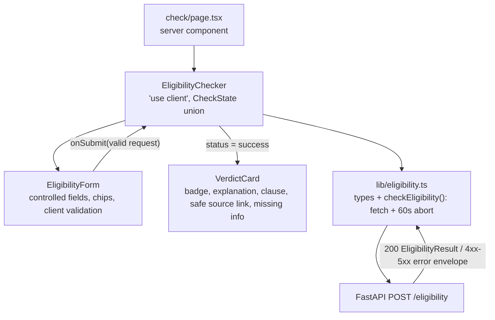

# 10 - Student eligibility flow

## What

Feature 10 built the real `/check` page, the product itself. A student:

1. describes their situation in free text, optionally adding income, state,
   GPA, and major, or clicks an example chip to fill the text in
2. submits, sees a loading state, and then gets a **verdict card**:
   - a status badge: Eligible, Partial match, or Not eligible
   - a plain-language explanation
   - the **exact clause** quoted from the rules
   - a **source** link
   - an **uncertainty callout** listing what information is missing

Every failure has its own state: invalid input is caught before sending, the
server rejects a field, the backend is unreachable, the request times out, or
the engine is unavailable.

This was the first time the full path worked end to end in a browser:
**Next.js → FastAPI → Agent → retrieval or web search → cited answer.**

## Why

Everything before this was either backend (an API you could only `curl`) or
frontend scaffolding (stub pages). Neither is a product. A student can't use
`curl`, and a stub page answers nothing. Feature 10 is where ScholarLens
becomes something a person can actually use, and where the cited-answer
differentiator becomes visible on screen.

It also had to be **safe and honest from day one**:

- **The verdict text is untrusted.** It comes from a language model that
  read web pages, so careless rendering could let a malicious page inject a
  clickable `javascript:` link into our UI.
- **Errors must be honest.** A student who sees a frozen spinner, or a raw
  error object, loses trust fast. Error states are part of the feature, not
  polish.

## Key concepts

### Client components and the `'use client'` boundary

A form must react to typing and clicks, so it needs state and event handlers,
which only work in the browser. In Next.js that means a **client
component**: a file starting with `'use client'`, which ships JavaScript to
the browser.

The rule here was to keep the boundary as low as possible:

- The **page** ([`check/page.tsx`](../frontend/src/app/check/page.tsx)) stays
  a server component: header, title, intro text.
- It renders `EligibilityChecker`, a client component, as the interactive
  island.

Everything above the island is static HTML. Only the interactive part costs
JavaScript.

### Controlled form inputs

In React, a **controlled input** gets its value from state
(`value={description}`) and reports every change back
(`onChange={e => setDescription(e.target.value)}`). React state becomes the
single source of truth for what the field contains. That's what makes the
example chips trivial: clicking one just calls
`setDescription(example.description)`, and the textarea updates.

### Client-side vs server-side validation

**Validation** means checking input is acceptable before acting on it. It
happens in two places, for different reasons:

- **The server** validates because it can't trust anyone. Anyone can send
  any request with `curl`, bypassing the form. This is the security
  boundary. Our backend's Pydantic model enforces description 1-2000
  characters, income and GPA ≥ 0, state ≤ 100 characters, and major ≤ 200.
- **The client** validates for *user experience*: instant feedback without a
  network round trip, and no wasted request.

The rule the spec set: the client **mirrors** the server's limits exactly and
**never adds a stricter rule** than the API enforces. For example, there's no
invented GPA ceiling of 4.0, because some schools use other scales. A stricter
client would reject input the real system accepts.

### Discriminated unions for UI state

The checker's state is one of four mutually exclusive shapes:

```ts
type CheckState =
  | { status: "idle" }
  | { status: "loading" }
  | { status: "success"; result: EligibilityResult }
  | { status: "error"; message: string; fields?: string[] };
```

This is a **discriminated union**: a TypeScript type that is one of several
variants, told apart by a shared field (`status`). The alternative is
separate booleans (`isLoading`, `hasError`, `result`) that can contradict
each other ("loading *and* has a result?"). The union makes impossible states
**unrepresentable**. When `status === "success"`, TypeScript knows `result`
exists, and in any other state it doesn't let you touch it.

### Timeouts with `AbortController`

`fetch` has no built-in timeout; a request can hang forever. An
**`AbortController`** gives you a switch that cancels an in-flight request:

```ts
const controller = new AbortController();
const timeoutId = setTimeout(() => controller.abort(), REQUEST_TIMEOUT_MS);
fetch(url, { signal: controller.signal, ... });
```

The number matters. The backend gives the agent **45 seconds**
(`agent_run_timeout_seconds`). If the browser gave up sooner, a slow but
successful run would be thrown away on the client while the server was still
working. So the client waits **60 seconds**: longer than the server's own
limit, so the server always gets to answer first, even if the answer is "I
timed out".

### Three kinds of failure

A request can fail in three different ways, and they need different
messages:

| Failure | What happened | What the student sees |
|---|---|---|
| `timeout` | We aborted after 60s | "That's taking longer than expected..." |
| `network` | `fetch` itself threw: server down, DNS, CORS | "Couldn't reach the eligibility service..." |
| `api` | The server answered with a non-2xx and an error envelope | Depends on `error.code` |

The backend's **error envelope** (feature 4) is a consistent JSON shape on
every error: `{ "error": { "code", "message", "fields" } }`. A stable `code`
lets the UI branch reliably:

- `validation_error`: highlight the named fields.
- `engine_unavailable`: show "temporarily unavailable".
- Anything else: show a generic retry message.

The UI never shows raw server text or stack traces.

### Accessible errors and status

Visual cues alone exclude screen reader users. The form uses standard ARIA
attributes (Accessible Rich Internet Applications), which describe meaning
to assistive technology:

- `aria-invalid="true"` on a field marks it as wrong.
- `aria-describedby="description-error"` links the field to its error text,
  so the error is read out when the field is focused.
- `role="alert"` on the error message announces it immediately.
- `role="status"` on the loading line announces politely, without
  interrupting.

### Untrusted output and XSS

**XSS** (cross-site scripting) is when attacker-controlled content runs as
code in someone else's browser. Our verdict text is attacker-*influenceable*:
the agent can quote web pages, and a hostile page could contain anything.

Two defenses:

1. **Render text as text.** React escapes strings placed as children
   (`<p>{result.explanation}</p>`), so `<script>` shows up as literal
   characters. The dangerous escape hatch, `dangerouslySetInnerHTML`, is never
   used. The review confirmed it appears nowhere in `frontend/src`.
2. **Guard URLs.** Escaping doesn't help with links: `<a href="javascript:...">`
   is perfectly valid HTML that *runs code when clicked*. So
   [`VerdictCard.tsx`](../frontend/src/components/check/VerdictCard.tsx) only
   renders `source.url` as a link when it parses as `http:` or `https:`:

   ```ts
   function safeHttpUrl(url: string): string | null {
     try {
       const parsed = new URL(url);
       return parsed.protocol === "http:" || parsed.protocol === "https:" ? url : null;
     } catch {
       return null;
     }
   }
   ```

   Anything else is shown as inert text. Real links open in a new tab with
   `rel="noopener noreferrer"`, so the opened page can't control our tab
   through `window.opener`. This addressed the frontend half of finding
   **F-13**, which an earlier audit raised against the backend.

### Mirroring types across a network boundary

The frontend can't import Python models, so
[`lib/eligibility.ts`](../frontend/src/lib/eligibility.ts) **mirrors** them as
TypeScript interfaces:

- `EligibilityRequest`
- `EligibilityResult`, with `status` as the exact wire values `"eligible" |
  "partial" | "not_eligible"`
- `Source`
- `ErrorResponse`

A mirror is only a promise, though. At this stage the response JSON was
**cast** (`as EligibilityResult`), not checked. If the backend ever sent an
unknown status, the UI would crash. The independent review recorded that as
**F-20**, and feature 12 replaced the cast with real validation at the
boundary.

## Architecture



The submit sequence:

```text
idle --submit--> [client validate] --fail--> inline field errors (no request sent)
                        |
                        ok
                        v
                    loading --200--> success (VerdictCard)
                        |----422 validation_error--> error + highlight server-named fields
                        |----503 engine_unavailable--> error "temporarily unavailable"
                        |----network / abort-------> error "couldn't reach" / "taking longer"
```

## What we actually built

Merged as `d06919d` (PR #13), 11 files:

- **[`lib/eligibility.ts`](../frontend/src/lib/eligibility.ts):** the types,
  the `EligibilityClientError` class carrying `kind: "api" | "network" |
  "timeout"`, and `checkEligibility()`, which posts to
  `${NEXT_PUBLIC_API_URL}/eligibility`. If the error body itself isn't valid
  JSON, it falls back to a synthetic `internal_error` detail, so a broken
  error response still produces a clean message.
- **[`EligibilityForm.tsx`](../frontend/src/components/check/EligibilityForm.tsx):**
  - five controlled fields and the client-side `validate()`
  - trims text, sends blank optional fields as *absent* rather than empty
    strings, and converts numbers with a `Number.isFinite` check
  - two example chips **adapted from real evaluation profiles** in
    `backend/data/evaluation/profiles.json` ("First-year Pell Grant", "Already
    have a Bachelor's"), so they match questions the corpus can answer
- **[`EligibilityChecker.tsx`](../frontend/src/components/check/EligibilityChecker.tsx):**
  the state machine, `describeError()`, the loading line, and disabling the
  form while loading so a double click can't send two paid requests.
- **[`VerdictCard.tsx`](../frontend/src/components/check/VerdictCard.tsx):**
  presentational, with a `STATUS_META` table mapping each status to a label,
  an icon, and a badge style:
  - **Eligible** gets the mint border.
  - **Partial** and **Not eligible** use the ink border with distinct icons.

  That stays within the design system's two accent colors instead of adding a
  red or orange.
- shadcn **`Input`, `Label`, `Textarea`**, added in the same style as
  feature 8's `Button`.
- **`frontend/.env.example`** plus `!.env.example` in `frontend/.gitignore`,
  so the template is committed while real `.env*` files stay out.

**What the independent review caught.** A Standards and Spec review of the
first version found two real gaps:

- A server `validation_error` only listed field names in a generic banner
  instead of highlighting the fields.
- The loading state had no spinner.

Fixes:

- The form gained a `serverFieldErrors` prop, merged with client errors, so a
  server-named field gets the same `aria-invalid` and inline message as a
  client-caught one.
- An animated `Loader2` was added.

The final automatic independent review (fresh subagent, Opus) **passed**,
recording F-20 as a P3.

**Checks:**

- Docker wasn't reachable in the build sandbox, so ChromaDB ran with
  `chroma run` on port 8001, with a real ingestion of 10 documents and 23
  chunks.
- Playwright, installed just for this check, drove the real flow:
  - the chip fills the field
  - an empty description is blocked with no request sent
  - a real submission shows the spinner, then a live verdict matching a direct
    `curl`
  - stopping the backend shows the network error with no crash
  - a mocked 422 naming `income` highlighted exactly that field
- `npm run lint` and `npx tsc --noEmit` passed. `npm run build` hit the known
  font-fetch sandbox issue from feature 8.

**A warning that came true later.** The review's remaining-risk list noted
that `checkEligibility` silently falls back to `http://localhost:8000` when
`NEXT_PUBLIC_API_URL` is unset at build time: "a misconfigured deployment
would silently target the visitor's localhost rather than failing visibly."
In feature 20a a *differently* misconfigured value (missing `https://`) made
every production check 404. Build-time validation of that variable is still a
good small follow-up.

## What's next

- **11 - agent transparency:** replaces the plain spinner with the agent's
  activity steps, using the `tool_trace` field this feature deliberately left
  unrendered.
- **12 - frontend/API integration:** swaps the hand-written `fetch` and state
  for TanStack Query and validates the response at the boundary, fixing F-20.
- **19c - end-to-end test:** turns this feature's manual browser check into a
  repeatable Playwright test.
