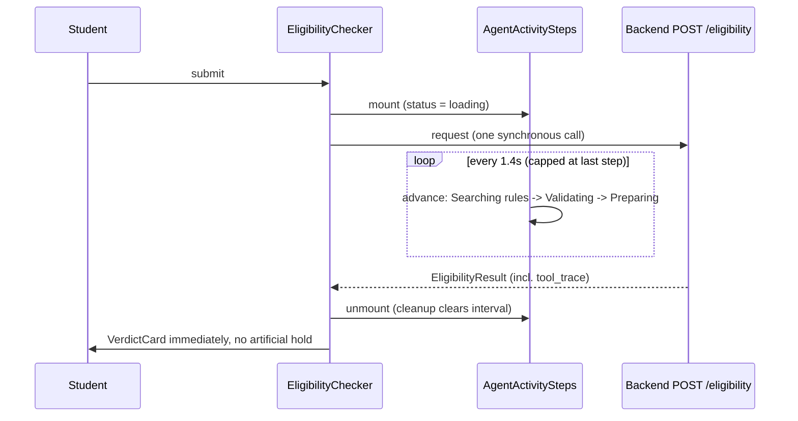

# 11 - Agent transparency UI

## What

While a check runs, `/check` now shows the agent's **activity steps** instead
of a bare spinner:

```text
✓ Searching program rules
◌ Validating eligibility        <- spinning: the current step
○ Preparing cited answer
```

The steps advance on a timer during the wait. When the real answer arrives,
the page goes straight to the verdict. The labels are the agent's own
user-facing trace labels. It is never the model's private reasoning, and it
never claims a step the agent might not have taken.

## Why

An eligibility check takes several seconds, sometimes up to 45. A single
spinner for that long feels broken, and it hides the thing that makes
ScholarLens different: it is an **agent** that *chooses* what to do (search
the rules corpus, maybe check the web) before answering. Showing those steps:

- **reduces perceived wait,** because visible progress makes waiting feel
  shorter than a static spinner does
- **builds trust,** because "searching program rules" tells the student the
  answer comes from real documents, which matches the cited-answer promise
- **makes the architecture visible,** which matters for a portfolio piece
  about agentic AI

But it had to be **honest**. A fake progress bar that invents work erodes
the trust it's meant to build.

## Key concepts

### What an agent's "steps" are

An **AI agent** is a language model that can call **tools**, which are
functions we give it, in a loop: think, call a tool, read the result, decide
what to do next, and eventually answer. Our agent has two tools:
`retrieve_program_rules` (search the ChromaDB corpus) and `search_the_web`
(Tavily).

The backend records a **tool trace**: a list of user-facing labels for what
happened, returned as `tool_trace` in every result
(`backend/app/agent/agent.py`):

```python
SEARCHING_PROGRAM_RULES = "searching program rules"
CHECKING_OFFICIAL_SOURCES = "checking official sources"
VALIDATING_ELIGIBILITY = "validating eligibility"
PREPARING_CITED_ANSWER = "preparing cited answer"
...
output.tool_trace = [*deps.trace, VALIDATING_ELIGIBILITY, PREPARING_CITED_ANSWER]
```

### Transparency vs chain-of-thought

**Chain-of-thought** is the model's raw intermediate reasoning text. The
build plan was explicit: *show the steps, never hidden chain-of-thought.*
Raw reasoning is:

- messy and sometimes wrong along the way
- not meant for users
- possibly a carrier for prompt-injected text from web pages

A **tool trace** is a different thing: a short, fixed vocabulary of *actions
taken*, defined by us, not written by the model. Those labels are safe to
show verbatim. The backend file even marks them as user-facing text this
feature renders.

### Synchronous requests vs streaming

The honest constraint: `POST /eligibility` is **synchronous**. The browser
sends one request and gets one response at the end. `tool_trace` only exists
in that final response. There is no channel to say "the agent just started
searching" *while* it happens.

Real live steps would need **streaming**:

- **SSE** (Server-Sent Events): the server keeps the response open and pushes
  messages down it.
- **WebSockets**: a two-way channel.

Either is a backend API architecture change, so the spec put it out of scope.

### Progressive reveal, done honestly

Without real-time events, the feature uses a **progressive reveal**: a local
timer advances through the steps during the wait. That only stays honest
with three rules:

1. **Only simulate steps that always happen.** Every real run searches the
   program rules (the system prompt requires retrieval first) and always ends
   with "validating eligibility" and "preparing cited answer". "Checking
   official sources" only happens when the agent chose a web search, so the
   simulation **never shows it**. Showing it would be claiming work that may
   not have occurred.
2. **Never run ahead of reality.** The timer caps at the last step and spins
   there, rather than ticking everything to done before the answer exists.
3. **Never make the user wait for theater.** When the real result arrives,
   the UI switches *immediately* to the verdict. It doesn't hold the screen
   to finish a fake animation.

The component also accepts `completedSteps`, the real `tool_trace`, so it can
show the true, reconciled step list, including "checking official sources"
when it actually happened, if a caller wants it.

### Timers in React: `useEffect`, `setInterval`, and cleanup

`setInterval(fn, ms)` calls `fn` every `ms` milliseconds until cleared. In
React you start it in a **`useEffect`**, code that runs after render, and
return a **cleanup function** that React calls when the component goes away
or its inputs change:

```tsx
useEffect(() => {
  if (completedSteps) return;
  const id = setInterval(() => {
    setActiveIndex((index) => Math.min(index + 1, GUARANTEED_STEPS.length - 1));
  }, intervalMs);
  return () => clearInterval(id);
}, [completedSteps, intervalMs]);
```

Forgetting the cleanup is a classic bug: the timer keeps firing after the
component is gone (a **memory leak**). This design gets cleanup for free.
The checker renders the steps *only* while loading, so on success or error
the component **unmounts**, React runs the cleanup, and no step can be left
stuck "in progress".

### Live regions and polite announcements

A screen reader won't notice text changing on its own. A **live region**
tells it to announce changes:

- `role="status"` makes the region polite: it waits until the user is idle.
- `aria-atomic="false"` means announce *only the part that changed*, not the
  whole list again on every tick.

Without the second one, a screen reader user would hear all three steps
re-read every 1.4 seconds.

### Test seams

A **test seam** is a deliberate place where a test can swap in its own value.
Timer code depending on real wall-clock time is slow and flaky to test. So
the interval is an exported constant and an overridable prop:

```ts
export const STEP_INTERVAL_MS = 1400;
// <AgentActivitySteps intervalMs={...} />
```

Nothing used it at the time, because the frontend had no test runner. It was
a cheap promise to the future. Feature 19c's Playwright test later asserted
the activity status shows "Searching program rules" while the request is held
open.

## Architecture



On error the same unmount happens, and the error message renders instead.

## What we actually built

Merged as `954f437` (PR #14), two files:

- **[`AgentActivitySteps.tsx`](../frontend/src/components/check/AgentActivitySteps.tsx)**
  (new):
  - the four label constants, copied **verbatim** from `agent.py`
  - `GUARANTEED_STEPS`, the three steps every run reports
  - `STEP_INTERVAL_MS = 1400`
  - three visual states per step, all reusing feature 10's lucide icons and
    ink/graphite styling with no new design tokens:
    - **done:** `CheckCircle2`, ink text
    - **active:** spinning `Loader2`
    - **pending:** hollow `Circle`, graphite text
  - display labels capitalize the first letter only, so the backend wording
    is kept rather than paraphrased
- **[`EligibilityChecker.tsx`](../frontend/src/components/check/EligibilityChecker.tsx)**
  (edit): the old `Loader2` plus "Checking eligibility..." line was replaced
  by `{state.status === "loading" && <AgentActivitySteps />}`. That one
  condition is what guarantees the timer stops on both success and error.

**A key design trade-off:** the steps are *not* reconciled on screen with the
real trace before the verdict. The spec weighed showing the true trace for a
moment against getting the student to their answer, and chose the answer. The
`completedSteps` prop keeps the reconciled view available without forcing a
delay.

**Checks, honestly:** the recorded evidence at completion was thin.

- `npm run lint` and `npx tsc --noEmit` passed.
- `npm run build` failed in the build sandbox for the known, unrelated reason
  that Turbopack could not fetch Google Fonts without network access. It was
  confirmed identical on unmodified `main`, and shipping on lint plus
  typecheck evidence was an explicit user decision.
- No browser run was recorded. The spec listed manual steps (watch the steps
  advance, check that an error leaves nothing stuck), but the archive holds no
  evidence they were performed.

The behavior got real coverage later. Feature 19c's end-to-end test holds a
stubbed response open, asserts `Searching program rules` is visible inside
the `status` region, then asserts the region disappears once the verdict
renders. Feature 20a's production browser run showed the full flow with no
console errors.

Feature 12 later moved the checker to TanStack Query, so the condition is now
`{mutation.isPending && <AgentActivitySteps />}`. It's the same idea: mounted
only while the request is pending.

## What's next

- **12 - frontend/API integration:** TanStack Query manages the request
  lifecycle this component hangs off.
- **19c - end-to-end test:** covers the activity steps in a real browser.
- **Possible future:** real streaming (SSE) of tool events from the agent.
  That would turn the simulation into true live steps, including "checking
  official sources" at the moment it happens. It needs a backend endpoint
  change, so it would be its own build-plan item.
