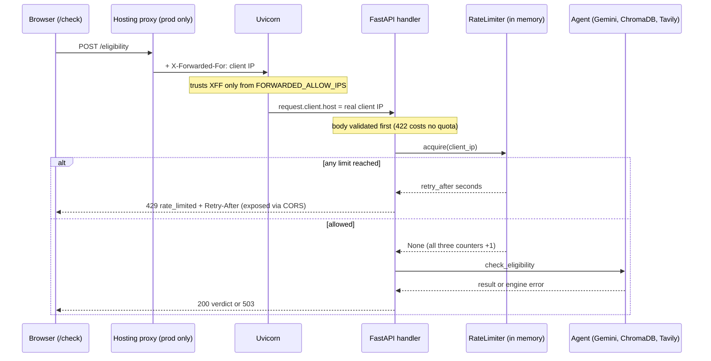

# 18a - Request protection

## What

Before this feature, anyone who found the ScholarLens API could call
`POST /eligibility` as often as they liked, and every accepted call runs the
Gemini-backed agent, which costs real money (roughly Rs 1.5 to 2 per check).
Feature 18a puts a guard in front of that endpoint and tightens a few loose
bolts around it:

- **Rate limits.** Each visitor (identified by IP address) gets 5 checks per
  minute and 20 per UTC day. On top of that, the whole service accepts at most
  100 checks per UTC day across everyone. Going over returns HTTP `429` with
  the error code `rate_limited` and a `Retry-After` header saying how many
  seconds to wait.
- **A friendly `/check` message.** The page reads `Retry-After` and says
  "You've reached the limit for eligibility checks. Please try again in about
  3 minutes." instead of a generic failure.
- **Fail-fast configuration.** The backend refuses to start if
  `FRONTEND_ORIGIN` is not a single, exactly-formed origin, or if any timeout
  setting is zero or negative.
- **Connect-only retries.** The Gemini and Tavily HTTP clients retry once,
  but only when the connection itself failed, never after a request reached the
  provider.
- **An audit.** A check that no public HTTP route can trigger ingestion or
  evaluation (both are command-line only) and that `/ops/summary` stays locked.

Feature 18 in the build plan ("Reliability + security") was too big for one
reviewable branch, so it was split. 18a is the request-path half. 18b covers
secrets that never print, pinned dependencies, and scrubbing telemetry.

## Why

ScholarLens runs on a small pool of paid Gemini credits (about Rs 400). With no
limit, three things can drain it:

1. **A curious visitor** mashing the submit button while comparing profiles.
2. **A script** that finds the public URL and loops over it. There are no
   accounts, so nothing else stops it.
3. **Many visitors at once**, each behaving reasonably, which still adds up.

A per-visitor limit handles the first two. Only a **global** cap handles the
third: with 100 checks a day, the worst-case daily spend is bounded at roughly
Rs 150 to 200 no matter what happens. This kind of attack has a name,
**denial of wallet**: nobody takes the service down, they just make it
expensive to keep running. For an AI app, where each request calls a paid
model, it is the most realistic abuse there is.

The other pieces protect against quieter failures:

- A `FRONTEND_ORIGIN` with a trailing slash (`http://localhost:3000/`) looks
  fine, starts fine, and then every browser request fails CORS with a confusing
  console error. Failing at startup turns a mystery into a one-line fix.
- A timeout of `0` would make every external call fail instantly.
- A retry in the wrong place can double-bill a model call or double a slow
  request. Being explicit about which failures are retried, and why, keeps
  that from creeping in.

## Key concepts

### Rate limiting

A **rate limit** caps how many requests a client may make in a period of time.
It is like a coffee shop's "5 free refills per visit": the shop doesn't ban
you, it just stops pouring for a while. The server keeps a **counter** per
client, and each accepted request adds one. When the counter reaches the limit,
further requests are refused until the counter resets.

Three questions define any rate limiter:

1. **Who is the client?** (the **key**: here, an IP address)
2. **How long is the period?** (the **window**: here, a minute and a day)
3. **What happens when the limit is hit?** (here, a `429` response)

### Fixed windows vs sliding windows vs token buckets

There are several ways to define "per minute":

- **Fixed window.** Chop time into aligned blocks (12:00:00 to 12:00:59,
  12:01:00 to 12:01:59, ...) and count within each block. It is simple and
  cheap. The known weakness: a client can send 5 requests at 12:00:59 and 5
  more at 12:01:00, so 10 requests in two seconds. For a cost cap, that burst
  is acceptable.
- **Sliding window.** Count requests in the last 60 seconds, measured from
  now. It is smoother, but it has to remember every request's timestamp.
- **Token bucket.** A bucket refills at a steady rate, and each request spends
  a token. It allows short bursts and a steady average, and is common in API
  gateways.

ScholarLens uses **fixed windows**, because the goal is a spend cap, not smooth
traffic shaping. The day windows are **UTC calendar days**. Because Unix time
counts seconds since midnight UTC on 1 January 1970, and every day has exactly
86,400 seconds in Unix time, `floor(now / 86400)` is the UTC day number. The
same trick with 60 gives the minute.

### Per-client limits vs a global limit

A **per-client** limit stops one person from hogging the service. It cannot
bound total cost, because a thousand polite clients are still a thousand
calls. A **global** limit is one shared counter for everyone. It protects the
wallet, at a price: once it is used up, *everyone* is refused until the next
UTC day, including real students. That trade was chosen deliberately.
ScholarLens is a portfolio project on a small credit balance, so a hard ceiling
on spend matters more than availability to strangers.

### Identifying the client: IP addresses and proxies

With no accounts, the only thing that identifies a visitor is the **IP
address** of the connection. Two things complicate that:

- **Proxies.** In production, the backend sits behind the hosting platform's
  load balancer (Render or Railway). Every request then *arrives* from the load
  balancer's address, so every visitor would look like the same client. Proxies
  solve this by adding an `X-Forwarded-For` header naming the original client.
- **Spoofing.** Anyone can send an `X-Forwarded-For` header. If the server
  believed it from anyone, a script could claim a new IP on every request and
  never hit the per-client limit.

The fix is a **trusted proxy list**: believe `X-Forwarded-For` only when the
connection comes from a proxy you know. Uvicorn (the server that runs FastAPI)
already does exactly this. It rewrites the client address from
`X-Forwarded-For` only when the connecting address is in `FORWARDED_ALLOW_IPS`,
which defaults to `127.0.0.1`. So ScholarLens reads `request.client.host` and
gets the right answer both locally and, once feature 20 sets the variable,
behind a proxy.

### HTTP 429 and `Retry-After`

HTTP status codes are a shared vocabulary between servers and clients. `429 Too
Many Requests` means "you personally are going too fast", which is different
from `503 Service Unavailable` ("I'm broken right now"). The `Retry-After`
response header tells the client how long to wait, as a number of seconds (or,
less commonly, a date). A well-behaved client stops and waits instead of
hammering.

ScholarLens sends seconds until the violated window ends. If more than one
limit is exceeded (say, the minute limit and the global daily cap), it sends
the **longest** wait, because that is the first moment every blocked limit has
reset.

### CORS and exposed headers

**CORS** (Cross-Origin Resource Sharing) is a *browser* rule. A page served
from `http://localhost:3000` that calls an API on `http://localhost:8000` is
making a cross-origin request, and the browser only lets the page see the
response if the API says that origin is allowed. Two details matter here:

- **Origins are compared as exact strings.** The browser sends
  `Origin: http://localhost:3000`: scheme, lowercase host, and a port only when
  it isn't the default (80 for http, 443 for https). No path, no trailing slash.
  If the server's allowed list says `http://localhost:3000/`, the strings don't
  match and every request is blocked.
- **Most response headers are hidden cross-origin.** By default, JavaScript
  can read only a few "safelisted" headers such as `Content-Type`.
  `Retry-After` is not one of them, so the server must list it in
  `Access-Control-Expose-Headers` or `/check` would see `null`.

### Fail fast on bad configuration

**Failing fast** means detecting a problem at the earliest possible moment
and stopping loudly, rather than running in a broken state. A config value is
cheapest to check at startup: the operator is watching, and the error message
can name the exact setting. Pydantic Settings makes this a one-line
declaration (`Field(gt=0)`) or a small **validator** function that inspects
the value and raises if it is wrong.

### Timeouts

A **timeout** is a deadline on an operation: "if this takes longer than N
seconds, give up". Without one, a hung dependency hangs the request, then the
worker, then the service. ScholarLens already had a timeout on every external
call; 18a made them explicit in one table and guaranteed that each one is
positive. The **agent run timeout** (45 s) is the outer deadline. Every
individual call inside a run (a Gemini request, a ChromaDB query, a Tavily
search) has its own shorter deadline, and the outer one caps the total,
including any retries.

### Retries and idempotency

Retrying a failed request is tempting, but it is only safe when repeating the
request can't cause harm. An operation is **idempotent** if doing it twice has
the same effect as doing it once. Reading a web page is idempotent; charging a
card is not. A paid model call sits in between: it has no side effect on the
world, but it *is* billed each time.

The key insight is **when** the failure happened:

- **Connect failure.** The request never left the machine (DNS failed, the
  connection was refused). The provider never saw it, never billed it, never
  ran it. Retrying is always safe.
- **Read timeout or error response.** The provider may have received it,
  started the work, and billed it. Retrying may double the cost, and on an
  overloaded provider it adds more load.

Both `httpx` and `httpx2` have a built-in option for exactly the safe case:
`AsyncHTTPTransport(retries=1)` retries **only** connection failures. No custom
retry loop was needed.

### Atomic check-and-increment on an event loop

A rate limiter has a classic race: two requests both read "4 of 5 used", both
decide they're allowed, and both increment, so 6 get through. The usual fix is
a lock. ScholarLens doesn't need one. FastAPI runs on an **asyncio event
loop**, which runs one piece of Python at a time and only switches tasks at an
`await`. The limiter's `acquire` method reads and increments with no `await`
in between, so no other request can run in the middle. In effect it is
atomic.

### In-memory state and its limits

The counters live in a Python dictionary inside the running process. That is
the simplest thing that works, and it has honest limits:

- **Restart resets it.** A deploy or crash clears the counters.
- **Per process.** If the service ever ran several workers, each would have its
  own counters, multiplying the effective limit.

A shared store such as Redis would fix both, but it is a whole new service to
run. With one process and a goal of capping spend, not exact enforcement, the
dictionary is the proportionate choice. The README states the limits so
nobody is surprised later.

## Architecture



Inside the limiter, three independent fixed windows are checked together:

```
acquire("203.0.113.7")
   |
   +-- minute window  (key = IP,           60 s,   limit 5)   --> wait or ok
   +-- day window     (key = IP,           86400 s, limit 20) --> wait or ok
   +-- global window  (key = "*all-clients*", 86400 s, limit 100) --> wait or ok
   |
   any wait?  yes -> return max(waits), count nothing
              no  -> add 1 to all three, return None
```

## What we actually built

### Backend

**Settings** in [`../backend/app/config.py`](../backend/app/config.py) gained
three limits and positive-only timeouts:

```python
rate_limit_per_minute: int = Field(default=5, ge=1)
rate_limit_per_day: int = Field(default=20, ge=1)
rate_limit_global_per_day: int = Field(default=100, ge=1)
...
llm_timeout_seconds: float = Field(default=20.0, gt=0)
```

The `frontend_origin` validator rebuilds the origin the way a browser would
write it and requires the configured value to equal that exactly:

```python
host = f"[{hostname}]" if ":" in hostname else hostname
if value != f"{parts.scheme}://{host}" + (f":{port}" if port is not None else ""):
    raise ValueError(error)
```

It also rejects non-http(s) schemes, invalid host characters, port 0, and a
default port written out explicitly.

**The limiter** is a new module,
[`../backend/app/api/rate_limit.py`](../backend/app/api/rate_limit.py). A small
`_FixedWindow` class counts per key within one window, and throws the whole
dictionary away when the window rolls over, which keeps memory bounded:

```python
def _roll(self, now: float) -> None:
    window = int(now // self._length)
    if window != self._window:
        self._window = window
        self._counts = {}
```

`RateLimiter.acquire` checks all three windows *before* counting anything, so
a refused request costs nothing:

```python
if waits:
    return max(waits)
self._minute.add(client_key)
self._day.add(client_key)
self._global_day.add(_GLOBAL_KEY)
return None
```

The constructor takes a `clock` argument (defaulting to `time.time`). That is a
**test seam**: a check can pass a fake clock and jump time forward to test
window rollover without waiting a real minute.

**The endpoint**,
[`../backend/app/api/eligibility.py`](../backend/app/api/eligibility.py), calls
the limiter *inside* the handler rather than in a FastAPI dependency. That
ordering is deliberate. FastAPI validates the request body before the handler
body runs, so a malformed request gets its `422` without spending quota:

```python
client_key = http_request.client.host if http_request.client else "unknown"
retry_after = limiter.acquire(client_key)
if retry_after is not None:
    raise ApiError(429, RATE_LIMITED, {"Retry-After": str(retry_after)})
```

`ApiError` already existed from feature 17 and already forwarded headers, so
the 429 reuses the project's one error envelope:
`{"error": {"code": "rate_limited", "message": "...", "fields": []}}`. The
code and message live in
[`../backend/app/api/errors.py`](../backend/app/api/errors.py).

**CORS** in [`../backend/app/main.py`](../backend/app/main.py) now exposes the
header:

```python
expose_headers=["Retry-After"],
```

**Retries** are a single constructor argument in
[`../backend/app/tools/web_search.py`](../backend/app/tools/web_search.py) and
[`../backend/app/agent/agent.py`](../backend/app/agent/agent.py):

```python
transport=httpx2.AsyncHTTPTransport(retries=1),
```

**Docs**: [`../backend/.env.example`](../backend/.env.example) lists the three
new variables, and [`../backend/README.md`](../backend/README.md) gained a
"Rate limits, timeouts, and retries" section with the limit table, the proxy
rule for `FORWARDED_ALLOW_IPS`, the full timeout table, and the retry policy.

### Frontend

[`../frontend/src/lib/eligibility.ts`](../frontend/src/lib/eligibility.ts)
reads the header, accepting only whole seconds and ignoring anything else
rather than guessing:

```ts
function parseRetryAfter(value: string | null): number | undefined {
  return value !== null && /^\d+$/.test(value) ? Number(value) : undefined;
}
```

[`../frontend/src/components/check/EligibilityChecker.tsx`](../frontend/src/components/check/EligibilityChecker.tsx)
turns seconds into words: "about a minute" up to 60 s, "about N minutes" under
an hour, "about N hours" beyond, and "later" when the header is missing. The
message appears in the existing `role="alert"` box, so screen readers announce
it. The form stays enabled. `/check` already refused to auto-retry any response
the server sent back (only network failures retry), so a 429 never triggers a
retry loop.

### The audit that built nothing

The plan asked for "protected ingestion/evaluation endpoints". Listing every
registered route showed there aren't any. Ingestion and evaluation run only
as `python -m app.ingestion` and `python -m app.evaluation` on the server. The
only HTTP routes are `/`, `/health`, `/eligibility`, `/ops/summary`, and
FastAPI's docs pages. `/ops/summary` returns `401` without the right bearer
token (and `503` when no token is configured). The right answer was to confirm
this and write nothing, not to add protection for a door that doesn't exist.

### Things that went sideways

- **The origin validator had holes.** The first version compared
  `scheme://netloc` against the value. A spec review probed edge cases and found
  it accepted `http://LOCALHOST:3000`, `http://localhost:80`,
  `http://localhost:` (empty port), and even `http://a,b`. A browser would never
  send those exact strings, so each one would have caused the very silent CORS
  failure the validator exists to prevent. The fix rebuilds the canonical
  browser form (lowercase host, default port dropped) and requires an exact
  match. Twenty bad inputs and five good ones (including IPv6 `[::1]`) were
  rechecked.
- **An off-by-rounding in the wait text.** The first version rounded to minutes
  and *then* checked "under 60", so 3541 to 3599 seconds read "about 1 hour".
  That arguably reads better, but it didn't match the spec, and feature 19's
  tests will be written against the spec, so it was aligned.
- **Retry transports skip proxy env vars.** The independent reviewer noticed
  that passing an explicit `transport=` to httpx or httpx2 means the client no
  longer picks up `HTTP_PROXY` or `HTTPS_PROXY` from the environment. Nothing
  here uses a proxy today, so it is recorded as a small open finding (F-21)
  rather than fixed.
- **No browser tool.** The Playwright integration failed to connect in the
  build session. Instead, `playwright-core` was installed in a scratch folder
  (not the project) and pointed at an already-downloaded Chromium, which was
  enough to drive `/check` and take screenshots.
- **The PR merged before the independent review finished.** The review target
  was the same commit that merged, and the merged tree is byte-identical to
  the reviewed one (`b18d725`), so the receipt still describes exactly what is
  on `main`.

### How we know it works

- `ruff check .`, `npm run lint`, and `npm run build` pass.
- **Limiter logic** (fake clock): the 6th call in a minute is refused and the
  next minute is allowed. The 21st call in a day is refused while another IP
  is fine. The 101st call across IPs is refused. A refused call counts
  nothing. Everything resets at UTC midnight. `Retry-After` stays between 1
  and the time left in the window.
- **Live backend without a Gemini key**, so no credits spent (the engine fails
  fast with 503): two checks returned `503`, the third returned `429` with
  `retry-after: 37`, `access-control-expose-headers: Retry-After`, and an
  `x-request-id`. An invalid body still returned `422`.
- **Retries**: both transports raise a clean `ConnectError` against a closed
  local port (about 4 s on Windows, one retry), and the agent still builds.
- **Browser**: the second `/check` submit showed "Please try again in about a
  minute", sent exactly one request (no auto-retry), and left the form usable.
- **One paid happy path**: a real check returned `200` and rendered a cited
  "Partial match" Pell Grant verdict.
- **Independent review**: a fresh reviewer re-ran all of the above with a
  stubbed agent and passed the work across quality, security, performance, and
  tests.

## What's next

- **18b - Secrets, dependencies, and telemetry scrubbing.** This feature
  promised that the client IP never goes into logs or traces, and the new code
  keeps that promise. But uvicorn's own access log still prints `ip:port`, and
  the OpenTelemetry FastAPI instrumentation may record the client address on
  spans. Closing that gap is 18b's job, along with `SecretStr` settings and a
  pinned, audited dependency set.
- **19 - Testing.** The limiter and the wait-text formatter are exactly the
  pure logic a unit test suite should cover first. The `clock` seam is already
  there.
- **20 - Deploy.** Set `FORWARDED_ALLOW_IPS` to the platform proxy's address,
  or every visitor shares one bucket. Keep the service to one worker, or accept
  that limits multiply. A request body size cap (open finding F-04) belongs at
  the platform edge.
- **22 - Provider rate-limit handling.** When *Gemini* says "slow down" (its
  own 429), that is a different situation from *ScholarLens* saying it.
  Feature 22 must use its own error code rather than reusing `rate_limited`,
  but can reuse the `Retry-After` convention built here.
