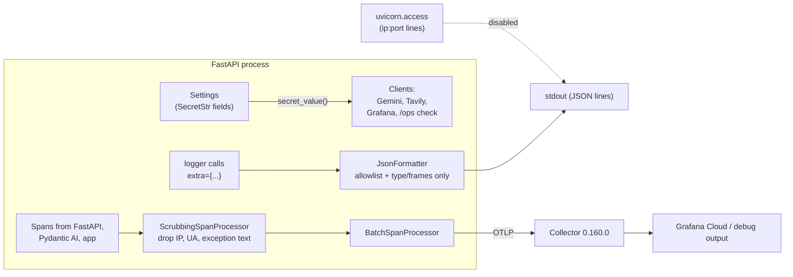

# 18b - Secrets, dependencies, and telemetry scrubbing

## What

Feature 18a guarded the front door (rate limits, CORS, timeouts). Feature 18b
closes the quieter leaks around the edges:

- **Secrets never print.** The four credentials (the Gemini key, the Tavily key,
  the `/ops` token, and the Grafana read token) are now typed so that printing
  the settings object shows `**********` instead of the value.
- **Logs keep only known fields.** The JSON log formatter writes only an
  allowlist of fields, and logs exceptions as their type plus stack frames,
  never the message. uvicorn's own access log, which printed every visitor's IP
  address, is switched off.
- **Traces lose visitor details.** Before a span leaves the app, a scrubber
  strips the visitor's IP, port, and browser user agent, plus any exception
  message or stack trace.
- **Dependencies are pinned and audited.** The backend container installs an
  exact list of 105 package versions, the OpenTelemetry collector image is
  pinned to a version, and both the Python and npm dependency trees were
  checked against known-vulnerability databases.

Together with 18a, this completes build-plan item 18, "Reliability + security".

## Why

ScholarLens has a simple privacy promise: a student's description of their
situation is used to answer one question and then forgotten. There are no
accounts and no stored profiles. But a web service leaves traces of every
request in places people rarely think about:

- **Logs.** A single `logger.exception(...)` call can write out an exception's
  message. If the model provider rejects a request, its error message may quote
  the student's text back. Once that line reaches a log aggregator, it is kept
  for weeks and searchable by anyone with access.
- **Traces.** OpenTelemetry's web instrumentation records, by default, the
  client's IP address and browser string on every request span. Features 14 to
  16 ship those spans to Grafana Cloud. An IP address plus a timestamp can
  identify a person, which is exactly what the "no stored student data" stance
  is meant to avoid.
- **Secrets.** A settings object printed in a debug session, or included in an
  error report, would expose every API key at once. A leaked Gemini key spends
  the project's credits; a leaked `/ops` token opens the internal dashboard.
- **Dependencies.** Without a lock, `pip install` picks whatever versions are
  newest on the day of the build. Two builds a week apart can run different
  code, and a new release of any of about 100 indirect packages can break the
  app or bring in a known vulnerability without anyone noticing.

Each of these is cheap to prevent now and expensive to clean up after a deploy
(feature 20), when logs and traces start flowing to a third-party service.

## Key concepts

### Secrets and `SecretStr`

A **secret** is any value that grants access: an API key, a password, a
token. The danger is rarely an attacker reading your code. It is the secret
showing up somewhere by accident: a log line, an error page, a screenshot of a
debug session.

Pydantic's **`SecretStr`** is a string wrapper that refuses to show itself.
`repr()`, `str()`, `model_dump_json()`, and validation errors all display
`**********`. To get the real value you must call `.get_secret_value()`
explicitly. That turns "don't print the key" from a rule people have to
remember into something the type system enforces. Think of it like a sealed
envelope: you can pass it around freely, and only the code that opens it on
purpose sees the contents.

One subtlety: code like `if settings.ops_api_token:` used to mean "is a token
configured?". With a wrapper object, the truthiness of an empty secret is an
implementation detail. So ScholarLens reads every secret through one helper,
`secret_value()`, which returns the raw string or `""`, and tests that instead.

### Structured logs and allowlists

A **structured log** is a log line written as data (here, one JSON object per
line) rather than free text. Fields like `path`, `status_code`, and
`duration_ms` can then be searched and graphed. Python's logging lets a caller
attach arbitrary fields with `extra={...}`, and the old formatter wrote out
*every* such field.

There are two ways to keep sensitive data out of a stream:

- A **denylist** names what is forbidden ("never log `description`"). It fails
  open: any field nobody thought to forbid gets through.
- An **allowlist** names what is permitted and drops everything else. It fails
  closed: a new, unreviewed field is dropped until someone decides it is safe.

The log formatter now uses an allowlist of the seven fields the app actually
logs. An unknown field isn't silently lost, though. Its *name* (never its value)
is listed under `dropped_fields`, so a developer notices and can decide.

### Why exception messages are dangerous

An exception has three parts: its **type** (`ValueError`), its **message**
(`"invalid literal for int(): 'abc'"`), and its **traceback** (the chain of
file, line, and function calls that led to it). The type and traceback describe
*code*. The message often describes *data*: the input that failed, or the text
of a provider's error response. So the safe summary of an exception is type
plus frames, never the message. Feature 13 already followed that rule for
unhandled 500s; 18b makes the formatter enforce it for every logged exception.

### Spans, attributes, and span processors

A **span** is one timed step in a request's journey (see feature 14's doc):
"handle `POST /eligibility`", "query ChromaDB", "call Gemini". Each span
carries **attributes** (key-value details such as `http.route` or
`http.status_code`) and **events** (timestamped notes, such as "an exception
happened here").

The OpenTelemetry SDK hands every finished span to one or more **span
processors**, which batch spans up and pass them to an **exporter** that sends
them over the network. A span processor is therefore a checkpoint every span
passes through on its way out. ScholarLens adds its own processor, which
**wraps** the batching one, like a customs desk in front of the departure gate.
It hands the batcher a cleaned copy of each span and passes everything else
straight through.

### Semantic conventions, old and new

OpenTelemetry names attributes by **semantic conventions**, a shared
dictionary that says "the client's IP goes in `client.address`". The conventions
were renamed a few years ago (`net.peer.ip` became `client.address`,
`http.user_agent` became `user_agent.original`), and instrumentation libraries
can emit the old names, the new names, or both. The scrubber's denylist lists
both spellings so it keeps working when the instrumentation switches over.

Here the scrubber uses a denylist rather than an allowlist, because
span attributes come from many libraries (FastAPI, Pydantic AI, the app's own
code) and an allowlist would silently strip useful details such as model name
and token counts. The denylist is narrow and aimed at exactly the fields that
identify a visitor.

### Dependency locks

A project's dependencies come in two layers. **Direct dependencies** are the
ones you ask for (`fastapi`, `chromadb`). **Transitive dependencies** are what
those need in turn (`starlette`, `onnxruntime`, and about 90 more).
`pyproject.toml` declares only direct ones, as ranges like `fastapi>=0.115`,
so the installer is free to choose any newer version.

A **lock file** freezes the whole resolved tree to exact versions
(`fastapi==0.141.1`), so every install is the same install. The frontend
already had one (`package-lock.json`, which npm maintains automatically).
ScholarLens now has one for Python too, generated with `pip freeze`.

A lock is only valid for the platform it was resolved on. The container runs
Python 3.11.16 on Linux, while the local dev venv runs Python 3.14 on Windows,
and those can resolve to different package versions. So the lock is generated
*inside* the container's exact base image, and only the container uses it.
Local development keeps resolving the ranges.

### Image pinning

Docker images have **tags** (`latest`, `0.160.0`) and **digests** (a
`sha256:` hash of the exact image). `latest` is a moving label: pulling it next
month may fetch different software. Pinning to a version tag (the collector:
`0.160.0`) or a digest (ChromaDB, since feature 3) makes a rebuild reproducible.
Feature 3 learned this the hard way when a floating ChromaDB tag moved its data
directory and silently made the store ephemeral.

### Vulnerability audits and CVEs

A **CVE** (Common Vulnerabilities and Exposures entry) is a public, numbered
record of a known security flaw in a specific package and version range.
Audit tools compare your installed versions against databases of these
records:

- `npm audit` checks the frontend's `package-lock.json`.
- `pip-audit` checks a Python requirements file against the PyPI advisory
  database.

An audit finding isn't automatically a fire. The questions are: does a fixed
version exist, and does *our* use of the package reach the vulnerable code?

## Architecture



The dependency side is a separate, build-time pipeline:

```
pyproject.toml (ranges)
      |
      |  pip install . && pip freeze   (inside python:3.11.16-slim)
      v
requirements.txt (105 exact pins)  --pip-audit-->  audit report
      |
      |  Dockerfile: pip install -r requirements.txt, then pip install --no-deps -e .
      v
infra-backend image (identical on every build)
```

## What we actually built

### Secrets

[`../backend/app/config.py`](../backend/app/config.py) types the four
credentials and adds the one reader:

```python
google_api_key: SecretStr | None = None
tavily_api_key: SecretStr | None = None
...
def secret_value(secret: SecretStr | None) -> str:
    """The raw secret, or "" when unset; an empty value means not configured."""
    return secret.get_secret_value() if secret is not None else ""
```

Each consumer opens the envelope only at the point of use. For example,
[`../backend/app/api/ops.py`](../backend/app/api/ops.py):

```python
expected = secret_value(settings.ops_api_token)
if not expected:
    raise ApiError(503, OPS_NOT_CONFIGURED)
```

The others are [`../backend/app/agent/agent.py`](../backend/app/agent/agent.py)
(the Gemini provider),
[`../backend/app/tools/web_search.py`](../backend/app/tools/web_search.py)
(the Tavily request body),
[`../backend/app/ops/prometheus.py`](../backend/app/ops/prometheus.py) (Grafana
basic auth), and
[`../backend/app/retrieval/client.py`](../backend/app/retrieval/client.py)
(which still has to copy the Gemini key into an environment variable for
ChromaDB's embedding function; that is open finding F-12).

### Logs

[`../backend/app/logging.py`](../backend/app/logging.py) gained the allowlist
and a message-free exception rendering:

```python
_ALLOWED_EXTRAS = {
    "correlation_id", "duration_ms", "error_type", "method", "path", "stack", "status_code",
}
...
if record.exc_info and record.exc_info[0] is not None:
    error_type, _, tb = record.exc_info
    # Type and frames only: an exception message can echo the student's input.
    entry["exception_type"] = error_type.__name__
    entry["exc_info"] = "".join(traceback.format_tb(tb))
```

And one line turns off uvicorn's access log:

```python
logging.getLogger("uvicorn.access").disabled = True
```

This works because of ordering. uvicorn sets up its own logging *before* it
imports the app, and `configure_logging` runs when `app.main` is imported. So
the switch-off happens last and sticks, even under `--reload`, where each
restart spawns a fresh worker process that repeats the same order. The app's
own `app.access` line (feature 13) still logs every request, with method, path,
status, and duration, but no IP.

### Traces

[`../backend/app/telemetry.py`](../backend/app/telemetry.py) adds the
scrubbing processor and registers it around the existing batcher:

```python
provider.add_span_processor(
    ScrubbingSpanProcessor(BatchSpanProcessor(OTLPSpanExporter(...)))
)
```

The core is `_scrubbed`, which builds a new read-only span. It copies every
field unchanged except three:

- **attributes** without the visitor fields
- **events** without `exception.message` and `exception.stacktrace`
- the **status description** cut down to a bare type name

The status rule deserves a note. The SDK describes a failed span as
`"ValueError: student text"`. The scrubber keeps the part before `": "` only
if it looks like a type name, and drops the description entirely otherwise:

```python
head = status.description.split(": ", 1)[0]
status = Status(
    status.status_code, head if re.fullmatch(r"[A-Za-z_][\w.]*", head) else None
)
```

### Dependencies

- [`../backend/requirements.txt`](../backend/requirements.txt) is now the lock:
  105 `==` lines under a header with the exact command that regenerates it.
- [`../backend/Dockerfile`](../backend/Dockerfile) pins
  `FROM python:3.11.16-slim` and installs the lock first, then the app with
  `--no-deps`, so pip can't quietly pull a different version of anything. The
  lock gets its own layer, so Docker's cache reuses it until the lock changes.
- [`../backend/.dockerignore`](../backend/.dockerignore) no longer excludes
  `requirements.txt`.
- [`../infra/docker-compose.yml`](../infra/docker-compose.yml) pins the
  collector to `0.160.0` and publishes ChromaDB on `127.0.0.1:8001` only (more
  on that below).
- [`../backend/README.md`](../backend/README.md) gained a "Dependencies"
  section: what the lock is, how to regenerate and check it, both audit
  commands, and the dated audit result.

### Things that went sideways

- **The audit found something with no fix.** `npm audit` was clean, but
  `pip-audit` flagged four CVEs in `chromadb` 1.5.9 with no patched release:
  two remote-code-execution bugs and two missing tenant checks. Reading the
  advisories showed all four live in the Chroma *server* (its HTTP endpoints and
  authorization). The backend only uses the `chromadb` package as an HTTP
  *client*, so none of that code runs in our process. The real exposure was the
  separate Chroma server container, which Compose published on every network
  interface, so anyone on the same Wi-Fi could reach an unauthenticated vector
  store. The decision, made with the user: accept the advisories (documented
  with reasons), bind Chroma to the loopback address so only this machine can
  reach it, and upgrade once a fix ships.
- **Lock resolution on the wrong Python.** The local venv turned out to be
  Python 3.14, not the 3.11 the container uses. A lock generated there would
  have pinned wheels that don't exist for the container. The fix was to run
  `pip freeze` inside `python:3.11.16-slim`. The folder is mounted read-only
  and the build happens in `/tmp`, so no build files leak into the repo.
- **The first scrubber lost information.** Copying a span into a plain `dict`
  and `list` quietly reset its "dropped" counters, which tell a trace viewer
  that the SDK had to truncate attributes or events. A reviewer caught it, and
  the copy now uses the SDK's own `BoundedAttributes` and `BoundedList` types
  with the original counts carried over. A second catch was a free-form status
  like `"student text only"`, which has no `": "` and would have passed through
  whole. That's why the type-name check exists.
- **A misleading test.** While checking the dropped-count fix, one event's
  count read 0 instead of 1. It turned out the test itself was wrong: with a
  limit of one event, the SDK keeps the *newest* event, so the event carrying
  the dropped attribute was the one discarded. Rerunning with room for both
  events showed the count preserved.
- **A merge ahead of the review.** The PR was merged before the independent
  review had run (the command runner was briefly unavailable). The review then
  ran against the branch tip, whose tree is byte-identical to what landed on
  `main` (`2c64f9b`), and passed.

### How we know it works

- `ruff check .` is clean, and the backend image builds.
- **Secrets:** the real `.env` keys are not present in the settings repr or
  dump (checked by searching, never printing). Fake keys show as `**********`.
  Tavily's request body and Grafana's auth header still carry the real values,
  and `/ops/summary` still answers 503, 401, and 200 as before.
- **Logs:** an unknown `extra` field is dropped and named; a logged
  `ValueError("student text")` keeps its type and frames but not the text; a
  live uvicorn run (normal and `--reload`) prints the `app.access` line and no
  `127.0.0.1:<port>` line.
- **Traces:** on an instrumented test app, the *unscrubbed* server span carries
  `http.user_agent`, `net.peer.ip`, and `net.peer.port`, and the scrubbed one
  carries none of them. Exception text is gone, parent links and timings are
  intact, and dropped counts survive. The same check passes inside the
  container on SDK 1.45.
- **Pinning:** inside the built image, `pip check` reports no broken
  requirements and `pip freeze` matches the lock line for line. The collector
  logs report version 0.160.0.
- **End to end:** one real, paid eligibility request went through the whole
  Compose stack. Its description contained a marker phrase
  (`QUOKKA-MARKER-7731`), and the request carried a custom user agent. It
  returned 200, and afterwards neither the backend logs nor the collector's
  trace output contained the marker, the Docker gateway IP, the user-agent
  string, or either configured key, while the agent, retrieval, and HTTP spans
  all arrived.
- **Independent review:** a fresh reviewer re-checked secrets, logs, and spans
  (including under the combined old-and-new semantic-convention mode) and
  passed the work with no new findings.

## What's next

- **19 - Testing.** The log allowlist, the exception rendering, the span
  scrubber, and `secret_value` are the pure logic a first unit-test suite
  should pin down, so a later change can't quietly reopen a leak.
- **20 - Deploy.** The lock and pinned images make the deployed backend the
  same software that was audited. Deployment must keep ChromaDB off the public
  network, and the uvicorn command there should drop `--reload`. When Grafana
  Cloud starts receiving real traffic, the scrubbing is already in place.
- **21 - Production polish.** Re-run both audits before the final release, and
  upgrade `chromadb` if a fixed version has shipped by then.
- **Open follow-ups.** F-12 (the Gemini key copied into the process
  environment) and F-21 (retry transports ignoring proxy variables) remain
  small open findings. uvicorn's `uvicorn.error` logger still uses its own
  format, which matters only if the server itself crashes.
