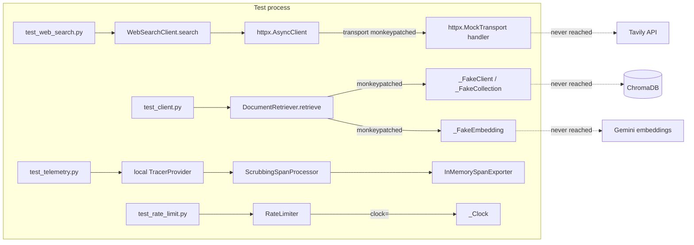

# 19a - Backend unit tests

## What

Up to feature 18, the backend was proven by hand: run the server, send a
request, read the logs, run the evaluation suite against live Gemini. Feature
19a gives it an automated safety net. `pytest` is now configured, and 120 unit
tests sit next to the modules they cover (`backend/app/**/test_*.py`). They
check the pure logic where a wrong answer is possible:

- **Input validation:** request field bounds, the evaluation profile rule, the
  CORS origin check, and secrets staying hidden.
- **Evaluation and ingestion:** scoring, aggregate metrics, the profile loader,
  document parsing, and chunking.
- **Protection and ops:** the rate limiter, error-code mapping, the `/ops` and
  metrics file readers, and Prometheus value parsing.
- **Privacy:** the log allowlist and the span scrubber, proving student text
  and exception messages never leave the process.
- **External clients:** the ChromaDB retriever and the Tavily web-search
  client, run against fakes so their success and failure paths can be forced.

The whole suite runs in about 3 seconds with no network, no ChromaDB, no API
keys, and no `.env`. `AGENTS.md` now declares `pytest` as the backend test
command, which turns tests into a required gate for later backend steps.

This is the first of three parts of build-plan item 19 ("Testing"). 19b adds
API and agent integration tests; 19c adds one browser end-to-end test.

## Why

Every feature so far added logic with real edge cases: a rate limiter with
three overlapping windows, a chunker that splits sentences, a scorer that
decides what counts as a hallucination, a scrubber that decides which span
attributes leave the app. Each was checked once, when it was built. Nothing
checked it again afterwards.

Without tests, three things go wrong:

1. **Regressions go unnoticed.** Change the chunker to fix one document and you
   may silently break how another is split. The first sign is a worse
   evaluation score days later, with no clue which change caused it.
2. **Every check costs money and time.** The only end-to-end check was the
   evaluation suite, which calls Gemini on paid credits and needs ChromaDB
   running. That is far too heavy to run after every small edit.
3. **Privacy promises are unverified.** The project promises that student
   prompts never reach logs or traces. Until now that promise lived in code
   comments. A test that feeds in student text and asserts it is absent from
   the output turns the promise into something a machine checks every run.

Unit tests fix all three: they are free, fast, and they fail loudly the moment
behavior drifts.

## Key concepts

### What a test is

A test is a small program that runs a piece of your code with known inputs and
checks the output matches what you expect. If it does, the test passes
silently. If not, it fails and tells you where.

```python
def test_slugify():
    assert slugify("NJ STARS (and NJ STARS II)") == "nj-stars-and-nj-stars-ii"
```

`assert` is plain Python: if the expression is false it raises an error. The
test runner collects those errors into a report.

Think of tests as a checklist a pilot runs before takeoff. Each item is quick
and boring, but running the whole list every time catches the one thing that
changed.

### Unit, integration, and end-to-end tests

Tests are usually sorted by how much of the system they run at once:

| Kind | Runs | Speed | Example here |
|---|---|---|---|
| Unit | One function or class, alone | Milliseconds | `score_attempt` on a fake result |
| Integration | Several parts wired together | Seconds | The FastAPI app handling a request (19b) |
| End-to-end | The whole product, like a user would | Seconds to minutes | A browser filling `/check` (19c) |

This is often drawn as a **testing pyramid**: many cheap unit tests at the
bottom, fewer integration tests in the middle, one or two end-to-end tests at
the top. Unit tests pinpoint exactly which function broke; end-to-end tests
prove the pieces actually connect. 19a builds the bottom layer.

### pytest

pytest is Python's most common test runner. It finds tests by convention:

- files named `test_*.py`
- functions inside them named `test_*`

You write plain functions with plain `assert`s. pytest discovers them, runs
them, and on failure prints the values on both sides of the failed comparison.
That is why a failing test earlier in this feature showed exactly which
substring leaked.

`testpaths = ["app"]` in `pyproject.toml` tells pytest where to look.

If pytest finds zero tests it exits with code 5, not 0. So "no tests ran" can
never look like "all tests passed". The coding standards call this out on
purpose.

### Fixtures

A fixture is a reusable piece of setup that pytest hands to any test that asks
for it by name. You declare it with `@pytest.fixture`; a test asks for it by
listing it as a parameter.

```python
@pytest.fixture
def make_settings():
    def build(**overrides):
        return Settings(_env_file=None, **overrides)
    return build

def test_unset_secret_reads_as_empty(make_settings):
    assert secret_value(make_settings().tavily_api_key) == ""
```

Fixtures placed in a file called `conftest.py` are shared automatically with
every test in that folder and below. No import needed.

This one is a **fixture factory**: instead of returning one `Settings`, it
returns a function that builds one with whatever overrides a test needs.

Two built-in fixtures show up a lot here:

- **`tmp_path`** gives each test its own empty temporary folder, deleted
  afterwards. Tests write fake documents there instead of touching
  `backend/data/`.
- **`monkeypatch`** temporarily replaces an attribute (a function, a class, an
  environment variable) for one test and puts the original back afterwards,
  even if the test fails.

### Parametrized tests

One test function can run against a table of inputs:

```python
@pytest.mark.parametrize("origin", [
    "https://app.example.com/",
    "https://App.example.com",
    "https://app.example.com:443",
])
def test_frontend_origin_rejects_anything_a_browser_would_not_send(make_settings, origin):
    with pytest.raises(ValidationError):
        make_settings(frontend_origin=origin)
```

pytest reports each row as its own test, so one bad case does not hide the
others. `pytest.raises` asserts that the code inside the `with` block raises
that error; the test fails if it does not.

### Test doubles: fakes, stubs, and mocks

Some code talks to things a unit test must not use: ChromaDB (a server),
Tavily (a paid API), Gemini (paid, slow, and not deterministic). The fix is to
swap the real dependency for a stand-in during the test. These stand-ins are
called **test doubles**, like a stunt double in a film:

- A **stub** returns canned answers ("the search returned these two results").
- A **fake** is a small working imitation (a pretend collection with a
  `query()` method).
- A **mock** also records how it was called, so the test can check the request
  that went out.

Here, `_FakeCollection` in the retriever test is a fake that also records its
calls, and `httpx.MockTransport` is httpx's built-in mock for HTTP.

### Seams

A seam is a place where you can swap one piece of code for another without
editing the code under test. Good seams make testing easy; missing seams force
hacks. This codebase already had three, from earlier design choices:

- `RateLimiter` takes a `clock` argument (feature 18a). A test passes a fake
  clock and controls time exactly, so the per-day limit can be tested without
  waiting a day.
- The retriever gets its ChromaDB client from `get_chroma_client()` and its
  embedding function from `build_embedding_function()`, two module-level
  functions a test can monkeypatch.
- The web-search client builds its HTTP connection with
  `httpx.AsyncHTTPTransport`, which a test can monkeypatch to a
  `MockTransport`.

Earlier features called these "thin clients". A thin client wraps an outside
service in one small class, so the rest of the app and its tests only deal
with that class. The coding standards say to mock "at their thin wrapper
boundary", and this is where that pays off: no production code had to change
to make any of it testable.

### Determinism and test isolation

A good test gives the same answer every run, on every machine. Two things
threaten that here:

- **Hidden inputs.** `Settings()` reads `.env` from the current folder. On
  your machine that file holds real API keys, so a test using bare `Settings()`
  could pass for you and fail in CI, or quietly call Tavily with your real
  key. `Settings(_env_file=None, ...)` turns that off.
- **Global state.** OpenTelemetry has one global tracer provider per process,
  and it can only be set once. The telemetry test builds its own local
  `TracerProvider` instead, so it never touches the global one the app uses.

### Testing async code without a plugin

The retriever and web-search clients are `async` functions: they must run
inside an event loop. Many projects add the `pytest-asyncio` plugin for this.
Here, tests call `asyncio.run(client.search("q"))` inside a normal test, which
creates a loop, runs the coroutine to completion, and closes the loop. That is
one standard-library call and no new dependency.

## Architecture

Tests live next to the code they check, per the coding standards:

```
backend/
  pyproject.toml              [tool.pytest.ini_options] testpaths = ["app"]
  app/
    conftest.py               make_settings fixture (ignores .env)
    config.py        <-  test_config.py
    logging.py       <-  test_logging.py
    telemetry.py     <-  test_telemetry.py
    status_metrics.py <- test_status_metrics.py
    api/
      models.py      <-  test_models.py
      errors.py      <-  test_errors.py
      rate_limit.py  <-  test_rate_limit.py
    evaluation/
      models.py      <-  test_models.py
      scoring.py     <-  test_scoring.py
      profiles.py    <-  test_profiles.py
    ingestion/
      documents.py   <-  test_documents.py
      chunking.py    <-  test_chunking.py
    ops/
      summary.py     <-  test_summary.py
      prometheus.py  <-  test_prometheus.py
    retrieval/
      client.py      <-  test_client.py
    tools/
      web_search.py  <-  test_web_search.py
```

Where each external dependency is cut off:



Everything to the right of the dotted lines is what a real request would hit.
None of it is reached from a test.

## What we actually built

### Setup

[`backend/pyproject.toml`](../backend/pyproject.toml) gained three lines:

```toml
[tool.pytest.ini_options]
testpaths = ["app"]
```

pytest was already in the `[dev]` extra, so no dependency changed and the
pinned runtime lock (`requirements.txt`, from 18b) is untouched. Dev tools
aren't in that lock because the container never runs tests.

[`backend/app/conftest.py`](../backend/app/conftest.py) holds the one shared
fixture, `make_settings`.

[`AGENTS.md`](../AGENTS.md) replaced "No test runner is configured yet" with a
`Test: pytest` command. Under the coding standards, declaring that command is
the single switch that makes tests a gate: from now on, a backend step that
adds logic must ship a passing test in the same diff.
[`backend/README.md`](../backend/README.md) got a matching Test section.

### Validation

[`test_config.py`](../backend/app/test_config.py) hammers the `frontend_origin`
validator from 18a with 5 good and 11 bad origins. The bad ones are all things
a person might paste into an env var that a browser would never send as an
`Origin` header: a trailing slash, a path, uppercase letters, the default port
spelled out, an empty port, a username. CORS compares origins byte for byte,
so any of these would silently block every browser request. The test makes
sure the app refuses to start instead.

It also checks the 18b secret handling: a key passed to `Settings` must not
appear in `repr(settings)` or `model_dump()`.

[`api/test_models.py`](../backend/app/api/test_models.py) and
[`evaluation/test_models.py`](../backend/app/evaluation/test_models.py) cover
field bounds (exactly 2000 characters passes, 2001 fails) and the rule that an
evaluation profile's `expected_program` and `expected_citation` are both set
or both null.

### Evaluation and ingestion

[`evaluation/test_scoring.py`](../backend/app/evaluation/test_scoring.py) is
the most valuable file in the feature. The scorer decides the headline numbers
on the `/ops` page, so a bug there quietly lies about AI quality. It pins down
each rule:

- an engine error counts as a wrong citation only if the profile expected one
- program names match after slugifying, so `"nj  stars"` equals `"NJ STARS"`
- an `eligible` or `partial` verdict with no clause is a `missing_citation`
  hallucination...
- ...except a `partial` verdict that lists `missing_info`, which rests on
  missing facts rather than a rule
- a clause not found anywhere in the corpus is `ungrounded_clause`
- an answer that used web search is not scored for hallucination at all,
  because web text can't be checked against the local corpus
- aggregate rates skip unscored (`None`) attempts instead of counting them as
  zero, and consistency is `None` when each profile ran only once

[`evaluation/test_profiles.py`](../backend/app/evaluation/test_profiles.py)
includes one test that loads the real committed `data/evaluation/profiles.json`
against the real `data/programs/` corpus. If someone edits a program document
so a labeled citation no longer appears in it, this test fails before any paid
evaluation run is wasted. Another test checks that a validation error names
the bad field (`request.gpa`) but never echoes the student description.

[`ingestion/test_documents.py`](../backend/app/ingestion/test_documents.py)
writes small fake documents into `tmp_path` and checks each front-matter
error, the BOM handling (a Windows editor can prepend an invisible byte that
would hide the opening `---`), and the rule that `a.md` and `a.txt` collide.

[`ingestion/test_chunking.py`](../backend/app/ingestion/test_chunking.py)
checks that headings start new sections, paragraphs pack up to `max_chars`,
and an over-long paragraph splits on sentence boundaries with every sentence
kept whole. Keeping clauses whole matters because the citation scorer looks
for the quoted clause inside a single chunk.

### Rate limiter

[`api/test_rate_limit.py`](../backend/app/api/test_rate_limit.py) uses the
clock seam. The fake clock starts at a chosen moment 10 seconds into a minute
and 3,610 seconds into a UTC day, so every expected `Retry-After` is plain
arithmetic:

```python
_START = 1_000_000 * 86_400 + 3_600 + 10.0
...
assert limiter.acquire("1.1.1.1") == 50            # 60 - 10 left in the minute
assert limiter.acquire("1.1.1.1") == 86_400 - 3_610  # left in the UTC day
```

The subtle case is `test_a_rejected_request_is_not_counted`. A client
hammering a full minute window gets rejected five times; if those rejections
counted toward the daily limit, one noisy minute would lock them out for the
day. The test proves only accepted requests count.

### Metrics readers, logs, and scrubbing

[`ops/test_summary.py`](../backend/app/ops/test_summary.py) checks the `/ops`
evaluation history reader: newest first, capped at 10, blank and broken lines
skipped, and a corrupt byte in one line not taking down the rest. It also
checks that the per-attempt detail, which holds program clause text, is left
out of the summary.

[`test_logging.py`](../backend/app/test_logging.py) logs a record carrying
`description="student text"` and asserts the value appears nowhere in the
output, only the field name under `dropped_fields`.

[`test_telemetry.py`](../backend/app/test_telemetry.py) wires the real
`ScrubbingSpanProcessor` in front of an `InMemorySpanExporter`, which is an
OpenTelemetry exporter that keeps finished spans in a list instead of sending
them anywhere. The test raises `ValueError("student text")` inside a span,
then checks the exported span has `exception.type` but no `exception.message`
or `exception.stacktrace`, and that the status description was cut to the
bare `"ValueError"`.

### External clients

[`retrieval/test_client.py`](../backend/app/retrieval/test_client.py) swaps
in a fake ChromaDB. The timeout test makes the fake `query()` sleep 0.5 s with
`chroma_timeout_seconds=0.05` and checks `RetrievalUnavailableError` comes
back. That is the behavior the agent relies on to degrade to a controlled
error instead of hanging.

[`tools/test_web_search.py`](../backend/app/tools/test_web_search.py) swaps
httpx's transport for a `MockTransport` whose handler returns whatever
response the test wants: a 401, a 503, a refused connection, HTML instead of
JSON, or JSON of the wrong shape. Each must become `WebSearchUnavailableError`.
The handler also records the outgoing request, so one test checks the body
Tavily would receive, including `max_results` taken from `retrieval_top_k`.

Because the patch replaces the only transport the client ever builds, a test
can't reach the real Tavily API even by accident.

### Things that went sideways

**The traceback that leaked the test's own text.** The first version of the
log test raised `ValueError("student text in the message")` and asserted
`"student text"` was not in the output. It failed. The formatter had correctly
dropped the exception message, but it keeps stack frames, and Python's
traceback frames quote the **source line** that raised: which was the test's
own `raise ValueError("student text...")`. The fix builds the message at
runtime (`" ".join(["student", "text"])`), so the source line reads
`raise ValueError(message)`. It's a useful reminder: stack frames can carry
source text, and a literal in a `raise` line will show up in them. In
production, raise sites use fixed messages, so this is not a leak there.

**The wrong Python.** After the build, running `pytest -q` in a plain terminal
failed with 11 collection errors like `cannot import name 'UTC' from
'datetime'`. Nothing was broken. That terminal was using the global Python
3.10, and the backend needs 3.11+ (`datetime.UTC`, `typing.Self`, and
`enum.StrEnum` all arrived in 3.11). Activating `backend/.venv` fixes it. The
venv here runs 3.14 while the container runs 3.11, so passing locally is
evidence for 3.14 only.

**What was deliberately left out.** No test covers `traced_span` directly: it
binds to the global tracer, and setting a global provider in one test would
leak into the others. The scrubber test covers the part that matters (what
leaves the process), and 19b's integration tests will exercise `traced_span`
through real requests.

### How we know it works

From `backend/` with the venv active:

- `pytest`: 120 passed in about 3.3 s
- `ruff check .`: clean

No production code changed, and no test found a bug in existing code.

## What's next

- **19b - API and agent integration tests.** FastAPI's `TestClient` sends real
  HTTP requests to the app in-process, so tests can check the full error
  envelope, the 429 with `Retry-After`, the 503 when the engine fails, and the
  `/ops` token check. The agent pipeline gets tested with Pydantic AI's test
  model, a stand-in model that returns scripted tool calls and answers, so the
  ReAct loop runs end to end without Gemini. The `make_settings` fixture and
  the ChromaDB/Tavily fakes from 19a are the building blocks.
- **19c - End-to-end eligibility journey.** One Playwright test drives a real
  browser through `/check`. The backend API is stubbed at the network layer,
  the same idea as `MockTransport` here but in the browser, so the test is
  repeatable and costs nothing.
- **22 - Provider rate-limit handling** will add logic (quota detection,
  retry-delay rules) that now must ship with tests, because `pytest` is a
  declared gate.
- Findings F-18 (other malformed Tavily bodies can still escape as untyped
  errors) and F-04 (unbounded request body) are good candidates for a
  test-first fix: write the failing test, then make it pass.
