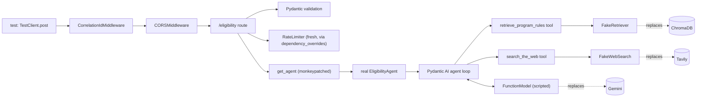

# 19b - API and agent integration tests

## What

19a tested functions one at a time. 19b tests how they behave once they are
wired together. It adds 37 tests in two groups:

- **API tests** send real HTTP requests to the real FastAPI app, running
  in-process, and check what a client would see: status codes, the error
  envelope, `X-Request-ID`, CORS headers, `Retry-After` on a 429, and
  `WWW-Authenticate` on a 401. They cover `/`, `/health`, `/eligibility`, and
  `/ops/summary`.
- **Agent tests** run the real `EligibilityAgent`, the Pydantic AI ReAct loop at
  the heart of ScholarLens, with the Gemini model swapped for a scripted
  `FunctionModel` and the retriever and web search swapped for in-memory
  fakes. They check which tools get called, the transparency trace the user
  sees, and that every failure becomes the one error type the API knows how
  to turn into a 503.

One test chains the two: `POST /eligibility` goes through the real route, the
real rate limiter, the real agent loop, and the fake tools, then back out as
JSON.

To make this possible, one piece of production code moved: app assembly now
lives in `create_app(settings)` in `backend/app/application.py`, so a test can
build an app from settings it controls.

The suite is now 157 tests, about 8 seconds, with no network, no API keys, and
no Gemini spend. A global switch makes any real model call fail loudly.

## Why

The unit tests from 19a prove the parts are right. They cannot prove the
parts are connected right. Most real bugs in a web service live in the
wiring:

- A route that forgets to check the rate limit, or checks it after calling
  the agent, which spends Gemini credits on requests it should have refused.
- An error handler registered in the wrong order, so a 422 comes back as
  FastAPI's default body instead of the project's envelope, and `/check`
  shows a generic error instead of the right message.
- A tool exception that escapes the agent as a raw Python error, so the user
  gets a 500 instead of the "engine unavailable" state.
- A 500 response that includes the exception message, and so echoes the
  student's own input back or into logs.

None of these show up in a unit test of one function. Before 19b the only way
to catch them was to start the server, start ChromaDB, spend Gemini credits,
and click through `/check` by hand. That's slow, costly, and easy to skip.

The agent is the hardest part to test, and the most important. A real model
answers differently each time, costs money per call, and can't be told to
fail on demand. Without a scripted model, the agent loop could only be tested
by the evaluation suite, which measures answer quality, not "does a Tavily
timeout become a 503". 19b makes the loop deterministic, free, and
breakable on purpose.

## Key concepts

### Integration tests

A unit test isolates one piece. An integration test runs several real pieces
together and replaces only what sits outside the system: here, Gemini,
Tavily, ChromaDB, and Grafana. The line is drawn at the edge of the process.
Everything inside it (routing, middleware, validation, rate limiting, error
handlers, the agent loop, tool dispatch) runs for real.

Analogy: a unit test checks each car part on a bench. An integration test
bolts the parts together and runs the engine on a test stand, without taking
the car onto a public road.

### ASGI and `TestClient`

FastAPI apps speak **ASGI** (Asynchronous Server Gateway Interface), a
standard contract between a Python web app and a web server. In production,
uvicorn is the server: it accepts TCP connections, turns bytes into ASGI
events, and hands them to the app.

Because the contract is just Python function calls, you don't need a real
server to talk to an app. FastAPI's `TestClient` (built on httpx) looks like an
HTTP client (`client.post("/eligibility", json=...)`), but instead of opening
a socket it calls the ASGI app directly in the same process. Every middleware,
dependency, and exception handler runs exactly as it would behind uvicorn. No
port, no network, and each request takes about a millisecond.

`TestClient` runs the app's async code in a separate worker thread, using an
event loop it manages. That detail mattered later (see "Things that went
sideways").

### Import-time side effects and the app factory pattern

Before 19b, `backend/app/main.py` built the app at module level:

```python
settings = get_settings()   # reads .env
app = FastAPI(...)
app.add_middleware(CORSMiddleware, allow_origins=[settings.frontend_origin], ...)
```

Code that runs just because a module was imported is an **import-time side
effect**. Here it meant: importing `app.main` from a test reads your
`backend/.env`, which holds real `GOOGLE_API_KEY` and `TAVILY_API_KEY` values,
and fixes the CORS origin to whatever that file says. A test importing it
would behave differently on your machine and in CI, and would have your real
keys in memory.

The standard fix is an **app factory**: a function that builds and returns
the app from its inputs.

```python
def create_app(settings: Settings) -> FastAPI:
    app = FastAPI(...)
    app.add_middleware(CORSMiddleware, allow_origins=[settings.frontend_origin], ...)
    ...
    return app
```

Production still calls it once in `main.py`. Tests call it with settings they
build themselves. A factory is like a recipe: the restaurant cooks it once for
the dining room, and a test kitchen can cook it again with measured
ingredients.

### Dependency injection and `dependency_overrides`

**Dependency injection** means a function receives the things it depends on
instead of reaching out and grabbing them. FastAPI does this with `Depends`:

```python
async def check_eligibility(
    request: EligibilityRequest,
    limiter: Annotated[RateLimiter, Depends(get_rate_limiter)],
): ...
```

The route doesn't create the rate limiter; FastAPI calls `get_rate_limiter()`
and passes the result in. The payoff for tests is
`app.dependency_overrides`, a dictionary that says "whenever something asks
for this dependency, call this other function instead":

```python
app.dependency_overrides[get_rate_limiter] = lambda: limiter   # fresh one per test
app.dependency_overrides[get_settings] = lambda: settings
```

Analogy: a play where each actor is cast by the director. For a rehearsal,
the director can swap in an understudy without rewriting the script.

### `lru_cache` singletons, and why tests must replace them

`get_settings`, `get_rate_limiter`, and `get_agent` are all wrapped in
`@lru_cache`. With no arguments, that means "compute once, then return the
same object forever": a cheap way to make a **singleton**, one shared
instance per process.

That's right for production: one rate limiter must count every request. In
tests it's a trap. If test A makes two requests, test B would inherit a
limiter that already counted them. So the fixture overrides each cached
dependency with a fresh object, and the one test that calls the real
`get_agent()` clears its cache before and after itself.

`get_agent` isn't a `Depends` dependency; the route calls it directly. For
that one, tests use `monkeypatch.setattr(eligibility, "get_agent", ...)`,
which replaces the name inside the `app.api.eligibility` module for one test.

### Stub agent

For the API tests the agent itself is not under test, so it's replaced by a
**stub**: a tiny class with the same `check_eligibility` method that returns a
canned result, or raises an error the test chooses, and records every request
it received. That last part lets a test prove a negative, for example "a
rate-limited request never reached the agent":

```python
assert len(stub_agent.requests) == 2   # the third, rejected request never arrived
```

### A quick recap: what the agent loop actually does

An **LLM agent** is a loop around a language model. The model is given
instructions and a list of **tools**, which are functions it may ask the program to
run. Each turn it either asks for tool calls or gives a final answer:

```
user prompt  ──►  model  ──► "call retrieve_program_rules(query='NJ STARS rank')"
                    ▲                         │
                    │                         ▼
                    └──── tool result ◄── our Python function runs
                  ...
                  model  ──► final answer (structured EligibilityResult)
```

This is the **ReAct** pattern (Reason + Act): think, act with a tool, observe
the result, repeat. In Pydantic AI, each round trip is a list of **messages**.
A `ModelRequest` holds what we send (the user prompt, tool results). A
`ModelResponse` holds what the model sends back (text, or `ToolCallPart`s
naming a tool and its arguments).

Structured output works the same way: Pydantic AI registers a hidden
**output tool** (typically `final_result`) whose arguments schema is
`EligibilityResult`. The model "answers" by calling that tool, and Pydantic
AI validates the arguments into an `EligibilityResult`.

### Scripted models: `FunctionModel` and `TestModel`

Pydantic AI ships two fake models for exactly this job:

- **`TestModel`** calls every tool once with made-up arguments and invents a
  valid output. Good for smoke tests; you don't control the path.
- **`FunctionModel`** calls a Python function you write on every turn. That
  function receives the full message history and an `AgentInfo` (which
  tools exist, including the output tool's name) and returns the
  `ModelResponse`. You decide exactly which tool is called with which
  arguments, and when the answer comes.

19b uses `FunctionModel`, through a small helper that turns a list of turns
into a model:

```python
model, seen = scripted(
    [("retrieve_program_rules", "rank"), ("retrieve_program_rules", "residency")],
    [("search_the_web", "NJ STARS official"), ("search_the_web", "HESAA NJ STARS")],
)
```

Turn 1 asks for two retrievals, turn 2 for two web searches, turn 3 answers.
`seen` records every message history the model received, so a test can look
inside, for example to check that the tool results really came back to the
model, or that the prompt contains only the fields the student gave.

Analogy: a flight simulator. The plane's systems (the agent loop, tool
dispatch, output validation) are real; the weather (the model's choices) is
scripted, so you can practice an engine failure on demand.

### `ALLOW_MODEL_REQUESTS`: a tripwire

`pydantic_ai.models.ALLOW_MODEL_REQUESTS` is a global flag. When it's `False`,
any real model (such as `GoogleModel`) raises instead of making a request.
`FunctionModel` and `TestModel` are exempt. Setting it in
`backend/app/conftest.py` means a test that forgets to swap the model fails
immediately with "Model requests are not allowed", rather than silently
spending credits. This was checked directly during the build.

### Timeouts and cancellation

The agent run is wrapped in `asyncio.wait_for(..., timeout=45)`. When the
timeout expires, asyncio **cancels** the running task: it raises
`CancelledError` inside whatever `await` is in progress, which unwinds the
agent loop, and `wait_for` raises `TimeoutError` to the caller. The timeout test
scripts a model that sleeps for 5 seconds with a 0.05-second run timeout, and
checks the result is `EligibilityEngineError("Agent run timed out")`. If
cancellation didn't work, the scripted model would reach its
`raise AssertionError("the run timeout should have cancelled this call")`.

### Error translation at boundaries

A design rule across the backend is that each layer converts the errors it
knows into the vocabulary of the layer above:

```
httpx / chromadb errors ──► WebSearchUnavailableError / RetrievalUnavailableError   (thin clients, 19a)
tool errors, timeouts, model errors ──► EligibilityEngineError                      (agent)
EligibilityEngineError ──► HTTP 503 {"error": {"code": "engine_unavailable"}}        (route)
anything else ──► HTTP 500 {"error": {"code": "internal_error"}}                    (middleware)
```

The frontend only ever sees a small, stable set of codes. The agent tests
check the middle arrow; the API tests check the last two.

### CORS and preflight, briefly

A browser page on `https://app.example.com` calling an API on another origin
is a **cross-origin** request. For a JSON `POST`, the browser first sends an
`OPTIONS` **preflight** asking "may this origin POST here?". The server answers
with `Access-Control-Allow-Origin` if yes, and leaves it out if no, and the
browser enforces the answer. The server also lists which response headers the
page may read (`Access-Control-Expose-Headers`); `/check` needs `Retry-After`
to tell the student how long to wait, so it must be listed. The tests send
preflights from the allowed origin and from `https://evil.example.com` and
check each answer.

### Bearer tokens and constant-time comparison

`/ops/summary` requires `Authorization: Bearer <token>`. "Bearer" means
whoever holds the token is let in, like a physical key. The server compares
tokens with `secrets.compare_digest`, which takes the same time whether the
first character or the last one differs, so an attacker can't guess the
token one character at a time by timing responses. The tests cover a missing
header, a wrong token, a token with one extra character, the wrong scheme
(`Basic`), no scheme, and a lower-case `bearer`, which must still work.

### Graceful degradation

`/ops/summary` gathers three independent sections: evaluation runs, ingestion
health, and traffic from Grafana. If Grafana is down, the page should still
show the other two. **Graceful degradation** means a failing optional part
reduces what's shown instead of failing the whole response. The tests
answer Grafana's queries with a mock 502 and check the response is still 200,
with `traffic.status == "unavailable"`.

## Architecture

What a full-pipeline test actually runs, with the fakes marked:



How the app is now built, in production and in tests:

```
production (uvicorn app.main:app)          tests
────────────────────────────────           ─────────────────────────────────────
main.py                                    app/api/conftest.py  api_client()
  settings = get_settings()  <- .env         settings = make_settings(...)   <- no .env
  configure_logging(...)                     app = create_app(settings)
  app = create_app(settings) ─┐              app.dependency_overrides[...] = ...
  configure_telemetry(...)    │              monkeypatch get_agent -> stub
  register_status_gauges(...) │              TestClient(app, raise_server_exceptions=False)
                              ▼
               application.py  create_app(settings)
                 FastAPI(...)
                 CORSMiddleware(settings.frontend_origin)
                 CorrelationIdMiddleware   (outermost)
                 register_error_handlers
                 include routers: routes, eligibility, ops
```

Everything process-wide (logging to stdout, OpenTelemetry providers, metric
gauges) stays in `main.py`. Only the per-app wiring moved.

Test files:

```
backend/app/
  conftest.py              make_settings (19a) + ALLOW_MODEL_REQUESTS = False
  application.py           create_app(settings)          [new, production]
  main.py                  process setup + create_app    [slimmed]
  api/
    conftest.py            StubAgent, cited_result(), api_client, client
    test_app.py            routes, request IDs, 404/405, CORS, 500
    test_eligibility.py    /eligibility behavior
    test_ops.py            /ops/summary auth and degradation
  agent/
    test_agent.py          scripted-model agent tests + full pipeline
```

## What we actually built

### The factory seam

[`backend/app/application.py`](../backend/app/application.py) holds
`create_app(settings)`: the FastAPI metadata, CORS with
`settings.frontend_origin`, `CorrelationIdMiddleware` added last (so it's the
outermost layer and sees even requests CORS rejects), the error handlers,
and the three routers. [`backend/app/main.py`](../backend/app/main.py) went
from 48 lines to about 20.

`configure_logging` deliberately did **not** move into the factory. It
replaces the `app` logger's handlers and turns off propagation to the root
logger, so calling it in tests would hide log records from pytest's `caplog`
fixture, which the privacy tests rely on.

The one ordering change: `configure_telemetry` now runs after the routers and
error handlers are registered, instead of before. That's safe because
FastAPI builds its middleware stack on the first request, not when
`add_middleware` is called, so the order of those setup calls doesn't change
the resulting stack.

The smoke check `python -c "import app.main"` confirmed the real entry point
still builds and serves `/`, `/eligibility`, `/health`, and `/ops/summary`.

### The guard and the fixtures

[`backend/app/conftest.py`](../backend/app/conftest.py) now sets
`models.ALLOW_MODEL_REQUESTS = False` at import, so it applies to every test.

[`backend/app/api/conftest.py`](../backend/app/api/conftest.py) provides:

- `StubAgent`, with `result`, `error`, and `requests`.
- `api_client(**overrides)`, which builds settings with
  `frontend_origin="https://app.example.com"`, creates the app, installs a
  fresh `RateLimiter` sized from those settings, overrides `get_settings`,
  monkeypatches `get_agent`, and returns
  `TestClient(app, raise_server_exceptions=False)`.

That last flag matters. By default `TestClient` re-raises any exception the
app didn't handle, which is handy for debugging but not what a browser sees.
With it off, the test gets the actual 500 response the middleware produces.

### Cross-cutting behavior

[`test_app.py`](../backend/app/api/test_app.py) covers what every route shares:

- `X-Request-ID`: generated as a UUID when absent, echoed when it matches
  `[A-Za-z0-9_-]{1,128}`, replaced when it doesn't (`"bad id;<script>"`), and
  present on error responses too, so a failed request can still be traced in
  the logs.
- 404 and 405 come back in the project's envelope, not FastAPI's default.
- CORS allows the configured origin, denies a foreign one, and exposes
  `Retry-After`.
- An unexpected `RuntimeError` from the agent returns
  `{"error": {"code": "internal_error", ...}}` with the request ID. The test
  then formats the captured log record with the real `JsonFormatter` and
  checks the exception message (built at runtime, a lesson from 19a) is
  absent from both the response and the log line.

### `/eligibility`

[`test_eligibility.py`](../backend/app/api/test_eligibility.py) pins down the
endpoint's contract:

- A valid body returns exactly the stub's `EligibilityResult` as JSON.
- A body with an over-long `description` and a negative `gpa` returns 422
  with `"fields": ["description", "gpa"]`, and the submitted text appears
  nowhere in the response.
- Malformed JSON (`{not json`) is a 422 as well.
- **Validation happens before rate limiting.** With a limit of 1 per minute, a
  rejected empty description followed by a valid request still gets a 200.
  The route checks the limit inside the handler, after FastAPI has
  validated the body, so bad requests don't burn a student's quota.
- With a limit of 2, the third request gets 429 `rate_limited`, a
  `Retry-After` between 1 and 60, and the stub shows the agent was called only
  twice. Refusing before the agent is what actually protects the Gemini
  budget.
- An `EligibilityEngineError` from the agent, or from `get_agent()` itself
  (for example, no API key), returns 503 `engine_unavailable`, and the
  internal message ("timed out") isn't leaked.

### `/ops/summary`

[`test_ops.py`](../backend/app/api/test_ops.py) points
`evaluation_runs_path` and `ingestion_status_path` at `tmp_path`, so the tests
never read the real `backend/data/` files.

- No `ops_api_token` configured: 503 `ops_not_configured`. The endpoint refuses
  to exist rather than being open.
- Five bad credentials: 401 with `WWW-Authenticate: Bearer`.
- A failed ingestion record carries a provider error string. The summary must
  serve `status: "failed"` without that string, and the test checks it.
- Grafana is faked by replacing `httpx.AsyncClient` with a version preset to
  a `MockTransport`, using `functools.partial`. A 502 gives
  `"unavailable"`; a valid Prometheus body gives `"ok"` with the parsed series.
  The working case also checks each request went to `/api/v1/query_range`
  with Basic auth, which confirms the mock is really routing the production
  query code and not short-circuiting it.

### The agent

[`test_agent.py`](../backend/app/agent/test_agent.py) builds a real
`EligibilityAgent`. Its constructor makes a `DocumentRetriever` and a
`WebSearchClient`; the `tools` fixture monkeypatches both names inside
`app.agent.agent` so the constructor receives the fakes instead. A fake
`google_api_key` lets the Google provider be constructed (no request is
made), and then the model is swapped for the script.

What the tests pin down:

| Test | What it proves |
|---|---|
| retrieval run | `tool_trace` is exactly `[searching program rules, validating eligibility, preparing cited answer]`, and the model-written `tool_trace` is overwritten |
| labels once, calls counted | two retrievals and two web searches give each label once in order, but `tool_calls == 4` |
| chunks reach the model | the second turn's history ends with a tool return holding the retrieved clause |
| prompt fields | with only a description and GPA, the prompt is exactly those two lines |
| tool unavailable | `RetrievalUnavailableError` and `WebSearchUnavailableError` propagate out of the tool and become `EligibilityEngineError`, logged with `error_type` only |
| model failure | a model exception becomes `EligibilityEngineError("Agent run failed")` and its message is in no log record |
| timeout | a stalled model is cancelled after 0.05 s |
| no key | `get_agent()` with no Google key and no `GOOGLE_API_KEY` in the environment raises `EligibilityEngineError` |
| full pipeline | `POST /eligibility` through everything returns the cited answer and trace |

The overwritten trace is worth dwelling on. The model's answer includes a
`tool_trace` field (`"model-written text that the agent must replace"` in the
test). The agent discards it and builds the trace from what actually happened.
That's the transparency UI's guarantee from feature 11: the steps shown to the
student come from real tool calls, never from text the model wrote.

### Things that went sideways

**`override` vs setting `.model`.** The spec said to swap the model with
Pydantic AI's `agent.override(model=...)`, the documented way. `override` is a
context manager backed by **context variables** (`contextvars`), which is
Python's mechanism for values that follow a logical flow of execution, such
as the current async task, rather than a global. The full-pipeline test runs
the agent inside `TestClient`, which runs the app in a separate worker
thread. A context variable set in the test's thread isn't guaranteed to be
visible there. Instead of relying on that, the tests assign
`agent._agent.model = scripted_model` on an agent instance that exists only
for that test. Same effect, no thread question.

**The routes that looked missing.** The import smoke check printed only
`/docs`, `/openapi.json`, and `/redoc` from `app.routes`. It looked as if the
factory had lost the routers. It hadn't: this FastAPI version stores each
included router as one nested `_IncludedRouter` entry instead of flattening
its routes. Stashing the change and running the same check on the old
`main.py` showed the identical structure, and the OpenAPI paths and a live
`/health` request on `app.main.app` confirmed all four routes. The lesson: when
a check looks alarming, run it against the known-good version before "fixing"
anything.

**Half-second agent tests.** Each agent test takes about 0.5 s, most of it
constructing the real Google provider and Pydantic AI agent. It's acceptable
for 10 tests. If the suite grows, a module-scoped fixture that builds the agent
once would be the fix.

**Known bugs left alone on purpose.** Findings F-03 (500s and rejected
preflights lack CORS headers) and F-06 (405 loses its `Allow` header) are
real, open, and live exactly in the code these tests touch. The tests
neither assert the bug as correct nor fix it. Asserting it would make the bug
look intended; fixing it would slip unreviewed product changes into a test
feature.

### How we know it works

From `backend/` with the venv active:

- `pytest`: 157 passed in about 7.7 s (37 new)
- `ruff check .`: clean
- `python -c "import app.main"`: the uvicorn entry point builds
- a direct check that an unscripted agent run raises "Model requests are not
  allowed"

No test found a bug in existing code. Merged as PR #36.

## What's next

- **19c - End-to-end eligibility journey.** One Playwright test opens `/check`
  in a real browser, fills the form, submits, and checks a cited verdict
  renders. The backend is stubbed at the network layer inside Playwright, the
  browser-side version of what `StubAgent` and `MockTransport` do here. 19b
  already proved the backend half of the contract (the JSON shape of a cited
  result and each error code), so 19c only needs to prove the frontend
  renders it. That completes build-plan item 19.
- **22 - Provider rate-limit handling** will add a new error code for Gemini
  quota exhaustion. `FunctionModel` can raise exactly the provider error that
  needs detecting, and `test_eligibility.py` already shows how to assert a
  code and a `Retry-After` header, so that feature can be built test-first.
- **Findings F-03 and F-06** are now cheap to fix test-first: the `client`
  fixture and the 405/500 tests are the starting point. Write the assertion
  for the `Allow` header or the CORS header on a 500, watch it fail, then
  fix.
- **20 - Deploy.** The factory seam also makes a smoke test against a
  deployed build straightforward, since the same routes and envelopes are
  now pinned down in code.
