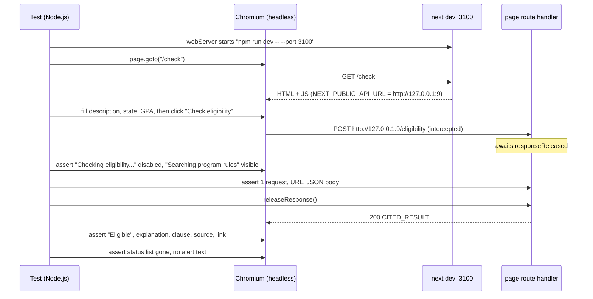

# 19c - End-to-end eligibility journey

## What

19c adds one browser test. Playwright opens a real Chromium browser, goes to
`/check`, types a student's situation into the form, clicks "Check
eligibility", watches the loading state, and then reads the cited verdict,
exactly as a student would. The backend is not running. Instead the test
answers the browser's `POST /eligibility` itself, from inside Playwright, with a
fixed, cited `EligibilityResult`.

It lives in `frontend/e2e/eligibility.spec.ts`, runs with `npm run test:e2e`,
takes about 7 seconds (most of it starting the dev server), and costs nothing.

With it, build-plan item 19 is complete. The project now has the full
**testing pyramid**:

| Layer | Feature | Count | What it proves |
|---|---|---|---|
| Unit | 19a | 120 | each backend function gives the right answer |
| Integration | 19b | 37 | the API and agent loop are wired correctly |
| End-to-end | 19c | 1 | a student can actually use `/check` in a browser |

## Why

19b proved the backend sends the right JSON for a cited verdict. That's only
half of the journey. The other half runs in the browser, and it has its own
ways to break:

- The form builds the request body. If a refactor sent `gpa` as the string
  `"3.6"`, the backend would reject it with a 422 and the student would see
  "Please check the highlighted field" for a perfectly valid GPA.
- `lib/eligibility.ts` checks every field of the response before trusting it.
  If the check and the backend model drifted apart (say, a new required
  field), every real verdict would be treated as malformed and the student
  would see "The server returned an unexpected response".
- The verdict card might stop rendering the quoted clause, which is the whole
  point of ScholarLens: an answer the student can audit, not a bare yes/no.
- The loading state might never appear, so a 20-second agent run looks like a
  frozen page.

None of these is visible to a backend test, and none would fail
`npm run build`, because they're all type-correct. The only thing that notices is
something that uses the page the way a person does. Before 19c, that was you,
clicking through `/check` by hand with the backend running and Gemini
billing each click.

One test is enough here on purpose. End-to-end tests are the slowest and most
fragile layer, so they should cover the one path that matters most, the
happy path of the main journey. The error states (429, 503, 422) are already
pinned at the API by 19b.

## Key concepts

### End-to-end tests

An **end-to-end (E2E) test** drives the product from the outside, through the
same interface a user has. For a web app that means a real browser: load a URL,
find elements on screen, type, click, and check what appears. It doesn't call
functions or components directly; it only knows what a user can see.

Analogy: unit tests inspect each ingredient, integration tests taste the sauce,
and an end-to-end test sits down in the dining room and eats the meal.

What makes a test "end to end" is a choice about where the ends are. Here the
ends are the browser's screen on one side and the network on the other. The
backend is replaced, so strictly this is a **frontend end-to-end** test. That
was a deliberate decision (see "Stubbing at the network layer" below).

### Playwright

**Playwright** is a browser automation library from Microsoft. It launches a
real browser engine (Chromium, Firefox, or WebKit), controls it, and gives
you an API to act on pages. `@playwright/test` is its test runner, the browser
world's equivalent of pytest: it finds `*.spec.ts` files, runs each `test(...)`,
and reports results.

Browsers are large, so they aren't in `node_modules`. `npx playwright install
chromium` downloads a Chromium build (about 150 MB) into a per-user cache
(`%LOCALAPPDATA%\ms-playwright` on Windows), shared by every project on the
machine. That's why it's a one-time setup step, not part of `npm install`.

### Headless browsers

By default Playwright runs Chromium **headless**, which means with no window. The
page is still fully rendered and JavaScript runs normally; nothing is drawn to
your screen. It's faster and works on machines with no display, like CI
servers. `npm run test:e2e -- --headed` opens a visible window so you can watch.

### Locators and why they use roles and labels

To act on an element, Playwright needs a **locator**: a description of how to
find it. There are two broad styles:

- **Implementation-based:** CSS selectors (`div.rounded-3xl > p`) or test IDs
  (`data-testid="verdict"`). These describe how the page is built.
- **User-facing:** "the text box labelled *GPA (optional)*", "the button named
  *Check eligibility*". These describe what a person perceives.

This test uses only the second style:

```ts
await page.getByLabel("GPA (optional)").fill("3.6");
await page.getByRole("button", { name: "Check eligibility" }).click();
```

`getByRole` finds elements by their **accessibility role**: what the
browser tells assistive technology (screen readers) an element is, such as
`button`, `link`, `heading`, `status`, or `alert`. `getByLabel` finds an input
through its `<label for="...">`.

Two benefits. The test survives restyling (swap Tailwind classes, restructure
divs, and it still passes) and fails only when something a user relies on
changes. And it quietly checks accessibility: if a field lost its label, a
screen-reader user couldn't identify it, and this test couldn't find it
either.

### Auto-waiting and web-first assertions

A browser is asynchronous. After a click, React re-renders a moment later,
and a network response arrives later still. Old-style browser tests were full
of `sleep(2000)` calls to cover that gap, which made them slow and
**flaky**: a test that passes or fails at random depending on timing.

Playwright's assertions **retry**. This one:

```ts
await expect(page.getByText("Eligible", { exact: true })).toBeVisible();
```

keeps checking the page until the text is visible, or gives up after 5
seconds. Actions like `click()` also wait until the element is visible,
enabled, and stable. So the test states *what* should become true and
Playwright handles *when*.

### Stubbing at the network layer

The browser code calls the backend with `fetch`. Playwright can intercept any
request the page makes, before it leaves the browser:

```ts
await page.route("**/eligibility", async (route) => {
  await route.fulfill({ status: 200, json: CITED_RESULT });
});
```

`page.route` takes a URL pattern (`**` matches anything, so this catches the
eligibility call whatever host it goes to), and the handler decides the
outcome: `fulfill` with a fake response, `abort`, or `continue` to the real
network. Here every eligibility call is fulfilled with a fixed result.

This is the browser-side twin of what 19a and 19b did in Python:

| Where | Tool | Replaces |
|---|---|---|
| 19a, Python | `httpx.MockTransport` | Tavily's HTTP API |
| 19b, Python | `FunctionModel`, `StubAgent` | Gemini, the agent |
| 19c, browser | `page.route` | the whole FastAPI backend |

Why not run the real backend? It would need ChromaDB running, the corpus
ingested, and a Gemini key, and every run would spend credits and give a
slightly different answer. A test that must pass reliably can't depend on a
model's wording. The trade-off is explicit: this test proves the frontend
honors the API contract, and 19b proves the backend does. Together they cover
the journey; neither alone does.

### Controlling time with a held promise

The loading state only exists while the request is in flight. With an
instant stub it could flash by too fast to check. The test takes control of
time instead: the route handler waits on a **promise** that only the test
can resolve.

A promise is JavaScript's "value that will arrive later": code can `await` it,
and it resumes when someone calls its `resolve` function. The test creates one
and keeps `resolve` for itself:

```ts
let releaseResponse: () => void = () => {};
const responseReleased = new Promise<void>((resolve) => {
  releaseResponse = resolve;
});

await page.route("**/eligibility", async (route) => {
  requests.push(route.request());
  await responseReleased;                       // the "network" hangs here...
  await route.fulfill({ status: 200, json: CITED_RESULT });
});

// ...while the test checks the loading state at leisure...
releaseResponse();                              // ...then lets the response through.
```

It's like a pause button on the network. The loading assertions run while the
request is guaranteed to be pending, with no guesswork about timing.

### The web server a test starts for itself

A browser test needs the app to be running. Playwright's `webServer` option
starts it before the tests and stops it after:

```ts
webServer: {
  command: "npm run dev -- --port 3100",
  url: "http://localhost:3100/check",   // wait until this answers before testing
  reuseExistingServer: false,
  env: { NEXT_PUBLIC_API_URL: "http://127.0.0.1:9" },
},
```

It uses port 3100 rather than 3000, and `reuseExistingServer: false`, so a dev
server you already have running is never mistaken for the test's.

### `NEXT_PUBLIC_` variables and a deliberately dead address

Next.js inlines any environment variable starting with `NEXT_PUBLIC_` into
the JavaScript it sends to the browser. That's how browser code knows the API
base URL. The test's server sets it to `http://127.0.0.1:9`. Port 9 is the old
"discard" port, and nothing listens there, so any request that reaches it
fails immediately with "connection refused".

This is a **fail-safe**. If a future test forgets to stub an endpoint, the
request can't quietly reach a backend you happen to have running on port 8000 and
spend Gemini credits. It fails loudly instead. It's the browser equivalent of
19b's `ALLOW_MODEL_REQUESTS = False`. The test also asserts that the request
really went to `http://127.0.0.1:9/eligibility`, proving the fail-safe is in
effect rather than trusting the config.

### Accessibility roles `status` and `alert`

Two ARIA roles matter in this journey:

- `role="status"` marks a **polite live region**: a screen reader announces
  changes when it's not busy. `/check` uses it for the agent activity steps
  ("Searching program rules").
- `role="alert"` marks an **assertive live region**: announced immediately.
  `/check` uses it for error messages.

The test uses both roles to check state: the status list is present while
loading and gone afterwards, and no alert with text is shown on success.

## Architecture



The request never leaves the browser. `127.0.0.1:9` is written into the
page's JavaScript but never contacted.

Files:

```
frontend/
  package.json              + "test:e2e": "playwright test", + @playwright/test
  playwright.config.ts      testDir e2e, chromium, webServer :3100, dead API URL
  e2e/
    eligibility.spec.ts     the one journey test
  .gitignore                + test-results/, playwright-report/, blob-report/, playwright/.cache/
```

## What we actually built

### Setup

`@playwright/test` ^1.63.0 went into `devDependencies` in
[`frontend/package.json`](../frontend/package.json), with the script
`"test:e2e": "playwright test"`. It's a dev dependency, so it never ships to
Vercel's production bundle.

[`frontend/playwright.config.ts`](../frontend/playwright.config.ts) makes a few
choices worth knowing:

- `forbidOnly: true`: `test.only(...)` is a debugging shortcut that runs one
  test and skips the rest. Left in by accident, the suite would "pass" while
  running almost nothing. This makes the run fail instead.
- `retries: 0`: a flaky test should be visible and fixed, not retried until it
  happens to pass.
- `trace: "retain-on-failure"`: when a test fails, Playwright keeps a **trace**,
  a zip recording every action, DOM snapshot, and network call. Open it with
  `npx playwright show-trace <file>` to step through the failure.
- One project, Chromium. Other engines are out of scope; the goal is the
  journey, not cross-browser coverage.

Playwright's output folders (`test-results/`, `playwright-report/`, and so on)
went into [`frontend/.gitignore`](../frontend/.gitignore).

### The test

[`frontend/e2e/eligibility.spec.ts`](../frontend/e2e/eligibility.spec.ts)
imports the real `EligibilityResult` type from `src/lib/eligibility.ts`, so
the stub's shape is type-checked against the frontend's own model. If that
type changed, `npm run build` would fail on the test file, because
`tsconfig.json` includes every `.ts` file.

It walks the journey in four phases.

**Fill and submit.** The description is typed with two spaces on each side,
the state and GPA are filled, and income and major are left blank.

**While the response is held.** The button text changed to
"Checking eligibility..." and it's disabled, so a student can't double-submit a
paid request. The `status` region shows "Searching program rules", the first
activity step. Only the first step is checked, because the steps advance on a
1.4-second timer and asserting later ones would tie the test to wall-clock
time.

**The request.** Exactly one request, a `POST`, to the dead address, with this
body:

```ts
expect(requests[0].postDataJSON()).toEqual({
  description: DESCRIPTION,   // trimmed: the two spaces on each side are gone
  state: "New Jersey",
  gpa: 3.6,                   // a number, not "3.6"
});
```

`toEqual` also proves `income` and `major` are absent, not `null` or `""`.
The form's contract is that blank optional fields are omitted, which matches
the backend's `EligibilityRequest` where they default to `None`.

**The verdict.** After `releaseResponse()`, the page shows the "Eligible" badge,
the explanation, the clause inside a `<blockquote>` wrapped in curly quotes,
"Source: Federal Pell Grant - Eligibility summary", and a "view source" link
whose `href` is the source URL. Finally, the activity list is gone, the button
is back to "Check eligibility" and enabled, and still only one request was
made, which confirms there were no silent retries. The frontend retries only
transport failures, never an answered request.

### Things that went sideways

**The phantom alert.** The first run got all the way to the verdict and then
failed on "no alert is shown": there was one `role="alert"` on the page. The
trace's page snapshot showed it was empty, right after the "Open Next.js Dev
Tools" button. It's Next.js's **route announcer**, an empty live region Next
adds to every page so a screen reader announces the new page title after a
client-side navigation. It isn't an error message. The fix narrowed the
assertion to alerts that contain text:

```ts
// Next.js adds an empty role="alert" route announcer to every page; only a message counts.
await expect(page.getByRole("alert").filter({ hasText: /\S/ })).toHaveCount(0);
```

`/\S/` is a regular expression that matches any non-whitespace character, so
an empty announcer doesn't count and a real error message does. The lesson:
"there is no element with role X" is a claim about the whole page, including
things the framework added.

**One dev server per folder.** The spec asked to check whether the test could
run while your own `npm run dev` was up on port 3000. It can't. With a dev
server on 3000, the test's server on 3100 exits immediately:

```
You can access the existing server at http://localhost:3000,
or run taskkill /PID 22240 /F to stop it and start a new one.
Error: Process from config.webServer was not able to start. Exit code: 1
```

Next.js 16 detects that a dev server is already running for this project
folder (it even names the PID) and refuses to start a second one, even on a
different port. The spec said to document this, not work around it, so
`AGENTS.md` and the frontend README say to stop `npm run dev` first. The
alternatives (a separate build directory, or `next build && next start` for
tests) were more machinery than one test justifies.

**The "slow filesystem" warning.** Every run prints `⚠ Slow filesystem
detected ... consider moving it to a local folder`. Next benchmarks the
`.next/dev` folder at startup, and on this drive (`F:`) the benchmark came in
slow. It's advice, not an error, and doesn't affect the test.

### How we know it works

From `frontend/`:

- `npm run test:e2e`: 1 passed (about 7 s), with no backend running
- `npm run lint`: clean
- `npm run build`: compiled successfully, including type-checking the config and
  test

The backend suite still passes (`pytest`: 157). No `/check` code changed.
Merged as PR #37.

## What's next

- **22 - Provider rate-limit handling** is the next unchecked item. It adds a
  new "busy, try again shortly" state to `/check` for Gemini quota errors.
  That's a natural second E2E test: `page.route` can return the new error code
  and a `Retry-After`, and the test checks the message. The backend half can
  be built test-first with 19b's `FunctionModel`, which can raise the exact
  provider error.
- **20 - Deploy.** Once the app runs on Vercel, the same spec could run
  against the deployed URL by pointing `baseURL` there. That would be a
  **smoke test** of production, though a stubbed backend would need
  rethinking, since the deployed frontend's API URL is baked in at build time.
- **21 - Production polish** includes an accessibility pass. The role- and
  label-based locators already act as a small accessibility check. Adding
  Playwright's `@axe-core/playwright` integration would turn that into a
  full automated audit of `/check`.
- **CI.** Every test layer now runs from one command per app. A CI workflow
  running `pytest`, `npm run lint`, `npm run build`, and `npm run test:e2e` on
  each pull request would make the gate automatic rather than manual.
