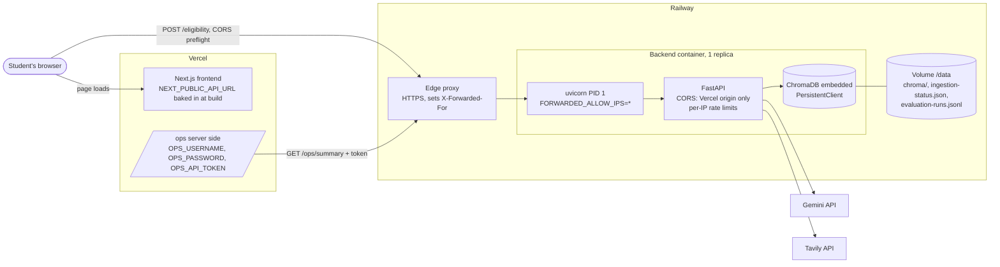

# 20a - Thin-path production deploy

## What

ScholarLens now runs on the public internet. The FastAPI backend runs as one
always-on container on **Railway**, and the Next.js frontend runs on
**Vercel**. Both are served over HTTPS:

- Frontend: `https://scholar-lens-kappa.vercel.app`
- Backend: `https://scholarlens-production-9caa.up.railway.app`

A student can open `/check`, describe their situation, and get a cited verdict
produced from the production corpus.

The code changes are small: one optional setting, a production container
command, a Railway config file, and a runbook. Most of the feature was
deciding *how* the pieces should run once they leave your laptop. Most of the
learning came from what broke on the way:

- an edge proxy that silently rejected every request
- a missing `https://` that turned every check into a 404
- a rate-limit test that "failed" because of how the limiter counts time

## Why

Everything before this ran on `localhost`. That proves the code works, but not
the product:

- **Nobody else can use it.** A portfolio project with no live link is a
  folder of code. A recruiter clicks a URL; they do not clone a repo and set up
  a Python venv.
- **Production breaks things that local never shows.** Tonight's evidence:
  - Railway's edge blocked all API traffic.
  - The client IP the rate limiter keys on would have been the proxy's IP
    instead of the visitor's.
  - A frontend env var without a scheme silently 404'd.
  
  None of these can happen on `localhost`. The build plan's working principle
  ("ship the thin end-to-end path early, *then* harden") exists for this reason:
  every later feature now improves something real and shareable.
- **Persistence stops being free.** Locally, the ChromaDB data sits in a Docker
  volume you never think about. On a hosting platform, a container's disk is
  thrown away on every deploy unless you ask otherwise. Without a volume, every
  redeploy would wipe the ingested corpus, and every check would fail until
  someone re-ingested.
- **The rate limits only mean something if they key on the real visitor.**
  Feature 18a added per-IP limits to bound Gemini spend. Behind a proxy, every
  request appears to come from the proxy. Without the proxy-trust setting in
  this feature, all visitors would share one bucket of 5 checks per minute.

The cost of not doing it: a project whose main claim ("productionized")
has never met production.

## Key concepts

### Local development vs production

"Production" is the copy of the app real users touch. It differs from local
dev in ways that matter:

- It runs unattended.
- It is reachable from the hostile internet.
- It restarts without asking you.
- It must keep its data across restarts.

Dev conveniences become liabilities there. A good example is auto-reload
(`uvicorn --reload`), which watches your files and restarts the server when
they change. On a laptop that is great. In a container it wastes CPU watching
files that never change, and it puts a second process in front of your app.

### Platform as a Service (PaaS)

A PaaS such as Railway, Render, or Vercel runs your code without you managing
servers. You point it at a Git repo and it builds and runs the app. It also
gives you a URL with HTTPS, restarts the app when it crashes, and shows logs.
Think of it as renting a furnished apartment instead of building a house: less
control, far less work.

**Vercel** specializes in frontends, especially Next.js; Vercel makes Next.js.
**Railway** runs any container, which suits our backend:

- It needs a *warm process*, one that stays running between requests.
- It needs a disk for ChromaDB.

Serverless platforms that start a fresh process per request would reload the
agent and the vector store on every check.

### Containers, images, and the Dockerfile

An **image** is a frozen snapshot of everything the app needs: OS libraries,
Python, our packages, our code. A **container** is a running instance of an
image, like a program launched from an installer. The **Dockerfile** is the
recipe that builds the image, step by step. Railway reads our
[`Dockerfile`](../backend/Dockerfile), builds the image, and runs it.

### PID 1 and signals

Every process in Linux has a process ID (PID). Inside a container, the first
process started gets **PID 1**, which makes it the "main" process. When the
platform wants to stop a container (during a redeploy, for example), it sends
PID 1 a **signal** called `SIGTERM`, which means "please shut down cleanly".
If PID 1 is a shell script that never forwards the signal, the app never
hears it. The platform waits, then kills it hard, and in-flight requests are
cut off.

That is why our start command uses `exec`:

```dockerfile
CMD ["sh", "-c", "exec uvicorn app.main:app --host 0.0.0.0 --port ${PORT:-8000}"]
```

- `sh -c "..."` runs a shell so `${PORT:-8000}` gets expanded. The JSON-array
  ("exec form") `CMD` does not expand variables by itself.
- `exec` makes the shell *replace itself* with uvicorn instead of starting
  uvicorn as a child. Uvicorn ends up as PID 1 and receives `SIGTERM`
  directly.

We confirmed this in the Docker smoke test: `/proc/1/cmdline` inside the
container was uvicorn itself.

### The platform's `PORT`

PaaS platforms decide which port your app should listen on and pass it in an
environment variable called `PORT`. Railway chose `8080` for us. Hardcoding
8000 would mean the platform's router sends traffic to a port nobody is
listening on. `${PORT:-8000}` means "use `PORT` if set, otherwise 8000", so the
same image works locally and on Railway.

### Ephemeral filesystems and persistent volumes

A container's own filesystem is **ephemeral**: rebuilt from the image on every
deploy, so anything written to it is lost. A **volume** is a disk that lives
outside the container and gets *mounted* (attached) at a path inside it, like
plugging in a USB drive. Data on the volume survives redeploys.

We mount Railway's volume at `/data`. ChromaDB, the ingestion status file, and
the evaluation runs file all go there. A tempting mistake would be to mount it
at `/app/data`, where the code expects data. But mounting a volume *hides*
whatever the image had at that path, and the image ships the scholarship
corpus in `/app/data/programs`. Mounting over it would make the corpus vanish.
So the volume gets its own path, and env vars point the app at it.

### Embedded vs client-server databases

There are two ways to run a database:

- **Client-server:** the database is its own process, often its own machine,
  and the app talks to it over the network. Locally, ChromaDB runs this way in
  its own Docker container, and the backend uses `chromadb.HttpClient`.
- **Embedded:** the database is a library *inside* the app's process, reading
  and writing files directly. SQLite is the classic example. Chroma's
  `PersistentClient` works this way: it stores data in a SQLite file plus index
  files under a directory.

For production we chose embedded. That gives one service and one volume, and
no second server to secure. Our Chroma server image has no authentication, so
running it as a separate service would mean carefully keeping it off the
public network. Embedded also costs half as much on a usage-billed platform.

The trade-off: an embedded store is meant for **one process**. Ingestion is a
separate command (`python -m app.ingestion`) that rebuilds the collection
while the API process is running. The API keeps a cached handle to the *old*
collection, so after ingesting you **restart the service**. Until then, a
check would fail into the controlled "retrieval unavailable" error rather than
crash.

### Reverse proxies, edges, and `X-Forwarded-For`

Requests do not reach our container directly. They hit Railway's **edge**
first: a fleet of proxy servers that terminate HTTPS and route to the right
container. A **reverse proxy** is a server that receives requests on behalf of
other servers and forwards them.

The catch: from our app's point of view, every request now comes from the
proxy. To preserve the original visitor's IP, proxies add an
**`X-Forwarded-For`** (XFF) header listing the client address. But anyone can
*send* an `X-Forwarded-For` header. If the app blindly trusts it, a visitor can
claim to be `1.2.3.4`, then `1.2.3.5`, and so on, getting a fresh rate-limit
bucket every request.

So trusting the header is a **trust-boundary decision**: only believe XFF when
it came from a proxy you trust, and know which entry the proxy controls.

Uvicorn handles this through an env var, `FORWARDED_ALLOW_IPS`:

- **Unset:** uvicorn trusts only `127.0.0.1`. Behind Railway, every visitor
  then looks like the proxy and everyone shares one bucket. That is wrong, but
  in the *safe* direction: stricter, not looser. This is called **failing
  safe**.
- **`*`:** trust every hop. Uvicorn then takes the *leftmost* XFF entry. That
  is only safe if the edge *replaces* any client-supplied XFF rather than
  appending to it. Railway staff state that it does, and we verified it live
  (below).

### Rate limiting with fixed windows

Feature 18a's limiter counts requests per **fixed window**: calendar-aligned
blocks such as 01:22:00-01:22:59, not a rolling "last 60 seconds". This
surprised us during the live test. Two requests 49 seconds apart got through
under a 1-per-minute limit, because they fell into *different* clock minutes.

A **sliding window** would have blocked the second one. Fixed windows are
simpler and cheaper; the cost is that a client can make up to 2x the limit in
a short burst across a boundary. For our purpose, bounding Gemini spend with a
daily cap behind it, that is an acceptable trade.

### CORS and origins

An **origin** is the scheme plus host plus port, for example
`https://scholar-lens-kappa.vercel.app`. Browsers enforce the
**same-origin policy**: a page from one origin may not read responses from
another origin unless that server says so. **CORS** (Cross-Origin Resource
Sharing) is how the server says so: it answers with
`Access-Control-Allow-Origin: <that origin>`.

Our frontend (Vercel) and backend (Railway) are different origins, so the
backend must allow exactly the Vercel origin
([`application.py`](../backend/app/application.py) passes
`settings.frontend_origin` to `CORSMiddleware`). For a `POST` with a JSON
body, the browser first sends a **preflight** request (`OPTIONS`) to ask
permission. We verified the Vercel origin gets an allow header, and a foreign
origin gets a 400 with none.

### Build-time vs runtime environment variables

Backend env vars are read when the server starts, which is **runtime**. Next.js
handles `NEXT_PUBLIC_*` variables differently: their values are **inlined**,
pasted as literal text into the JavaScript bundle at **build time**. The
browser cannot read Vercel's environment; it only gets the bundle. Two
consequences:

1. Changing `NEXT_PUBLIC_API_URL` does nothing until you **rebuild and
   redeploy**.
2. Anything `NEXT_PUBLIC_` is **public**: anyone can read it in DevTools. So
   only the API URL is public. `OPS_API_TOKEN` and the ops login have no prefix
   and stay server-side.

### Secrets in platform environment variables

API keys (`GOOGLE_API_KEY`, `TAVILY_API_KEY`) and tokens live only in
Railway's and Vercel's variable settings, never in the repo. The `.env.example`
files document *which* variables exist, with empty values. We grepped the
production bundle to confirm no `AIza…` (Google key prefix) or `tvly-…`
(Tavily) strings reached the browser.

### Health checks and restart policies

A **health check** is an endpoint the platform polls to ask "are you alive?".
Ours is `GET /health`, which returns `{"status":"healthy"}`. Railway waits for
it to answer 200 before routing traffic to a new deploy. If it never does, the
deploy fails and the old version keeps serving. That gives a zero-downtime
deploy for free. A **restart policy** says what to do if the process dies:
`ON_FAILURE` with up to 5 retries.

### Config as code

Instead of clicking settings into a dashboard, where nobody can review them
and they get lost when you recreate the project, **config as code** keeps them
in a file in the repo. [`backend/railway.toml`](../backend/railway.toml) holds
the build and deploy settings. One quirk worth remembering: Railway does not
look for this file relative to the service's root directory, so the service
settings must name the absolute path `/backend/railway.toml`.

### SSH keys (public-key authentication)

To run ingestion *inside* the deployed container we used `railway ssh`, which
needs an **SSH key pair**:

- The **private key** stays on your machine.
- The **public key** (`.pub`) is given to Railway.

Railway can then challenge your machine to prove it holds the matching private
key, without the private key ever leaving it. That's why you added `*.pub` to
`.gitignore`.

### Edge DDoS protection ("Under Attack Mode")

Platforms protect against floods of malicious traffic (DDoS, distributed
denial of service) at the edge. Railway's **Under Attack Mode** answers
non-browser traffic with a challenge or a block. A real browser can pass a
challenge; `curl`, scripts, and server-to-server calls cannot. With it on,
every request we sent got a plain-text `429 rate limited` from the edge. The
container never saw it, and its own `/health` was fine. That mode is meant for
an active attack, not always-on use.

## Architecture



Two flows to notice:

- **The browser calls Railway directly.** Vercel serves the page, but the
  student's browser makes the `/eligibility` request itself, which is why CORS
  matters and why the API URL must be public.
- **`/ops` goes server-to-server.** Vercel's server calls the backend with the
  secret token, so the browser never sees it. Under Attack Mode broke exactly
  this kind of non-browser call.

Deploy order matters, because each side needs the other's URL:

```text
1. Railway backend up    -> get its https:// domain
2. Ingest inside it      -> restart service
3. Vercel frontend       -> NEXT_PUBLIC_API_URL = Railway domain (build time)
4. Back to Railway       -> FRONTEND_ORIGIN = Vercel domain -> deploy
```

## What we actually built

### One setting, two kinds of Chroma

[`config.py`](../backend/app/config.py) gained one optional field:

```python
# Set in production to run Chroma embedded on the service's volume instead of as a server.
chroma_persist_path: str | None = None
```

[`retrieval/client.py`](../backend/app/retrieval/client.py) branches on it.
This is the *only* place the app creates a Chroma client, and both retrieval
and ingestion go through it, so one `if` covers everything:

```python
def get_chroma_client(settings: Settings) -> ClientAPI:
    if settings.chroma_persist_path:
        # Embedded mode would otherwise send Chroma's product telemetry from the API process.
        return chromadb.PersistentClient(
            path=settings.chroma_persist_path,
            settings=chromadb.config.Settings(anonymized_telemetry=False),
        )
    return chromadb.HttpClient(host=settings.chroma_host, port=settings.chroma_port)
```

With the setting unset, local dev and Docker Compose behave exactly as before.

The telemetry flag is easy to miss. In embedded mode, Chroma's library would
send anonymous usage pings to its makers from *our* API process: an outbound
call we never asked for. The independent review later noted no test pins this
flag (**F-23**, P3), so deleting it would go unnoticed.

**Test-first:** two tests were written and seen failing before the code
existed:

- [`test_config.py`](../backend/app/test_config.py) checks the default is
  `None`.
- [`retrieval/test_client.py`](../backend/app/retrieval/test_client.py) writes
  a collection through one client, then reopens it from disk through a fresh
  one.

The second test needed one subtlety. Chroma caches one in-memory "system" per
path per process, so a second client would silently reuse the first one's
memory and prove nothing about the disk. The test clears that cache first:

```python
# Chroma shares one in-memory system per path within a process; drop it so the
# second client really reopens the store from disk.
SharedSystemClient.clear_system_cache()
```

### The production container

[`Dockerfile`](../backend/Dockerfile) changes:

- **No `--reload`, platform port, `exec`:** see the concepts above.
- **The corpus ships in the image**, but only the two folders production needs:
  ```dockerfile
  COPY data/programs data/programs
  COPY data/evaluation data/evaluation
  ```
  `data/` also holds local `ingestion-status.json` and `evaluation-runs.jsonl`
  files, which must not leak into production as if they were real production
  runs.
- **No hardcoded proxy trust.** `FORWARDED_ALLOW_IPS` stays an env var, so
  local runs keep the safe default.

Dev keeps hot reload by overriding the command in
[`docker-compose.yml`](../infra/docker-compose.yml):

```yaml
command: ["uvicorn", "app.main:app", "--host", "0.0.0.0", "--port", "8000", "--reload"]
```

### Railway config and the runbook

[`railway.toml`](../backend/railway.toml) holds the Dockerfile builder, the
`/health` check with a 60s timeout, and restart on failure. An earlier draft
also set `dockerfilePath`. The spec reviewer pointed out we had not verified
whether Railway resolves that path from the repo root or the service root, so
it was removed in favour of Railway's default lookup in the root directory.

The root [`README.md`](../README.md) "Deploy" section is the runbook, and
[`backend/.env.example`](../backend/.env.example) and
[`frontend/.env.example`](../frontend/.env.example) document every variable the
deployed services read. PR #40 added what the first deploy taught us:

- Deploy from `main`.
- Volumes are created on the project canvas, not in service settings.
- Keep Under Attack Mode off.
- `railway ssh` needs a registered key.
- `NEXT_PUBLIC_API_URL` must include `https://`.

### What broke during the deploy, and why

These are the parts the code cannot tell you:

1. **The edge 429.** After the first redeploy, every request returned
   `429 rate limited` as plain text, with headers `server: railway-hikari` and
   `x-railway-edge: sin1`. It was not our app: our 429s are JSON, and the app
   logs showed no requests arriving. We narrowed it down step by step:
   - Calling the public URL *from inside the container* also got 429, so it
     wasn't our IP.
   - Calling `localhost:8080` inside the container returned 200, so the app was
     fine.
   - A brand-new regenerated domain was blocked too, so it wasn't the domain.
   - Railway's status page was clean.
   
   A Railway community thread with the identical symptom pointed to Under
   Attack Mode. Turning it off fixed it. Lesson: **locate the layer before
   debugging the code.** Response headers (`server:`) and app logs tell you
   which layer answered.
2. **The 404.** `NEXT_PUBLIC_API_URL` was set to
   `scholarlens-production-9caa.up.railway.app` without `https://`. The bundle
   ended up with
   `fetch("scholarlens-production-9caa.up.railway.app/eligibility")`. A URL
   with no scheme is a **relative path**, so the browser requested
   `https://scholar-lens-kappa.vercel.app/scholarlens-production-9caa.up.railway.app/eligibility`,
   which is a Vercel 404. Found by grepping the deployed JavaScript for
   `/eligibility`. A small `/fix` to make the frontend build reject a
   scheme-less URL is a good follow-up.
3. **The rate-limit test that looked wrong.** See *fixed windows* above. Before
   calling it a bug, we read
   [`rate_limit.py`](../backend/app/api/rate_limit.py) and checked the
   timestamps against minute boundaries.
4. **The Vercel font build error.** A `next/font/google` "Module not found"
   during the first Vercel build. A clean clone of `main` built fine locally,
   so the code was not at fault. The usual cause is a failed Google Fonts
   download in the build environment.
5. **Branch merged before `/complete`.** PR #39 was merged on GitHub before
   the workflow's completion step. The independent-review contract requires
   `main` as the review base, so the enforceable range would have held only
   the README commit. We ran an **out-of-contract review** of the full range
   instead, with a fresh subagent and all four lenses. It passed, and the
   exception is recorded in the archive. Lesson: let `/complete` drive the
   merge, or the review gate loses its footing.

### The checks that proved it

Local:

- `pytest`: 198 passed, including the 2 new tests.
- `ruff`, `npm run lint`, `npm run build`, plus a clean-clone build.
- Docker smoke test:
  - `PORT=9000` served `/health`.
  - uvicorn was PID 1 with no reloader.
  - only the two data folders shipped.
  - the embedded store survived a container restart.

Production (recorded in
[`../blueprint/history/features/20a-thin-path-production-deploy.md`](../blueprint/history/features/20a-thin-path-production-deploy.md)):

- `/health` 200 over HTTPS.
- Ingestion: 10 documents, 23 chunks, written to `/data`, and still there after
  a redeploy.
- With the limit at 1/min:
  - A request with a **forged** `X-Forwarded-For: 1.2.3.4` still got `429`, so
    spoofing doesn't help.
  - A request from Railway's own IP got 200 *in the same clock minute* that
    our IP had already used, so the limit keys on the real client.
- CORS: the Vercel origin is allowed; a foreign origin gets 400.
- Headless Chromium on Vercel's `/check` got a cited verdict (NJ TAG, source
  `hesaa.org`). It contacted only the two origins, with no console errors, and
  no keys appeared in the bundle.
- `/ops`: 401 without login, and the summary renders after login, showing the
  production ingestion run.

## What's next

- **20b - production telemetry to Grafana Cloud.** Production currently runs
  with `OTEL_EXPORTER_OTLP_ENDPOINT` unset, so tracing and metrics are off. The
  Grafana dashboards (16) and `/ops` trends (17) see nothing from the live
  site. Grafana Cloud accepts OTLP over HTTP with auth headers, while our
  exporter speaks gRPC to a local collector. Logs need a route out too.
- **21 - production polish.** The UX/accessibility pass, mobile checks, a
  rerun of the evaluation suite *against production*, the README operations
  note, and dashboard screenshots, which need 20b first.
- **Small fixes:**
  - F-23: assert the Chroma telemetry flag in the test.
  - Validate `NEXT_PUBLIC_API_URL` at build time.
  - Older P3s such as F-04: there is no request-body size cap. 18a deferred it
    to the deploy, and Railway's edge doesn't obviously provide one.
- **Keep the link alive.** The Railway Trial ends around 2026-10-31. After
  that the backend stops unless the account moves to the Hobby plan.
