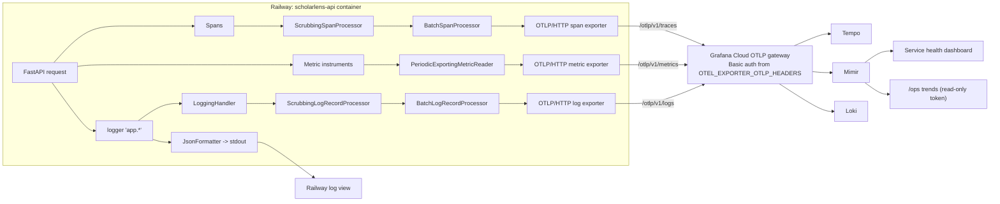

# 20b - Production telemetry to Grafana Cloud

## What

Feature 20b makes the deployed backend on Railway report on itself to Grafana
Cloud. Every production request now leaves three kinds of evidence behind: a
**trace** (a timed tree of what the request did, down to each LLM call and
retrieval step), **metrics** (running counters and timing histograms), and
**logs** (one structured line per request). The backend sends all three
straight to Grafana Cloud's OTLP gateway over HTTPS, with no extra service in
between. The scrubbing rules built in features 13, 14 and 18b apply to every
signal, so nothing a student types, no provider payload, and no exception
message ever leaves the process. The dashboards from feature 16 and the `/ops`
trend charts from feature 17, which until now only ever saw local test
traffic, now show real production traffic.

## Why

Features 13 to 17 built a full observability stack: correlation IDs, spans,
metrics, dashboards, an ops page. But all of it only worked on a laptop, through
a Docker Compose collector. Feature 20a deployed the app to Railway with
telemetry switched **off** (`OTEL_EXPORTER_OTLP_ENDPOINT` unset), because there
was nowhere for it to go yet.

That left production as a black box. Without 20b:

- When a real user says "the check was slow" or "it failed", the only evidence
  is Railway's raw stdout, which you can scroll but not query, graph, or join
  to a trace.
- You cannot tell whether the agent's latency comes from Gemini, from the
  ChromaDB embed call, or from the agent looping through extra tool calls. The
  trace answers that in one glance.
- `/ops` says "trends not configured" in production, so the page meant for
  watching the live service shows nothing.
- Features 21c (tuned dashboards and alerts) and 21d (final eval rerun and
  screenshots) both need live production data to exist first.

And there is a second, quieter reason. A telemetry pipeline is also a data
pipeline to a third party. Turning it on without carrying the scrubbing rules
across would have quietly shipped student descriptions to Grafana's servers.
20b's job was to switch production telemetry on **and** prove nothing private
leaks through it.

## Key concepts

### Telemetry and its three signals

**Telemetry** is data a running program emits about itself so you can see what
it is doing from the outside. Think of the instruments in a car: the
speedometer, the fuel gauge, the warning lights. You do not open the engine to
know you are low on fuel.

Modern telemetry comes in three **signals**:

- **Traces**: the story of one request. A trace is a tree of **spans**; each
  span is one timed operation ("call Gemini", "query ChromaDB") with a start,
  a duration, a parent, and some attributes. Like a receipt that itemises
  every step of one transaction with its time.
- **Metrics**: numbers aggregated over many requests. A **counter** only goes
  up ("agent runs so far: 42"); a **histogram** buckets durations ("how many
  runs took under 1 s, under 5 s, under 10 s"). Like a car's odometer and trip
  computer: they do not remember individual journeys, only totals.
- **Logs**: timestamped text lines with structured fields, one per event. Like
  a ship's logbook.

Each answers a different question. Metrics say *something is wrong* (latency
went up). Traces say *where* (it is the second LLM call). Logs say *what
happened around it* (which request, which status code).

### OpenTelemetry and OTLP

**OpenTelemetry (OTel)** is a vendor-neutral standard and set of libraries for
producing those three signals. The app talks to the OTel SDK; the SDK talks to
whatever backend you choose. Swapping Grafana for another vendor would not
change the app's instrumentation code.

**OTLP (OpenTelemetry Protocol)** is the wire format the SDK uses to ship
signals. Like a standard shipping container: any port that handles containers
can take it, whatever is inside.

OTLP runs over two transports:

- **gRPC**: a binary RPC protocol over HTTP/2, conventionally on port 4317.
- **HTTP/protobuf**: plain HTTP `POST` requests carrying protobuf bodies,
  conventionally on port 4318, with one URL path per signal: `/v1/traces`,
  `/v1/metrics`, `/v1/logs`.

Before 20b the backend used gRPC to the local collector. Grafana Cloud's
gateway takes OTLP over HTTP, so 20b switched every exporter to HTTP/protobuf.

### Collectors, gateways, and why production has neither collector nor agent

An **OpenTelemetry Collector** is a separate process that receives telemetry,
can transform or filter it, and forwards it somewhere. Locally the project runs
one in Docker Compose: it prints spans to its own log and serves metrics on a
Prometheus endpoint.

An **OTLP gateway** is a vendor's public HTTPS endpoint that accepts OTLP
directly. Grafana Cloud runs one per stack, at a URL like
`https://otlp-gateway-prod-<region>.grafana.net/otlp`.

The spec chose **direct export**: the backend sends to the gateway itself, and
production has no collector. The reasons were cost and simplicity. A collector
would be a second Railway service to pay for, keep private, and keep alive, for
traffic that is a few requests a day. The trade-off is that any filtering has
to happen inside the app, which is exactly where the scrubbing processors live
anyway.

### Base URL vs signal URL

A **base URL** is the shared prefix; a **signal URL** is the base plus the
signal path. The setting `OTEL_EXPORTER_OTLP_ENDPOINT` now holds the base
(`https://…/otlp`), and the code appends `/v1/traces`, `/v1/metrics`, or
`/v1/logs`. Getting the join wrong in either direction (`…/otlp//v1/logs` or
`…/otlpv1/logs`) gives a 404, so the code strips any trailing slash and adds
exactly one.

### HTTP Basic auth, base64, and URL encoding

The gateway has to know who is sending. Grafana Cloud uses **HTTP Basic
authentication**: the client sends a header

```
Authorization: Basic <base64 of "username:password">
```

Here the username is the stack's numeric **instance ID** and the password is an
access token that starts with `glc_`.

**Base64** is not encryption. It is a way to write arbitrary bytes using only
64 safe characters (letters, digits, `+`, `/`), so the value can travel inside
an HTTP header. Anyone can decode it, which is why the header is a secret: it
*is* the token, just reversibly rewritten.

The OTel spec reads extra headers from the `OTEL_EXPORTER_OTLP_HEADERS`
variable as `key=value` pairs, with values **URL-encoded**. URL encoding writes
awkward characters as `%` plus a hex code; a space becomes `%20`. So the
production value is:

```
Authorization=Basic%20<base64 of instanceID:token>
```

The SDK decodes `%20` back into a space before sending.

### Native SDK environment variables

The OTel SDKs read a family of standard `OTEL_*` variables on their own:
`OTEL_EXPORTER_OTLP_HEADERS`, `OTEL_RESOURCE_ATTRIBUTES`,
`OTEL_METRIC_EXPORT_INTERVAL`, and others. 20b leans on that instead of adding
new app settings, the same pattern 20a used for `FORWARDED_ALLOW_IPS` with
uvicorn. Fewer settings in `config.py` means fewer places a secret can be read,
copied, or accidentally logged.

### Resources and resource attributes

A **resource** describes *who* is emitting the telemetry: service name,
version, environment. It is stamped on every span, metric, and log record,
like the return address on every envelope.

The backend's resource has `service.name=scholarlens-api`. Grafana Cloud
derives the Prometheus `job` label from that name, which is why every
dashboard and `/ops` query filters on `job="scholarlens-api"`. Renaming the
service would silently empty every chart. The spec says plainly that the
resource must stay as it is.

Setting `OTEL_RESOURCE_ATTRIBUTES=deployment.environment=production` on Railway
adds one more attribute. Prometheus turns the dots into underscores, so
production series carry `deployment_environment="production"`. That lets 21c
split production traffic from local test runs that use the same `job`.

### Exporters, processors, and batching

Inside the SDK each signal flows through a small pipeline:

```
your code -> processor(s) -> exporter -> network
```

- An **exporter** turns records into OTLP and sends them.
- A **processor** sits in front of the exporter. It can rewrite records, as
  the scrubbing processors do, or buffer them.
- A **batch processor** queues records in memory and a background thread
  sends them in batches every few seconds.

Batching is why telemetry never slows a request. The request's thread only
drops a record in a queue and moves on. If Grafana is slow or down, the
background thread waits (up to `OTEL_EXPORT_TIMEOUT_SECONDS`) and logs a
warning; the student's check is unaffected.

Metrics work slightly differently: a **periodic reader** collects the current
counter values every `OTEL_METRIC_EXPORT_INTERVAL` milliseconds (60 s by
default) and exports them. That is why metric export errors show up in the
logs even with no traffic, while trace and log errors only appear once a
request arrives.

### Python's logger tree, handlers, and propagation

Python loggers form a tree by dotted name: `app.access` is a child of `app`,
which is a child of the **root** logger. A **handler** attached to a logger
decides where its records go (stdout, a file, OTel). Records **propagate** up
the tree, so a handler on `app` sees everything logged by `app.access`,
`app.agent`, and so on.

That tree is a scoping tool. Libraries log under their own names (`httpx`,
`chromadb`, `opentelemetry`), and those loggers can print URLs, request
bodies, or provider responses. By attaching the OTel handler to `app` and
**not** root, only the project's own, already-reviewed log calls get
exported.

### The OTel logging bridge

OTel does not replace Python's `logging`; it bridges it. A `LoggingHandler`
is an ordinary handler that turns each Python `LogRecord` into an OTel log
record and passes it to a `LoggerProvider`.

The catch: by default the handler copies **every** non-standard attribute on
the record, and for exceptions it adds `exception.message` and
`exception.stacktrace`. Exception messages are a classic leak path. A
`ValueError` raised while parsing a student's description can include the
description. So the handler's defaults are exactly what must be stripped.

### Scrubbing by allowlist

There are two ways to filter: a **denylist** (remove the fields you know are
bad) or an **allowlist** (keep only the fields you know are good). An
allowlist fails safe. A new field nobody thought about is dropped by default,
instead of leaking by default.

Feature 13 already had an allowlist for stdout logs in `logging.py`. 20b made
it a public constant and reused it, so stdout and OTLP enforce **one** policy.
Two copies of a security rule tend to drift; one copy cannot.

### Trace and log correlation

Each exported log record carries the **trace ID** and **span ID** of whatever
span was active when it was logged. The OTel handler adds them automatically.
In Grafana that becomes a button: from a trace, "Logs for this trace"; from a
log line, a link to its trace. The project's own `correlation_id` (feature 13)
rides along too, so one ID ties together the browser's error message, the
stdout line, the Loki line, and the trace.

### Grafana Cloud's storage backends

Grafana Cloud stores each signal in a different database, all queried through
Grafana:

| Signal | Backend | Query language |
|---|---|---|
| Traces | Tempo | TraceQL |
| Metrics | Mimir (Prometheus-compatible) | PromQL |
| Logs | Loki | LogQL |

Each one shows up in Grafana as a **data source**. A stack also has some
built-in data sources, such as one for Grafana's own alert history, which look
similar in the dropdown. During verification a Loki query first ran against
`…-alert-state-history` instead of `…-logs` and returned "No logs found",
which proved nothing. An empty search only means something once you know the
same data source *does* return the lines you expect.

### Why a counter's first request is invisible to `rate()`

Prometheus counters are cumulative, so charts show `rate(counter[5m])`: how
fast the counter grew per second over the last 5 minutes. `rate()` needs at
least two samples to see growth.

A brand new series is born already at 1 (the first request), with no earlier
sample at 0. So `rate()` sees no increase, and `/ops` showed a request rate of
0 after the first check. From the second request on, the growth is visible.
This is normal Prometheus behaviour, not a bug.

### A lone point on a line chart

A separate effect hit `/ops`'s latency and 5xx charts. With 5-minute steps and
all test requests inside one step, only one step had a latency value; the
steps on either side were `0 / 0`, which is "no value". A line chart with
`dot={false}` draws lines *between* points, and a lone point has no neighbour,
so nothing is drawn. The data was there: the Grafana dashboard ran the same
queries and showed a 5.30 s mean. This is logged as a `/fix` candidate for
`TrendChart`, not a telemetry problem.

## Architecture



Two sets of Grafana credentials are involved, and mixing them up is an easy
mistake:

```
WRITE (push)   OTEL_EXPORTER_OTLP_HEADERS   instance ID + glc_ token with write scopes
               -> used by the exporters, sent to the OTLP gateway

READ  (query)  GRAFANA_PROMETHEUS_URL/USER/TOKEN   Prometheus user + metrics:read token
               -> used by /ops summary, queries Mimir's /api/prom
```

Locally the shape is the same, except the backend sends to the Compose
collector at `http://otel-collector:4318`, which prints traces and logs, serves
metrics on `localhost:8889/metrics`, and, with the opt-in Grafana override,
forwards all three signals to Grafana Cloud as well.

## What we actually built

### One helper for signal URLs

[`backend/app/telemetry.py`](../backend/app/telemetry.py) gained a tiny
function that is easy to get wrong inline:

```python
def otlp_signal_url(base: str, signal: str) -> str:
    """The OTLP/HTTP URL for one signal, under the configured base endpoint."""
    return f"{base.rstrip('/')}/v1/{signal}"
```

The tests pin both a collector base and a Grafana base with a path (`/otlp`),
each with and without a trailing slash.

### HTTP exporters with the existing timeout

`configure_telemetry` keeps its early return, so an unset endpoint still means
"all telemetry off". The gRPC imports became their `proto.http` equivalents,
and every exporter gets its signal URL and the existing
`otel_export_timeout_seconds`:

```python
OTLPSpanExporter(
    endpoint=otlp_signal_url(base, "traces"),
    timeout=settings.otel_export_timeout_seconds,
)
```

Note what is **not** passed: headers. The spec asked to confirm that an
exporter built with an explicit `endpoint=` still reads
`OTEL_EXPORTER_OTLP_HEADERS` from the environment. It does; the independent
reviewer re-checked it against the pinned SDK 1.45.0 (each exporter resolved
`authorization: Basic …` from the env, URL-decoded). So the secret never
passes through `Settings` at all.

### The scrubbing log processor

[`backend/app/logging.py`](../backend/app/logging.py) renamed `_ALLOWED_EXTRAS`
to the public `ALLOWED_EXTRAS`, with a comment saying it now governs both
paths. `telemetry.py` builds on it:

```python
_LOG_ATTRIBUTES = ALLOWED_EXTRAS | {"exception.type"}

class ScrubbingLogRecordProcessor(LogRecordProcessor):
    def on_emit(self, log_record: ReadWriteLogRecord) -> None:
        record = log_record.log_record
        original = record.attributes or {}
        attributes = {
            k: v for k, v in original.items() if k in _LOG_ATTRIBUTES or k.startswith("code.")
        }
        if (correlation_id := get_correlation_id()) is not None:
            attributes.setdefault("correlation_id", correlation_id)
        ...
        self._inner.on_emit(log_record)
```

What survives: the message body, allowlisted extras, `code.*` (file, function,
line), `exception.type`, and the correlation ID. What is dropped:
`exception.message`, `exception.stacktrace`, and any extra not on the list.

The correlation ID is read from a `ContextVar`. That works because `on_emit`
runs synchronously inside the `logger.info(...)` call, while the request's
context is still current. The batch thread only sees the already-scrubbed
record later.

It is wired as `LoggingHandler -> ScrubbingLogRecordProcessor ->
BatchLogRecordProcessor -> OTLPLogExporter`, and the handler goes on
`logging.getLogger("app")` only. The comment there records both reasons:
library loggers can log URLs and payloads, and OTel's own export warnings must
not loop back into the exporter.

The `exception.type` decision mirrors feature 18b's span rule: a type name like
`ValueError` is useful for grouping errors and cannot carry user text; the
message can.

### Dependencies

[`backend/pyproject.toml`](../backend/pyproject.toml) swapped
`opentelemetry-exporter-otlp-proto-grpc` for `-proto-http`. In
[`backend/requirements.txt`](../backend/requirements.txt) only the two new pins
were added (`opentelemetry-exporter-otlp-proto-http==1.45.0` and its
`opentelemetry-exporter-http-transport==0.66b0`), instead of a full
re-resolve that would have upgraded unrelated packages. The gRPC exporter
stays in the lock because chromadb itself depends on it.

### Local stack

- [`infra/docker-compose.yml`](../infra/docker-compose.yml) points the backend
  at `http://otel-collector:4318`, the collector's HTTP receiver, which was
  already open.
- [`infra/otel-collector-grafana.yaml`](../infra/otel-collector-grafana.yaml)
  gained a `logs` pipeline (`debug` plus `otlp_http/grafana`), so the local
  opt-in sends the same three signals as production.
- [`backend/.env.example`](../backend/.env.example) documents the HTTP base
  URL, warns that an old `:4317` value no longer works, and describes
  `OTEL_EXPORTER_OTLP_HEADERS` without a value.

### The runbook

The root [`README.md`](../README.md) "Deploy" section gained a "Production
telemetry (Grafana Cloud)" block: where to find the endpoint, a one-line
Python command that builds the header from the instance ID and a token read
with `getpass` (so the token is never echoed or saved in shell history), the
environment attribute, the optional export interval, and the `/ops` read
credentials.

### What broke during the live rollout, and why

The code was right the first time; the configuration took three attempts.
Each is a good lesson.

1. **"Where is the instance ID?"** Grafana's OpenTelemetry page labels it
   inconsistently ("Instance ID" on some layouts, "Username" on others). The
   page can also show a ready-made `OTEL_EXPORTER_OTLP_HEADERS` value after you
   generate a token, which skips the manual step entirely. The Prometheus,
   Loki, and Tempo "User" numbers look similar but are per-database IDs the
   gateway rejects.

2. **`Failed to export metrics batch code: 401, reason: Unauthorized`.** A 401
   (rather than a 404 or connection error) shows the URL was right and only
   the credentials were wrong. Decoding the header showed it was **base64
   encoded twice**: the "token" part decoded to another base64 string, which
   decoded to `1843311:glc_…`. An already-built header had gone into the
   helper's token prompt, so the gateway saw `instanceID:<base64 of
   instanceID:token>`. A quick check is to decode the header and confirm the
   token half starts with `glc_`. The lesson generalises: when an auth
   value is "almost right", decode it one layer at a time.

3. **A token pasted into chat.** The full header was pasted while debugging.
   Because base64 is reversible, that is the same as pasting the token, so it
   was revoked and replaced. The safe way to share auth state is to share only
   what identifies it (the instance ID, the token's `glc_` prefix and length),
   never the value.

Only metrics errors appeared at first because metrics export on a timer, even
with no traffic; traces and logs only export when a request comes in, so their
credentials are tested by the first real request.

### The checks that proved it

Automated, on `main`:

- `pytest`: 205 passed, including the new telemetry tests: URL joins (4
  cases), allowlisted extras kept and unknown ones dropped, an exception
  exported with `exception.type` but no message or stacktrace, and the
  correlation ID attached inside a request context.
- `ruff check .`, `npm run lint`, `npm run build`: clean.

Live, on production (2026-10-05), using one check whose description contained
the marker `zebra-marker-7731`:

- **Tempo**: the `POST /eligibility` trace (7.89 s, 9 spans) showed
  `scholarlens.agent.run`, `invoke_agent`, two `chat gemini-3.8-flash` spans,
  and `retrieve_program_rules -> retrieval.retrieve -> embed + query`.
- **Mimir**: `scholarlens_agent_duration_seconds_count{job="scholarlens-api"}`
  returned a series with `deployment_environment="production"`.
- **Loki**: 14 `request completed` lines from `app.access`, each with
  `correlation_id`, method, path, status, duration, and `trace_id`.
- **Scrubbing**: none of the Loki lines contained the marker or any profile
  text, and filtering the trace on `zebra` highlighted no span.
- **Dashboards**: the [service-health dashboard](../infra/grafana/dashboards/service-health.json)
  showed request rate by route and a 5.30 s `/eligibility` mean latency.
- **`/ops`**: trends rendered and showed the traffic.
- **No damage**: no export errors in Railway, `/health` healthy, checks from
  Vercel returned 200.

An independent reviewer with no build context also passed the change (no P0 or
P1). It confirmed on the pinned SDK that a logged exception whose message and
unknown extra held the marker exported neither, that the `app` logger had the
OTel handler while root had none, and that the HTTP client never logs headers.
It raised three P3s, now in the findings ledger:

- **F-24**: no test exercises `configure_telemetry`'s wiring, so attaching the
  handler to root or dropping the scrubber wrap would still pass the tests.
- **F-25**: the README says traceback frames are not exported, but the
  allowlisted `stack` extra (set in
  [`backend/app/api/errors.py`](../backend/app/api/errors.py) for unhandled
  errors) does export them. Frames carry no message, so the policy is fine;
  the sentence is wrong.
- **F-26**: two comments still describe the pre-20b setup.

### A process note: the early merge

PR #41 was merged on GitHub before `/complete`, and `main` then gained 21a and
21b. That meant `main` could no longer serve as the review base, so the
independent review ran "out of contract" on the branch's own range
(`63179f2..9e30e58`), as 20a's did. Nothing was lost, but holding PRs until
`/complete` keeps the review inside the workflow's normal guarantees.

## What's next

- **21c, tuned dashboards and alerts**: now that production data exists,
  dashboards can filter on `deployment_environment` to split production from
  local, the 4xx panel can stop counting `/favicon.ico` 404s (they currently
  push the error ratio to 100% at low traffic), and alerts can watch the
  agent's error and latency.
- **21d, final eval rerun and screenshots**: run the evaluation suite against
  the deployed service and capture dashboard screenshots now that they show
  real traffic.
- **Small `/fix` candidates**: let `/ops`'s `TrendChart`
  ([`TrendChart.tsx`](../frontend/src/components/ops/TrendChart.tsx)) show a
  lone data point; close F-24 to F-26; correct `backend/README.md`'s outdated
  "chromadb only as an HTTP client" note from 20a.
