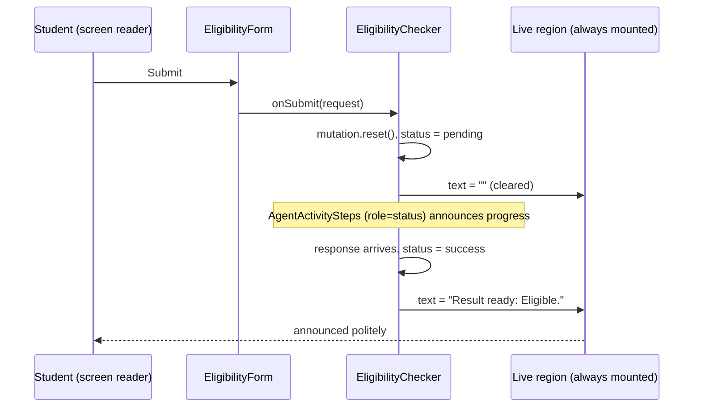

# 21a - UX and accessibility pass

## What

This was a sweep over the two public pages, the landing page `/` and the
eligibility checker `/check`. The goal was to make them work for people who
don't use a mouse, can't see the screen, have asked their device to calm down
animations, or are on a small phone. Nothing about *what* ScholarLens answers
changed. The changes are about *how* a person reaches the answer and notices it:

- every focusable control gets a clearly visible focus ring
- the pages gain a `<main>` landmark and a heading outline that doesn't skip
  levels
- a failed submit puts the cursor in the field that needs fixing
- a finished check is announced out loud to screen-reader users
- the loading spinner stops spinning for people who prefer reduced motion
- long URLs and long words in a cited rule no longer push the page sideways on
  a phone

It shipped as PR #42 (`c75ddb5`), with three new Playwright tests that pin the
behavior down.

## Why

ScholarLens's whole pitch is that the answer is *auditable*: you can see the
exact rule behind your result. That pitch is empty for anyone who can't
operate the form or can't tell that a result arrived. Before this feature,
several such people existed.

1. **Keyboard users couldn't see where they were.** The focus ring was mint
   green (`#6ece9d`) on a cream background (`#f8f5ed`). That's a contrast
   ratio of about **1.76:1**. Inputs drew it at 50% opacity, which drops to
   about **1.32:1**, practically invisible. Someone tabbing through the form
   couldn't tell which field they were typing into.
2. **Screen-reader users never heard the verdict.** The "Searching program
   rules..." activity list announced its progress. But when the answer came
   back, that list was removed and the verdict card appeared silently. The
   user had to guess that something had happened and go looking.
3. **Validation failures stranded people.** Press "Check eligibility" with an
   invalid GPA and the error text appeared, but focus stayed on the button. A
   screen-reader user heard nothing useful, and a keyboard user had to tab
   backwards to hunt for the problem.
4. **Phones could break the layout.** A source URL that isn't a safe link is
   shown as plain text, for the security reason recorded in finding F-13. A
   long one, or a long unbroken token in a cited clause, made the verdict card
   wider than a 375px screen. The whole page then scrolled sideways.
5. **The page outline was wrong.** Screen readers let people jump between
   headings and landmarks the way sighted people skim. The landing page went
   from `h1` straight to `h3`, "How it works" wasn't a heading at all, and
   neither page marked its main content.

Fixing these after launch is part of the plan's "production polish" phase.
Leaving them would mean shipping a public tool that quietly excludes some of
the students it's for, and for a portfolio piece, an accessibility audit is
one of the first things a careful reviewer runs.

## Key concepts

### Accessibility, assistive technology, and WCAG

**Accessibility** (often shortened to "a11y", meaning "a", 11 letters, then
"y") means making software usable by people with different abilities. Some
people can't use a mouse. Some can't see the screen. Some get motion-sick
from animation. Some are on a tiny phone with a fat thumb.

**Assistive technology** is the software or hardware that sits between those
people and your page:

- A **screen reader** (VoiceOver on Mac and iPhone, NVDA or JAWS on Windows,
  TalkBack on Android) reads the page aloud and lets the user move around it
  with the keyboard or gestures.
- A **keyboard-only** user presses Tab to move between controls and
  Enter or Space to activate them.

**WCAG** (Web Content Accessibility Guidelines) is the W3C's rulebook for
this. It's organized as numbered success criteria at three levels: A
(minimum), AA (the usual legal and industry target), and AAA (strictest).
This feature cites a few by number:

| Criterion | Level | In plain words |
|---|---|---|
| 1.4.11 Non-text Contrast | AA | UI parts you need to see, including focus indicators, need at least 3:1 contrast against what's next to them |
| 2.4.7 Focus Visible | AA | When a control has keyboard focus, you can see that it does |
| 1.3.1 Info and Relationships | A | Structure you can see (headings, regions) must also exist in the code |
| 4.1.3 Status Messages | AA | Important status changes are announced without moving focus |
| 2.5.8 Target Size (Minimum) | AA | Click and tap targets are at least 24x24 CSS pixels |
| 2.3.3 Animation from Interactions | AAA | Motion can be turned off |

### Contrast ratio

How different two colors look, as a single number from 1:1 (identical) to
21:1 (pure black on pure white). To compute it, convert each color to its
**relative luminance**, which is how bright it looks to a human eye: green
counts for a lot, blue for very little. Then:

```text
ratio = (lighter + 0.05) / (darker + 0.05)
```

For this project's palette:

| Color on cream `#f8f5ed` | Ratio | Verdict |
|---|---|---|
| mint `#6ece9d` (old focus ring) | 1.76:1 | fails the 3:1 focus rule |
| mint at 50% opacity (old input ring) | 1.32:1 | barely visible |
| ink `#000000` | 19.28:1 | far above every threshold |
| ink at 50% opacity (new input ring) | about 3.9:1 | passes 3:1 |
| graphite `#707070` (body text) | 4.55:1 | just passes 4.5:1 for text |

An analogy: contrast is to color what volume is to sound. Mint on cream is
someone whispering in a noisy room. It's technically there, but you can't
rely on hearing it.

### Focus and `:focus-visible`

**Focus** is the browser's notion of "which element receives the keyboard
right now". Only one element has it at a time. Tab moves it forward, Shift+Tab
moves it back. JavaScript can move it with `element.focus()`.

A **focus indicator** is the visual cue that shows where focus is, usually an
outline or ring. Browsers draw a default one, but design systems often
replace it, and that's where invisible rings come from.

The CSS pseudo-class **`:focus-visible`** matches a focused element *only
when the browser judges a visible cue is useful*. In practice: yes after
keyboard navigation, no after a mouse click on a button. That's why you can
put a strong ring on `:focus-visible` without mouse users seeing rings flash
on every click.

There are two ways to draw the ring, and this feature uses both:

- **`outline`** is a line drawn outside the element's border. It doesn't take
  up layout space. `outline-offset` pushes it out a little further, so there's
  a gap between the control and the ring.
- **`box-shadow` rings** are what Tailwind's `ring-*` utilities produce: a
  solid shadow with zero blur, which looks like a border but doesn't affect
  layout either. shadcn/ui components use these.

### Landmarks, headings, and the accessibility tree

Browsers build a second tree next to the DOM, called the **accessibility
tree**. It's what assistive technology actually reads. Each node has a
**role** (button, link, heading, main...), a **name** (its label), and a
**state** (focused, invalid, expanded...).

- **Landmarks** are big regions with a role: `<header>` (banner), `<main>`
  (main), `<nav>` (navigation), `<footer>` (contentinfo). Screen readers offer
  a "jump to main content" key, which only works if `<main>` exists. Think of
  landmarks as the chapters in a table of contents.
- **Headings** (`h1` to `h6`) form an outline. Screen-reader users commonly
  list all headings and jump between them, the same way you skim the bold
  text in a document. Skipping from `h1` to `h3` reads as a missing section,
  like a book that goes from Chapter 1 straight to Section 1.1.1.

Heading level is *structure*, not *style*. A tiny pill-styled label can still
be an `h2`. Our "How it works" pill is exactly that.

### Live regions (ARIA)

**ARIA** (Accessible Rich Internet Applications) is a set of HTML attributes
for telling assistive technology what plain HTML can't. One of its tools is
the **live region**: an element marked with `aria-live`. When its text
*changes*, the screen reader reads the new text without moving the user's
focus.

- **`aria-live="polite"`** waits until the reader finishes what it's saying.
  Use it for "something finished" messages.
- **`aria-live="assertive"`** interrupts. Use it for errors and urgent
  messages.
- **`role="status"`** is a shortcut meaning polite, and **`role="alert"`** is
  a shortcut meaning assertive.

The crucial rule: **the live region must already exist in the page before its
text changes.** Screen readers watch *existing* regions for changes. A region
that's inserted together with its text is often never announced. It's like a
radio: it has to be switched on before the broadcast starts.

### Focus management

**Focus management** means moving focus deliberately when the page changes
under the user. The rule of thumb: when you know where the user's attention
has to go next, put focus there. After a failed submit, attention has to go to
the first problem, so we focus it. Focus also announces the field's label, its
"invalid" state, and its error message (through `aria-describedby`), so one
`focus()` call does the work of three announcements.

The opposite matters too. *Don't* yank focus around when nothing requires it.
That's why the verdict uses a live region rather than stealing focus: the
student might be rereading their description, and a polite announcement lets
them decide when to look.

### `prefers-reduced-motion`

Operating systems let people ask for less animation, because motion can cause
dizziness or nausea for people with vestibular disorders. Browsers expose that
setting as the media query `@media (prefers-reduced-motion: reduce)`.
Tailwind's `motion-safe:` prefix wraps a utility in the opposite query
(`no-preference`), so the animation runs *only* when the user hasn't asked
for less.

### Overflow, `overflow-wrap`, and the viewport

Browsers break lines only at "soft wrap opportunities", mostly spaces and
hyphens. A 200-character URL has none, so it's one unbreakable word, and an
unbreakable word wider than its box **overflows**: it sticks out the side.
On a phone, that makes the whole document wider than the screen, and the page
scrolls sideways. That's a classic broken-on-mobile symptom.

`overflow-wrap: anywhere` tells the browser that, when a word won't fit, it
may break it at any character. Tailwind v4 exposes it as `wrap-anywhere`. The
property is *inherited*, so putting it on a paragraph also covers any text
inside it.

Two other phone facts the feature checked:

- **iOS zooms the page when you focus an input whose text is smaller than
  16px.** Our inputs use `text-base md:text-sm`: 16px on phones, 14px on wider
  screens. So there's no zoom. This was measured, not changed.
- **Target size.** WCAG AA asks for at least 24x24 CSS pixels per tap target.
  The smallest target measured was the 28px-tall header wordmark, so nothing
  needed enlarging.

### CSS cascade layers, briefly

Tailwind v4 organizes CSS into **cascade layers**: `base`, then `components`,
then `utilities`. A rule in a later layer beats a rule in an earlier one,
whatever its selector. This feature relies on that. A broad `:focus-visible`
outline in `base` styles everything by default. Components that draw their
own ring use the `outline-none` *utility*, which wins over `base` and
switches the default off for them only. So there are no double rings.

### Test-first with a browser

**TDD** (test-driven development) is "red, green, refactor": write a test
that fails for the right reason, make it pass, then tidy up. There's no
frontend unit-test runner here, so the seam was **Playwright**, a tool that
drives a real Chromium browser. The three new tests were written first and
all failed. One of the failures was a real bug the spec had only predicted:
the 375px overflow test failed its `scrollWidth <= innerWidth` assertion,
which proved the page really did scroll sideways before the fix.

## Architecture

The feature touches the presentation layer only. No API, model, or backend
changes.

```text
globals.css  ── design tokens ──────────────────────────────────────────┐
  --ring: ink  (was mint)       -> every shadcn ring (Input, Textarea,   │
  base :focus-visible outline   -> links + chips (no ring of their own)  │
                                                                         │
/  (app/page.tsx)                         /check (app/check/page.tsx)    │
  SiteHeader  <header>                      SiteHeader <header>          │
    Link "/"  Link "/check"                 <main>                       │
  <main>                                      h1 Check your eligibility  │
    h1 hero                                   EligibilityChecker ('use client')
    h2 How it works                             ├─ EligibilityForm       │
      h3 x3 steps                               │    submit fails ──► focus first invalid field
    h2 x2 feature cards                         ├─ AgentActivitySteps    │
    h2 CTA                                      │    role="status" (while pending)
  <footer>                                      │    spinner: motion-safe:animate-spin
                                                ├─ VerdictCard (on success)
                                                │    wrap-anywhere on clause + source
                                                └─ <p aria-live="polite" sr-only>
                                                     "Result ready: <label>."
```

The announcement's lifecycle as a sequence:



## What we actually built

### Focus rings: one token, one rule

[`../frontend/src/app/globals.css`](../frontend/src/app/globals.css) had
mapped shadcn's `--ring` token to mint. Every shadcn control draws focus as
`focus-visible:border-ring focus-visible:ring-3 focus-visible:ring-ring/50`,
so changing the one token fixed the inputs, the textarea, and the submit
button together:

```css
/* Ink, not mint: mint on cream is about 1.7:1, below the 3:1 a focus
   indicator needs (WCAG 1.4.11). */
--ring: var(--color-ink);
```

Plain links and the example-query chips have no ring of their own, so a base
rule covers them:

```css
/* Links and other controls without their own focus ring. Components that
   draw a ring set outline-none, which overrides this. */
:focus-visible {
  outline: 2px solid var(--color-ink);
  outline-offset: 2px;
}
```

Mint is still the brand's action color for fills. Only the *focus* meaning
moved to ink. That's a design-token idea in miniature: because the components
reference "ring" rather than "mint", one line changes a meaning everywhere.

### Structure: `<main>`, the wordmark link, the heading outline

- [`../frontend/src/app/check/page.tsx`](../frontend/src/app/check/page.tsx):
  the content `<section>` became `<main>`.
- [`../frontend/src/app/page.tsx`](../frontend/src/app/page.tsx): the
  sections are wrapped in `<main>`, with the footer outside it.
  - "How it works" went from `<span>` to `<h2>` with the same pill classes.
  - The three step titles went from `<p>` to `<h3>`.
  - The two `FeatureCard` titles went from `h3` to `h2`, because that section
    has no heading of its own to sit under.
  - The result is h1, h2, h3, h3, h3, h2, h2, h2. Nothing looks different.
- [`../frontend/src/components/layout/SiteHeader.tsx`](../frontend/src/components/layout/SiteHeader.tsx):
  the "ScholarLens" wordmark was plain text, so `/check` had no way home. It's
  now a link to `/`.

**A decision reversed mid-build.** The spec said to keep plain `<a href>`
links, matching the rest of the codebase. ESLint disagreed: Next.js's
`@next/next/no-html-link-for-pages` rule rejects `<a href="/">`, because a
plain anchor reloads the whole app while `next/link` navigates client-side. So
the wordmark uses `Link`. The code review then pointed out that the header now
had one `Link` and one `<a>` side by side for no visible reason, so the
`/check` link moved to `Link` as well. The landing page's call-to-action
buttons are still plain `<a>`. The deviation is recorded in the archived spec.

### Form: focus the first problem

[`../frontend/src/components/check/EligibilityForm.tsx`](../frontend/src/components/check/EligibilityForm.tsx)
already validated on submit and linked each error to its field with
`aria-invalid` and `aria-describedby`. What it lacked was the focus move:

```ts
// Visual order of the fields, whose element ids match these names, so a failed
// submit can focus the first one that needs fixing.
const FIELD_ORDER: (keyof EligibilityRequest)[] = ["description", "income", "state", "gpa", "major"];
...
if ("errors" in outcome) {
  setErrors(outcome.errors);
  const firstInvalid = FIELD_ORDER.find((field) => outcome.errors[field]);
  if (firstInvalid) {
    event.currentTarget.querySelector<HTMLElement>(`#${firstInvalid}`)?.focus();
  }
  return;
}
```

Why not refs? The spec allowed either. The inputs are always rendered, even
before an error exists, so they can be focused immediately in the submit
handler, before React re-renders. A query on the form is simpler than five
forwarded refs. The cost, which the standards review noted, is that it
depends on the element ids matching the field names. The comment says so.
Error text also moved from `text-graphite` to `text-ink`, so an error no
longer looks like ordinary helper copy.

### Announcing the result

[`../frontend/src/components/check/EligibilityChecker.tsx`](../frontend/src/components/check/EligibilityChecker.tsx)
owns the request lifecycle (a TanStack Query mutation), so the live region
lives there:

```tsx
{/* Always mounted, so screen readers announce the text when it changes.
    Not role="status": the activity list already uses that role. */}
<p aria-live="polite" data-testid="result-announcement" className="sr-only">
  {mutation.isSuccess ? `Result ready: ${statusLabel(mutation.data.status)}.` : ""}
</p>
```

Three details matter here:

- **Always mounted.** The `<p>` exists from the first render, empty, so
  screen readers are already watching it when text appears. That's the radio
  rule from Key concepts.
- **`sr-only`.** This Tailwind utility hides the element visually but keeps it
  in the accessibility tree. Sighted users already see the verdict card.
- **Not `role="status"`.** That would have announced the same way. But the
  existing end-to-end test finds the activity list with
  `getByRole("status")`, and a second status element would have made that
  query ambiguous. A plain `aria-live` avoids the clash.

The label text comes from
[`../frontend/src/components/check/VerdictCard.tsx`](../frontend/src/components/check/VerdictCard.tsx),
through a new one-line export:

```ts
export function statusLabel(status: EligibilityStatus): string {
  return STATUS_META[status].label;
}
```

So "Eligible", "Partial match", and "Not eligible" exist in exactly one place.
Because `handleSubmit` calls `mutation.reset()` first, a resubmission empties
the region. The next result is then a genuine change, and it's announced
again even when it's the same verdict.

### Reduced motion and overflow

- [`../frontend/src/components/check/AgentActivitySteps.tsx`](../frontend/src/components/check/AgentActivitySteps.tsx):
  `animate-spin` became `motion-safe:animate-spin`. With reduced motion on,
  the active step still shows the loader icon, just still.
- `VerdictCard.tsx`: `wrap-anywhere` is on the cited-clause `<blockquote>` and
  on the source paragraph. Because `overflow-wrap` is inherited, that also
  covers the plain-text URL shown inside it when a URL isn't a safe http(s)
  link (the F-13 guard, which is unchanged).

### Tests and evidence

[`../frontend/e2e/accessibility.spec.ts`](../frontend/e2e/accessibility.spec.ts)
adds three Playwright tests, all written red-first. They stub the backend
with `page.route`, as the existing spec does, so no Gemini credits are spent:

1. Submitting the empty form focuses "Describe your situation". A valid
   description with GPA `-1` focuses the GPA field.
2. The live region starts empty, then reads exactly `Result ready: Eligible.`
   and carries `aria-live="polite"`.
3. At a 375x812 viewport, a result with a 200-character `ftp://` URL and a
   160-character unbroken token leaves
   `document.documentElement.scrollWidth - innerWidth <= 0`.

The final gate was `npx tsc --noEmit`, `npm run lint`, `npm run build`, and
`npm run test:e2e` (5/5, counting the two existing journey tests).

Some of the done-whens were things a test can't really see, so they were
checked by hand in the in-app browser:

- **Focus rings.** Tabbing through both pages, each focused element's
  computed style showed a solid ink outline (links and chips) or the 3px ink
  ring (inputs and the button). There are screenshots of a focused link, an
  input, and the submit button.
  - Two oddities came up on the way. The outline reported as `1.6px`, not
    `2px`: the browser snaps widths to whole device pixels, and at a 1.25
    device-pixel ratio, 2 CSS px becomes 1.6.
  - The button's `box-shadow` first read as all zeros. It has
    `transition-all`, and the reading landed mid-animation. A second reading
    and a screenshot showed the ring.
  - The lesson: a single computed-style snapshot of an animated property can
    mislead you.
- **Phone widths.** At 320 and 375px, horizontal overflow was 0 on `/` and on
  `/check` while idle, loading, and showing a long-URL verdict. Inputs
  measured 16px, and the smallest target was 28px.
- **Reduced motion.** This could not be emulated in the pane. Instead, the
  compiled CSS was inspected, and it does wrap the spin animation in
  `@media (prefers-reduced-motion: no-preference)`. That's weaker evidence
  than watching the spinner stop, and it's recorded as such.

### How it got scheduled

Feature 21 ("production polish") bundled six unrelated jobs, so it was split
into 21a to 21d. 21c (dashboards and alerts) and 21d (the deployed eval rerun
and screenshots) need production telemetry, which feature 20b exports. 20b's
last step, a live check in Grafana Cloud, was still open. So 20b's spec was
parked, unchanged, in `blueprint/context/parked/`, and 21a went first.

## What's next

- **21b, answer and source presentation.** Clearer verdict, cited-rule, and
  source display on `/check`. 21a deliberately left `VerdictCard`'s layout
  alone, apart from wrapping, and the exported `statusLabel` is the seam 21b
  will build on. If more components start needing status metadata, it should
  move to `src/lib/`.
- **20b step 4**, then **21c** and **21d.** Once production telemetry is
  confirmed live, the dashboards can be tuned with a production/local split
  and alerts, and the final evaluation rerun and screenshots can happen.
- **Possible follow-ups the reviews raised (not blocking):**
  - a small shared `FieldError` component (five identical error paragraphs
    had to change together here)
  - shared Playwright fixtures for the two spec files
  - a look at `/ops`, which was out of scope as an internal page
