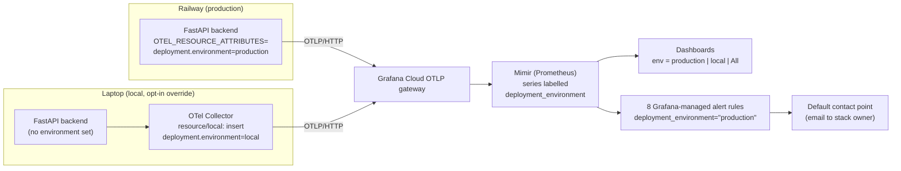

# 21c - Tuned dashboards and alerts

## What

Feature 21c finishes the monitoring story that features 14 to 20b started. It
does three things. First, every piece of telemetry that reaches Grafana Cloud
now says which **environment** it came from: production (the Railway backend)
or local (a laptop running the Docker stack with the Grafana override). Second,
both Grafana dashboards gained an **Environment** drop-down, so you look at
production, local, or both, instead of an unlabelled mix. Third, eight
**alert rules** now watch production and email the stack owner when something
breaks: the backend going silent, a burst of server errors, failing agent
runs, Gemini rate limits, slow answers, and evaluation scores below target. A
new README section explains each alert and what to check first when it fires.

No application code changed. The whole feature is configuration (one collector
file, two dashboard JSON files, one alert-rule YAML file) plus documentation.

## Why

After 20b, production telemetry was flowing into Grafana Cloud, but two gaps
remained.

**Mixed data.** Production and the local opt-in export both report as
`job="scholarlens-api"`. The moment you ran the local stack with the Grafana
override to test something, your test requests landed in the same dashboard
panels as real student traffic. A latency spike might be your laptop on slow
Wi-Fi; an error burst might be you deliberately breaking ChromaDB. You could
not tell.

**Nobody is watching.** Dashboards only help when someone is looking at them.
ScholarLens is a portfolio project with one maintainer, so in practice nobody
is. Without alerts:

- If Railway's trial credit runs out or the container crashes, the site is
  down until someone happens to try it.
- If the Gemini paid credits run dry, every student sees "busy, try again
  shortly" indefinitely, and nothing tells you why.
- If a corpus or prompt change makes the agent worse, the next evaluation run
  records lower accuracy in a gauge nobody opens.

Alerts turn "the data exists somewhere" into "you get an email". The
environment split is a prerequisite: an alert that fires because of your own
local experiments is noise, and noisy alerts get ignored.

## Key concepts

### Environments and why telemetry needs to know its own

An **environment** is one running copy of the system with its own purpose:
production serves real users, local is where you develop, and many teams also
have staging. The same code runs in each, so the telemetry it emits looks
identical unless something stamps it with where it came from.

Think of two branches of the same shop sending sales reports to one head
office on identical forms. Unless the form has a "branch" box, head office
adds them together and cannot say which branch is struggling. The environment
label is that box.

### Resource attributes become Prometheus labels

In OpenTelemetry, a **resource** describes the thing producing telemetry,
rather than any single measurement: the service name, its version, the host,
the environment. Its key/value pairs are **resource attributes**, attached
once and carried on every span, metric point, and log line that process sends.
The conventional key for environment is `deployment.environment`.

Grafana Cloud's Prometheus (Mimir) stores metrics as series identified by
**labels** (key/value pairs like `http_target="/eligibility"`). When OTLP
metrics arrive, Grafana Cloud turns some resource attributes into labels on
every series, replacing dots with underscores. 20b's live check proved that
`deployment.environment` is one of them: production series carry
`deployment_environment="production"`. That label is what every query in this
feature filters on.

### Collector processors, and `insert` versus `upsert`

An **OpenTelemetry Collector** is a relay: it receives telemetry, optionally
transforms it, and sends it on. A collector **pipeline** has three stages:
receivers (where data comes in), **processors** (what is done to it on the
way through), and exporters (where it goes). Processors run in the order
listed.

The **resource processor** edits resource attributes. Its `action` decides
what happens to an attribute that may already exist:

| Action | If missing | If present |
| --- | --- | --- |
| `insert` | add it | leave it alone |
| `update` | do nothing | overwrite it |
| `upsert` | add it | overwrite it |

This feature uses `insert`. The collector only ever handles local traffic, so
in practice nothing arriving there already has an environment. But `insert`
means that if a backend ever does set its own value, the collector respects
it instead of silently relabelling it.

### Dashboard template variables

A **template variable** is a drop-down at the top of a Grafana dashboard whose
current value is substituted into every query that mentions it. The dashboards
already had one, `$datasource`, which picks the Prometheus data source. This
feature adds `$env`.

It is a **custom** variable: its options are a fixed list typed into the
dashboard (`production,local`) rather than queried from the data. It also has
**Include All**, which adds an "All" option. When All is selected, Grafana
substitutes the variable's **custom all value**, here `.*`.

### Regex label matching, and why `.*` also matches "no label"

PromQL selects series with label matchers:

- `label="value"` matches exactly.
- `label=~"regex"` matches when the label's value fits the regular
  expression, anchored at both ends.

So `deployment_environment=~"$env"` becomes `=~"production"` or `=~"local"`
for a single environment, and `=~".*"` for All. A subtlety makes All behave
well: in Prometheus a series *without* a label is treated as having that label
set to the empty string, and `.*` matches the empty string. So All also shows
old series from before any label existed. A plain `=~"production|local"`
would have hidden them.

### What an alert is

An **alert rule** is a query that a server runs on a schedule, plus a
condition. When the condition holds, the rule raises an **alert**, which a
notification system turns into an email, chat message, or page. It is a smoke
detector for your metrics: it does not watch for you so much as interrupt you
when a threshold is crossed.

Each rule here has:

- **`expr`**: a PromQL expression. In Prometheus semantics, the rule is
  active when the expression returns any result, so the threshold lives inside
  the query (`... >= 3`). An empty result means "nothing wrong".
- **`for`** (the **pending period**): how long the condition must hold
  continuously before the alert actually fires. Until then the alert is
  **Pending**. A `for` filters out blips that fix themselves.
- **`labels`**: extra key/values on the alert, here `severity: critical` or
  `severity: warning`, which notification policies can route on.
- **`annotations`**: human-readable text for the notification. Here
  `summary` says what broke and `description` says where to look first.

A rule's **state** is one of Normal (nothing wrong), Pending, Firing,
**No Data** (the query returned nothing and the rule is configured to treat
that as its own state), or **Error** (the query failed, for example a wrong
data source).

### Rule groups and evaluation interval

Rules live in **groups**. Every rule in a group is evaluated on the group's
**interval**. The service rules run every minute because outages matter
quickly. The quality rules run every 5 minutes because evaluation scores only
change when someone reruns the evaluation suite.

### Prometheus rule files versus Grafana-managed rules

There are two places an alert rule can live in Grafana Cloud:

- **Data-source-managed** rules run inside Mimir's own ruler, in the classic
  Prometheus rule-file format, and notify through Mimir's Alertmanager.
- **Grafana-managed** rules run inside Grafana itself and notify through
  Grafana's contact points and notification policies.

The repo keeps the rules in the classic **Prometheus rule-file format** (a
YAML file of `groups` and `rules`), because it is portable, reviewable as
plain text, and checkable offline with `promtool`. The README then imports
them as Grafana-managed rules, so they use the stack's default **contact
point** (where notifications go, here the stack owner's email) without
setting up a separate Alertmanager.

### Counting failures instead of ratios at low traffic

The obvious error alert is "error ratio above 5%". At high traffic that is
right: a ratio is fair whether you serve 100 or 100,000 requests a minute.

ScholarLens serves a handful of requests an hour. At that volume a ratio is
mostly noise: one failure out of three requests is 33%, and one failure out
of one is 100%. A ratio alert would fire on a single unlucky request, so you
learn to ignore it. Counting instead asks "did at least 3 things fail in 15
minutes?", which one stray failure cannot trip, but a real outage trips
quickly.

PromQL's `increase(counter[15m])` estimates how much a counter grew over the
last 15 minutes. Summed across series, that is "how many 5xx responses in the
last 15 minutes". It shares `rate()`'s blind spot from 20b: the very first
increment of a brand-new series (for example the first-ever `rate_limited`
outcome after a restart) is invisible, because there is no earlier sample to
compare against. A real outage produces more than one failure, so the alert
still fires.

### Percentiles from a histogram: `histogram_quantile`

The latency alert uses **p95**: the latency that 95% of requests come in
under. Percentiles are better than averages for "is it slow?", because one
very slow request barely moves an average but shows up in the tail.

Prometheus does not store individual request times. It stores a
**histogram**: counters for "requests that took at most 100 ms", "at most 250
ms", and so on (the **buckets**, labelled `le` for "less than or equal").
`histogram_quantile(0.95, sum by (le) (rate(..._bucket[15m])))` estimates p95
from how requests spread across those buckets over 15 minutes. It is an
estimate interpolated within a bucket, which is accurate enough for an alert.

### A heartbeat: alerting on silence with `absent_over_time`

The hardest failure to alert on is total silence. If the backend crashes, it
stops sending metrics, so every error-counting rule sees no data and
reports nothing wrong. A crashed backend looks exactly like a healthy idle
one.

The fix is a **heartbeat**, sometimes called a **dead man's switch**: a rule
that fires when an expected signal *stops*. `absent_over_time(metric[10m])`
returns a value only when the metric had no samples at all in the last 10
minutes, so it inverts the usual logic.

The metric has to be one that is always sent while the backend is up, even
with zero traffic. Request counters do not qualify: OpenTelemetry only creates
a series after its first measurement, so after a restart they are absent
until someone makes a request. The ingestion gauge
`scholarlens_ingestion_last_run_timestamp_seconds` does qualify: the backend
re-reads its status file and exports the gauge every metric interval, traffic
or not. With the 10-minute window plus a 5-minute `for`, the alert means "no
production metrics for 15 minutes".

### Alerting on symptoms, with one cause-level exception

A well-known guideline is to alert on **symptoms** (what users experience:
errors, slowness, unavailability) rather than **causes** (CPU high, one
dependency slow), because many causes never hurt users and every alert costs
attention. Most rules here are symptoms. `ScholarLensProviderRateLimited` is
the deliberate exception: Gemini refusing requests is a cause, but it has one
specific fix (check quota and billing) that no other alert would point you to.

### Alert fatigue and pairing panels with alerts

**Alert fatigue** is what happens when alerts fire too often for things that
do not matter: people stop reading them, and then miss the real one. Every
choice above (counts not ratios, a `for` on latency, production-only rules)
pushes against it.

A related habit is drawing the alert's threshold on the matching dashboard
panel, so when the email arrives the chart shows the same line the alert
crossed. Panels in Grafana carry **thresholds** (value steps with colours),
and a time-series panel can draw them as lines with `thresholdsStyle`.

## Architecture



The label is set at the two places telemetry enters Grafana Cloud:
production sets it itself, and the local collector adds it. From then on it
is just a label like any other. Dashboards let you choose with `=~"$env"`;
alerts hard-code `="production"` so local experiments can never page you.

## What we actually built

### Labelling local exports

[`../infra/otel-collector-grafana.yaml`](../infra/otel-collector-grafana.yaml)
is the override merged on top of the base collector config when you run
`docker compose -f infra/docker-compose.yml -f infra/docker-compose.grafana.yml up`.
It gained a processor and uses it in all three pipelines:

```yaml
processors:
  # Production sends deployment.environment=production itself; local exports carry no label,
  # so the dashboards could not tell them apart. insert leaves an already-set value alone.
  resource/local:
    attributes:
      - key: deployment.environment
        value: local
        action: insert

service:
  pipelines:
    metrics:
      processors: [resource/local, batch]
      exporters: [prometheus, otlp_http/grafana]
```

Two details matter. When collector configs are merged, a list like
`processors` in the override *replaces* the base list rather than appending to
it, so `batch` has to be repeated or batching silently disappears. And the
resource processor runs before `batch`, so every item is labelled before it
is grouped for export.

Labelling in the collector, rather than adding the environment variable to
the Compose backend service, was a choice made while writing the spec. The
collector sees everything that goes through the override, including a backend
run directly on the host and pointed at `localhost:4318`, so one place covers
both ways of running locally.

### The Environment drop-down

Both [`../infra/grafana/dashboards/service-health.json`](../infra/grafana/dashboards/service-health.json)
and [`../infra/grafana/dashboards/ai-quality.json`](../infra/grafana/dashboards/ai-quality.json)
gained a second template variable after `datasource`:

```json
{
  "name": "env",
  "label": "Environment",
  "type": "custom",
  "query": "production,local",
  "current": { "selected": true, "text": "production", "value": "production" },
  "includeAll": true,
  "allValue": ".*",
  "multi": false
}
```

Every one of the 35 panel queries across the two dashboards had its selector
extended the same way. For example, request rate went from

```promql
sum(rate(http_server_duration_milliseconds_count{job="scholarlens-api"}[$__rate_interval]))
```

to

```promql
sum(rate(http_server_duration_milliseconds_count{job="scholarlens-api",deployment_environment=~"$env"}[$__rate_interval]))
```

The edit was made by a short script rather than by hand. It first checked that
loading and re-saving each file with the same indentation produced
byte-identical output, so the real diff contains only the intended changes.
It then asserted that every selector containing `job=` also had the
environment matcher. Dashboard uids did not change, so re-importing a file
replaces the existing dashboard in Grafana rather than creating a duplicate.

### Panel tuning, and a deviation from the spec

The spec asked for alert thresholds on three panels: 5xx error ratio,
`/eligibility` latency, and agent runs by outcome. During the build it became
clear only one of those can honestly show an alert line:

- **`/eligibility latency`** plots p95 in milliseconds, and the latency alert
  is "p95 above 30,000 ms". Same quantity, same unit, so the panel got a dashed
  red threshold at 30 s:

  ```json
  "custom": { "thresholdsStyle": { "mode": "dashed" } },
  "thresholds": {
    "mode": "absolute",
    "steps": [{ "color": "transparent", "value": null }, { "color": "red", "value": 30000 }]
  }
  ```

- **5xx error ratio** plots a *ratio*, while the alert counts 5xx responses
  over 15 minutes. A line at "3" on a percentage axis would be meaningless, so
  that panel keeps its existing 1% and 5% colour thresholds.
- **Agent runs by outcome** plots runs *per minute*, while the alert counts
  failures over 15 minutes. Instead of a misleading line, each outcome got a
  fixed colour so failures stand out: success green, timeout orange,
  tool_unavailable yellow, rate_limited purple, error red. Its description now
  lists `rate_limited` too, which was missing since feature 22.

The deviation was recorded in the spec's implementation notes and accepted in
review.

### The alert rules

[`../infra/grafana/alerts/scholarlens-alerts.yaml`](../infra/grafana/alerts/scholarlens-alerts.yaml)
holds two groups. Every expression pins
`job="scholarlens-api",deployment_environment="production"`.

| Rule | Fires when | `for` | Severity |
| --- | --- | --- | --- |
| `ScholarLensMetricsMissing` | the ingestion gauge has been absent for 10 minutes | 5m | critical |
| `ScholarLensServerErrors` | 3 or more 5xx responses in 15 minutes | 0m | critical |
| `ScholarLensAgentFailures` | 3 or more agent runs end in `timeout`, `tool_unavailable`, or `error` in 15 minutes | 0m | warning |
| `ScholarLensProviderRateLimited` | at least 1 `rate_limited` run in 15 minutes | 0m | warning |
| `ScholarLensSlowEligibility` | p95 `/eligibility` latency above 30 s | 15m | warning |
| `ScholarLensEligibilityAccuracyLow` | latest evaluation run below 80% | 0m | warning |
| `ScholarLensCitationAccuracyLow` | latest evaluation run below 70% | 0m | warning |
| `ScholarLensHallucinationRateHigh` | latest evaluation run above 10% | 0m | warning |

The heartbeat rule, as shipped:

```yaml
- alert: ScholarLensMetricsMissing
  expr: absent_over_time(scholarlens_ingestion_last_run_timestamp_seconds{job="scholarlens-api",deployment_environment="production"}[10m])
  for: 5m
  labels:
    severity: critical
  annotations:
    summary: No production metrics for 15 minutes. The backend is down or its export to Grafana Cloud fails.
    description: Check the Railway service status, GET /health, and the Railway logs for "Failed to export".
```

Where each number came from:

- **30 s latency.** The agent's whole-run timeout is 45 s
  (`agent_run_timeout_seconds` in [`../backend/app/config.py`](../backend/app/config.py)),
  and 20b observed a mean around 5 s. 30 s is well clear of normal and still
  warns before requests start timing out.
- **80% / 70% / 10%.** These are the project's existing evaluation targets,
  the same ones the AI quality dashboard draws.
- **Agent failures separate from 5xx.** Feature 5's agent degrades failures
  to a controlled response, so a timeout or a dead tool is not always a 5xx.
  The agent outcome metric sees it either way.
- **Outcome names** come straight from the `record(...)` calls in
  [`../backend/app/agent/agent.py`](../backend/app/agent/agent.py):
  `success`, `rate_limited`, `timeout`, `tool_unavailable`, `error`.

The quality rules fire on the *latest* run, because the evaluation gauges in
[`../backend/app/status_metrics.py`](../backend/app/status_metrics.py) always
hold the newest record from `evaluation-runs.jsonl`. So a quality alert keeps
firing until a passing run replaces the failing one. That is intended: the
problem is not fixed until a run proves it.

The heartbeat's metric name was not written anywhere in the repo. It was
derived from the gauge's definition in `status_metrics.py`
(`scholarlens.ingestion.last_run_timestamp`, unit `s`) using the same
OTLP-to-Prometheus naming the working AI quality dashboard already relies on
(`scholarlens.evaluation.last_run_timestamp` became
`scholarlens_evaluation_last_run_timestamp_seconds`). The live check then
confirmed it in Explore.

### The README operations note

[`../README.md`](../README.md) changed in two places. The Dashboards section
now explains the Environment drop-down and where each label comes from. A new
**Alerts and operations** section explains how to import the rule file into
Grafana Cloud, the fallback of creating rules by hand, how to test the contact
point, a table of every alert with its first checks, and the reasoning behind
counting and the heartbeat.

It also carries one practical instruction learned from the alert semantics:
every rule returns *no data* when things are healthy, so if Grafana shows a
rule as "No Data", set its "Alert state if no data" to Normal.

### Things that changed during the build

- **The spec had the heartbeat backwards.** The spec's live check said
  `ScholarLensMetricsMissing` "must not be NoData while production is up". But
  `absent_over_time` returns *nothing* precisely when the metric is present,
  so a healthy heartbeat is an empty result, like every other rule. The spec
  was corrected to two separate checks: rules may need their no-data state
  set to Normal, and Explore must return a real production value for the
  heartbeat metric, or the rule is watching nothing.
- **A wrong pointer in the alert text.** The first draft of the quality
  alerts said "inspect the run's failed profiles in /ops". `/ops` shows run
  totals, not per-profile failures. The evaluation command's own output does
  (`failure categories` and `failing attempts` in
  [`../backend/app/evaluation/__main__.py`](../backend/app/evaluation/__main__.py)),
  so the descriptions point there instead.
- **Review fixes.** A two-axis code review (standards and spec, run as
  separate subagents) found that the README described the heartbeat's status
  file by its local path, while production uses
  `INGESTION_STATUS_PATH=/data/ingestion-status.json` on the Railway volume.
  That sentence was corrected. The review also flagged a header comment block
  in the rule file, which the coding standards forbid; it was trimmed to the
  one comment that explains a decision.

### The checks that proved it

- **Collector config:** the collector's own `validate` command (image
  `otel/opentelemetry-collector-contrib:0.160.0`, the version Compose uses)
  accepted the merged base plus override config. As a control, a copy
  referencing a non-existent processor was rejected, which shows the check
  really inspects pipelines.
- **Compose:** `docker compose ... config` renders both the base stack and
  the stack with the override.
- **Dashboards:** both files parse as JSON, both have `["datasource", "env"]`
  variables, and a script confirmed all 35 targets carry
  `job="scholarlens-api",deployment_environment=~"$env"`.
- **Alert rules:** `promtool check rules` (from the `prom/prometheus` image)
  reported `SUCCESS: 8 rules found`, both before and after the review fixes.
  A small YAML check confirmed every rule has `alert`, `expr`, `for`, a
  severity label, a summary, and the production matcher.
- **Regression:** `ruff check .` passed and `pytest` passed 205 tests. No
  backend code changed, so this only shows nothing broke.
- **Live in Grafana Cloud (user-run):** the user followed the test guide
  (import both dashboards, check the production and local views, query the
  heartbeat metric in Explore, import the rules, check rule states, send a
  contact point test email) and reported that every step worked. The report
  was a single confirmation, so it does not record whether the rule file
  imported directly or rules were created by hand, or whether any rule needed
  its no-data state changed.

The branch was merged on GitHub as PR #50 (`61e45f9`), and its tree was
verified identical to the reviewed branch tip before local `main` was
fast-forwarded.

## What's next

- **21d, final eval rerun and screenshots.** This is the last open build-plan
  item. Rerunning the evaluation suite against production will produce a
  fresh run in the AI quality dashboard under `env=production`, and will be
  the first real test of the three quality alerts: a run below target should
  trigger an email. The dashboard screenshots for the README and resume can
  now be taken with the Environment drop-down on `production`, so they show
  only real traffic.
- **`/ops` is not environment-aware.** Its trend queries in
  [`../backend/app/ops/prometheus.py`](../backend/app/ops/prometheus.py) still
  use only `job="scholarlens-api"`, so they mix local data in while the local
  override runs. This was left out of scope deliberately; it would be a small
  follow-up fix if it ever matters.
- **Open finding F-22** asked for `rate_limited` in the README's metrics table
  and the agent panel's description. This feature fixed the panel
  description; the README table still lists four outcomes, so F-22 stays open
  for a future `/audit` or `/fix`.
- **Railway's trial credit** ends around the end of October 2026. If the
  service stops, `ScholarLensMetricsMissing` is exactly the alert that should
  tell you, which makes it a real-world test of the heartbeat.
