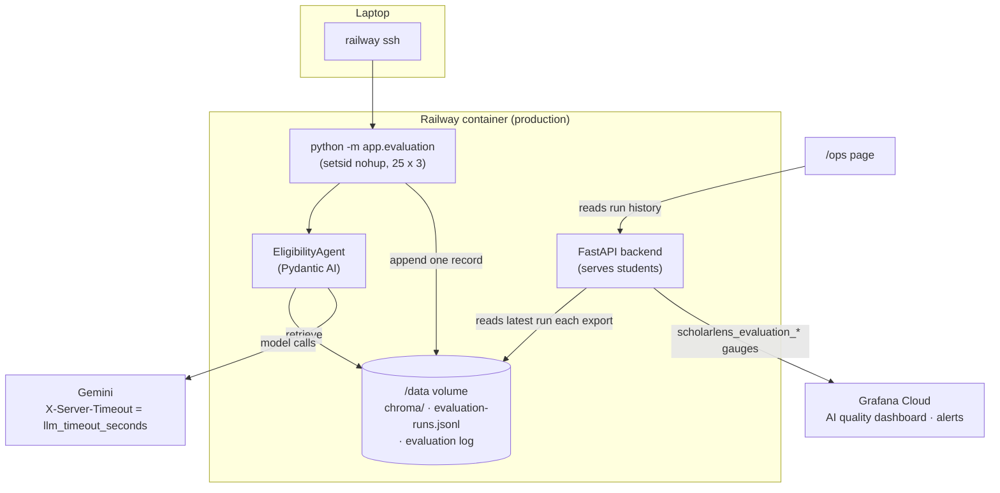

# 21d - Final eval rerun and screenshots

## What

Feature 21d is the last item in the ScholarLens build plan. It ran the
labeled-profile evaluation suite (25 hand-labeled student profiles, each
answered 3 times) once, **inside the deployed production backend on Railway**,
so the score describes the system real students use rather than a laptop. The
run met every target: eligibility accuracy 93.3%, citation accuracy 97.0%,
hallucination rate 1.4%, consistency 92.0%, at 7.6 s and about one tool call
per answer, for a measured cost of Rs 35.32. The results, two Grafana
screenshots, and the command for running the evaluation in production now sit
in the root README.

Getting there was most of the work. The feature was paused twice, and two
real bugs were found and fixed first (PR #51 and PR #52). That journey is the
more instructive part of this doc.

## Why

Every earlier feature claimed something: the agent answers from a knowledge
base, cites the exact rule, degrades gracefully, is observable. An
**evaluation** is the evidence for those claims. Without a production run:

- The only full evaluation on record was a local run from 2026-09-24, on the
  free tier, scoring eligibility 68% and **citation 0%**. Anyone reading the
  project would reasonably conclude the core promise ("cites the exact rule")
  did not work.
- The AI quality dashboard, `/ops`, and the three quality alerts from 21c had
  never seen a production run, so nobody knew if they worked end to end.
- A portfolio project needs a number you can defend: what was measured, how,
  on which model, on what date, and what it cost.

There was also a hard constraint: Gemini credit was prepaid (about Rs 403 at
the start, no auto-reload), and at an estimated Rs 120-150 per full run, there
was money for roughly one good final run, not several attempts.

## Key concepts

### Offline evaluation and labeled profiles

An **evaluation** (often "eval") is a repeatable test of an AI system's output
quality. Unit tests check that code does what it was written to do; an eval
checks that a model-driven system gives *good answers*, which no unit test can
assert because the answers are not fixed.

An **offline** eval runs against a fixed set of inputs with known right
answers, rather than live users. Here each input is a **labeled profile**: a
made-up student (`request`) plus the expected verdict, program, and a phrase
the cited rule must contain, in
[`../backend/data/evaluation/profiles.json`](../backend/data/evaluation/profiles.json).
It is like an exam with an answer key: the same questions every time, so
scores from different days are comparable.

### What each metric means

The scorer in
[`../backend/app/evaluation/scoring.py`](../backend/app/evaluation/scoring.py)
is **deterministic**: plain string comparison, no second model acting as a
judge ("No model judge" is in its first line). That makes it cheap, repeatable,
and strict.

- **Eligibility accuracy:** the share of answers whose verdict (`eligible`,
  `partial`, `not_eligible`) matches the label. An answer that never arrived
  (an engine error) counts as wrong.
- **Citation accuracy:** the share of answers whose `source.program` equals the
  expected program and whose quoted `supporting_clause` contains the expected
  phrase. Both are compared after **slugifying** (lowercase, every run of
  non-alphanumeric characters turned into one hyphen), so punctuation and case
  do not matter, but wording does.
- **Hallucination rate:** of the answers that were scored, the share that claim
  eligibility without a citation, or quote a "rule" that appears nowhere in the
  knowledge base. In RAG systems, a **hallucination** is a confident statement
  the sources do not support; here it is checked by searching the corpus for the
  quoted text.
- **Consistency:** the share of profiles that got the *same* verdict on every
  repeat. Language models are **non-deterministic**: the same question can get
  different answers, so asking 3 times measures how stable the system is.

### Repeats, sample size, and why 5 profiles is not enough

Running each profile 3 times (75 answers) costs 3x but buys two things:
consistency becomes measurable, and one unlucky answer moves the score less.
The same idea explains a caution from this feature: a 5-profile spot check is
fine for "does this bug still happen", but too small to claim a quality number.
The final claim rests on all 75 answers.

### Running a job inside a production container

The production backend is a **container**: a packaged, isolated Linux
environment on Railway with the code, the Python install, and a mounted
**volume** (`/data`, persistent storage that survives restarts) holding the
ChromaDB files and the run history.

`railway ssh` opens a shell inside that running container. A command run there
uses the real production configuration, database, and model key, which is
exactly what "evaluate the deployed version" means.

The evaluation could not go through the public website instead: the API allows
5 requests a minute and 20 a day per visitor (feature 18a), and a full run is
75 answers.

### Keeping a long job alive after you disconnect

When an SSH session closes, the shell sends **SIGHUP** ("hang up") to the
processes it started, and most programs exit on it. A 25-minute run would die
if the laptop slept. Two standard Unix tools prevent that:

- `nohup` makes the process ignore SIGHUP.
- `setsid` starts it in a new **session**, detached from the SSH session's
  terminal entirely.

Output goes to a log file on the volume (`> /data/evaluation-20261006.log
2>&1`), and `< /dev/null` stops it from waiting on input. The runner only
writes its record at the very end, so a killed run leaves nothing behind; this
is why "don't redeploy during a run" matters.

### Fail fast: aborting on repeated errors

[`../backend/app/evaluation/runner.py`](../backend/app/evaluation/runner.py)
stops the whole run after 3 consecutive `engine_error` attempts
(`_MAX_CONSECUTIVE_ENGINE_ERRORS = 3`). The reasoning: if the engine is
broken, finishing 75 attempts only burns money to record a meaningless score.
It is a small **circuit breaker**: after a burst of failures, stop calling the
thing that is failing. In this feature it fired, correctly, and pointed
straight at a real bug.

### Deadlines versus client timeouts

A **client timeout** is how long your code waits before giving up. A
**deadline** is a time budget the *server* is told to respect. They can be the
same number while behaving differently.

The Google SDK sends the client's timeout to Gemini in an `X-Server-Timeout`
header. Gemini then stops generating when the budget runs out and returns HTTP
**504 `DEADLINE_EXCEEDED`**. So a "timeout" setting in ScholarLens was really
an instruction to Gemini to *give up*, not just a limit on how long we wait.

### Tail latency

The same request does not always take the same time. **Latency** varies with
server load and with how long the model "thinks". The **tail** is the slow end
of that spread (for example the slowest 5%, called p95). Here one profile took
9 s, 21 s, 22 s, 23 s, and sometimes more than 30 s. A limit that covers the
typical case can still cut off the tail, which is why the fix improved things
from 0 of 4 to 3 of 4 rather than to 4 of 4.

### `localhost`, IPv4, and IPv6

Computers have two address families: **IPv4** (`127.0.0.1` is "this machine")
and **IPv6** (`::1` is "this machine"). The name `localhost` can resolve to
either. On Windows it tries IPv6 first. Docker Compose here publishes ChromaDB
only on IPv4 (`127.0.0.1:8001:8000` in
[`../infra/docker-compose.yml`](../infra/docker-compose.yml)), so each
connection first tried IPv6, waited for it to fail, then fell back to IPv4.
Measured: `localhost` 4.7 s, `127.0.0.1` 0.6 s.

### Reproduce before you fix

The single most useful habit in this feature: before changing code, rerun the
failing case on *current* code. The 0% citation score was 11 days old, from
different code and a different billing tier. A cheap 5-profile rerun showed it
no longer happened, and showed a different failure instead. Fixing the old
diagnosis would have meant changing the agent's prompt for a problem that no
longer existed.

## Architecture



The evaluation runs as its own process in the same container. It does not
export telemetry itself; instead it appends one record to
`evaluation-runs.jsonl`, and the long-running API process re-reads that file
at every metric export and publishes it as gauges. That is why the AI quality
dashboard, the quality alerts, and `/ops` all saw the run within a minute, and
why the service-health dashboard (which only counts real HTTP traffic) did not.

## What we actually built

### The journey, in order

| Date | What happened | Outcome |
| --- | --- | --- |
| 10-05 | Spec written; only prior run showed citation 0% | Decided to fix quality first instead of paying to confirm it |
| 10-05 | Comparing the old run's answers with labels (free) | 19 of 22 answers came from web search, quoting web text |
| 10-05 | 5-profile rerun on current code (about Rs 10) | 3 of 3 completed answers cited the knowledge base correctly; 2 crashed |
| 10-05 | Timing the crash (free) | First retrieval always hit the 5 s limit: `localhost` cost 4.6 s |
| 10-05 | PR #51: default ChromaDB host `127.0.0.1` | Subset rerun: 5 of 5 correct |
| 10-05 | First production run | Aborted after 21 of 75: `teach-meets-gpa` failed 3 of 3 |
| 10-05 | One production probe (Rs 2) | Gemini 504 `DEADLINE_EXCEEDED` at the 20 s limit |
| 10-05 | PR #52: model timeout 20 s to 30 s | Probe answered 3 of 4 times (9-23 s); 1 still over 30 s |
| 10-06 | Final production run | 69 of 75 fully right; every target met; Rs 35.32 |

### Fix 1: the local ChromaDB host (PR #51)

[`../backend/app/config.py`](../backend/app/config.py):

```python
# Not "localhost": Compose publishes ChromaDB on IPv4 only, and Windows tries IPv6 first,
# which costs seconds per connection and pushes the first query past its timeout.
chroma_host: str = "127.0.0.1"
```

The breakdown that found it timed each stage of the first retrieval in
[`../backend/app/retrieval/client.py`](../backend/app/retrieval/client.py):
building the embedding client 1.4 s, creating the ChromaDB client 4.6 s,
opening the collection 0.8 s, the query 0.9 s. All of that ran inside the
5 s query timeout, so the first retrieval in every fresh process failed.
Production was never affected: it runs ChromaDB embedded on the volume
(client 0.1 s), which was checked before the production run.

### Fix 2: the Gemini timeout (PR #52)

Same file:

```python
# Gemini enforces this as the request deadline (504 DEADLINE_EXCEEDED); 20 s cut off answers
# that needed about 21 s.
llm_timeout_seconds: float = Field(default=30.0, gt=0)
```

The proof that the setting really reaches Gemini came from reading the
installed libraries rather than guessing: `pydantic_ai/providers/google.py`
copies the httpx client's read timeout into `HttpOptions.timeout`, and
`google/genai/_api_client.py` turns that into the `X-Server-Timeout` header.

The trade-off was explicit. `_can_retry` in
[`../backend/app/agent/agent.py`](../backend/app/agent/agent.py) retries a
Gemini rate limit only if the suggested wait plus one model-call window fits in
the 45 s run budget, so raising the call window from 20 s to 30 s shrank the
retryable wait from about 25 s to about 15 s. Answering slow questions was
judged more important than waiting out long rate limits.

### The production run

```bash
railway ssh -s <backend-service> -- sh -c "cd /app && EVALUATION_REPEATS=3 setsid nohup python -m app.evaluation > /data/evaluation.log 2>&1 < /dev/null &"
railway ssh -s <backend-service> -- tail -n 30 /data/evaluation.log
```

The Dockerfile ([`../backend/Dockerfile`](../backend/Dockerfile)) already
ships `data/evaluation` in the image "because ingestion and evaluation run
inside the deployed service", so no new tooling was needed. The run summary,
as printed by
[`../backend/app/evaluation/__main__.py`](../backend/app/evaluation/__main__.py):

```text
eligibility accuracy  93.3%  (target >80%)  met
citation accuracy     97.0%  (target >70%)  met
hallucination rate    1.4%  (target <10%)  met
consistency           92.0%
mean latency          7603 ms
mean tool calls       1.01
failure categories    {'engine_error': 2, 'wrong_status': 3, 'ungrounded_clause': 1}
```

Reading the numbers: 70 of 75 verdicts were right (93.3%). The 5 wrong ones
were `calgrant-a-meets-gpa` answering "partial" instead of "eligible" on all 3
repeats, and 2 Gemini calls that ran past the 30 s deadline. One more answer
had the right verdict but quoted text not found in the corpus. Hallucination
is 1 of 73 because the 2 engine errors produced no answer to score.
Consistency is 23 of 25: the two profiles hit by an engine error did not get
the same verdict on all three tries. The `calgrant` profile counts as
consistent, because it was consistently wrong.

### README and screenshots

[`../README.md`](../README.md) gained an "Evaluation results" section near the
top (metric table with plain-language definitions, target and status columns,
the run's date and model, the misses), the evaluation command in Deploy, and
two images:

- [`../docs/screenshots/ai-quality.png`](../docs/screenshots/ai-quality.png),
  placed beside the numbers it shows.
- [`../docs/screenshots/service-health.png`](../docs/screenshots/service-health.png),
  a 7-day view in the Dashboards section, sparse because the site has had
  little real traffic.

Both were cropped with Windows' built-in .NET imaging (Pillow was not
installed, and adding it to the project for a crop was not justified). The crop
removed Grafana's top bar, which showed the data source name identifying the
Grafana stack.

### The checks that proved it

- **Preflight (read-only, over `railway ssh`):** `/health` healthy; ingestion
  succeeded 2026-10-01 with 23 chunks; profiles present; no prior production
  runs; embedded ChromaDB setup 0.1 s.
- **Run:** recorded as run `0e568cf5` at 2026-10-05 18:38 UTC.
- **Dashboards and `/ops`** (user screenshots): the AI quality stats and `/ops`
  both showed 93 / 97 / 1 / 92%, 7.6 s, 1.0 tool call.
- **Alerts** (user screenshot): all 8 ScholarLens rules Normal, none paused.
  The quality rules staying quiet is the correct result for a run that met
  every target. The one firing alert in the stack was Grafana's own
  `asserts_up` heartbeat, not a ScholarLens rule.
- **Cost:** balance Rs 373.02 before, Rs 337.70 after: Rs 35.32 for 75 answers,
  about Rs 0.47 each. The earlier estimate of Rs 120-150 was about 3-4x too
  high, a reminder to measure cost rather than estimate it from token guesses.
- **Review:** two review passes found no hard violations; wording fixes landed
  in `afac342` (a Status column, misses split into 5 wrong verdicts plus 1
  ungrounded quote, a hallucination definition that matches the scorer).
- **Gates:** `ruff check .` passed and `pytest` passed 205 tests.
- **Not checked:** the README was not viewed in a Markdown previewer during the
  build.

Merged on GitHub as PR #53 (`e0b3ab4`); its tree matched the reviewed branch.

## What's next

The build plan is complete: every item from 1 to 22 is checked. What remains
are known gaps, none of them blocking:

- **Slow Gemini tail.** 2 of 75 answers still ran past the 30 s deadline. If
  that rate matters, the recorded next step is `llm_timeout_seconds` 40 s with
  `agent_run_timeout_seconds` 55 s, still under the browser's 60 s limit and
  keeping the same 15 s rate-limit retry window.
- **`calgrant-a-meets-gpa`.** Answered "partial" 3 of 3 times when the label
  says "eligible". Worth a look: either the label is too strict about Cal
  Grant's income ceilings, or the agent is over-cautious.
- **Open findings.** 13 low-severity (P3) findings remain in the ledger, such as
  F-22 (the README's outcome list lacks `rate_limited`).
- **Stale numbers in older design docs.** Docs for features 5, 18a, and 22 and
  the architecture page still mention the old 20 s model timeout; they
  describe each feature as built.
- **Hosting deadlines.** The Grafana Cloud trial showed 4 days left on
  2026-10-06, and Railway's trial credit runs out around the end of October.
  If Railway stops, `ScholarLensMetricsMissing` is the alert that should notice.
