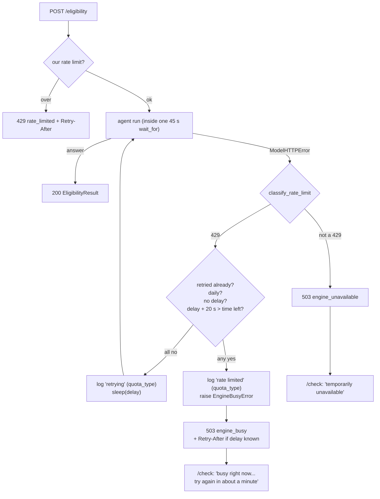

# 22 - Provider rate-limit handling

## What

When Gemini refuses a request because a quota has run out (HTTP 429,
`RESOURCE_EXHAUSTED`), ScholarLens now treats it as "busy", not "broken".
The backend reads Google's error body for two facts, which quota ran out and
how long Google suggests waiting, and then does one of two things:

- **Waits and retries once, silently**, when the quota is a short-window one
  (such as per-minute) and the suggested wait still leaves time to finish the
  request. The student simply gets their answer a bit later.
- **Gives up clearly** otherwise: `POST /eligibility` returns 503 with a new
  error code, `engine_busy`, plus a `Retry-After` header when Google gave a
  wait. `/check` shows "The eligibility engine is busy right now. Please try
  again in about a minute."

Logs, traces, and metrics record only *which kind* of quota was hit, never
Google's response text. This was the first feature to go through the
project's **independent review** gate, because it adds an automatic retry of a
paid API call.

## Why

Before this, every Gemini failure looked the same. A 429 fell into the agent's
catch-all `except Exception` branch, became "Agent run failed", and the student
saw "The eligibility engine is temporarily unavailable. Please try again
shortly." That caused three problems.

1. **Wrong message, wrong action.** "Temporarily unavailable" suggests
   something is broken. A per-minute quota clears in seconds; a daily quota
   doesn't clear until tomorrow. The student had no way to know whether to
   click again now or come back later, so many would click again at once and
   hit the limit again.
2. **Wasted recoveries.** A per-minute limit often clears in well under the
   45 seconds the request is allowed to run. Failing immediately threw away a
   request that could have succeeded by waiting.
3. **Blind operations.** The logs said "agent run failed, `ModelHTTPError`"
   for a quota problem and for a real Gemini outage alike. The project memory
   records that this is exactly what happened on the free tier: 503s that
   turned out to be the 20-requests-per-day cap. Diagnosing it took a manual
   call to Gemini.

With paid credits and a public deploy coming (feature 20), rate limits stop
being a development nuisance and become something real users will hit.

## Key concepts

### Rate limits and quotas

A **rate limit** caps how many requests a client may make in a time window. A
**quota** is the budget that limit enforces: "20 requests per day per project",
"15 requests per minute". Providers use them to share capacity fairly and
protect themselves from runaway clients.

The window length is everything:

| Window | Clears in | Sensible reaction |
|---|---|---|
| Per minute | seconds | wait a moment, try again |
| Per day | up to 24 hours | stop, come back tomorrow |

Analogy: a per-minute limit is a queue at a coffee shop; a daily limit is the
shop having sold out of beans. Waiting helps with one and not the other.

ScholarLens has **two** unrelated rate limits now, and it's worth keeping them
apart:

- **Ours** (feature 18a): per-IP and global limits on `/eligibility`, to protect
  the Gemini budget from one visitor. Exceeding it returns **429**
  `rate_limited`: *you* are sending too much.
- **Gemini's** (this feature): Google's limits on our API key. Hitting it
  returns **503** `engine_busy`: *our server* can't get capacity right now.

### HTTP 429 vs 503

HTTP status codes say whose problem a failure is:

- **4xx** means the client did something wrong. **429 Too Many Requests** means
  "you, specifically, are over your limit".
- **5xx** means the server couldn't do it. **503 Service Unavailable** means
  "the service can't handle this right now; try later".

Gemini sends us a 429, since from Google's view *we* are the client. But the
student's browser didn't do anything wrong; our server just lacks upstream
capacity. So we translate it to a 503 for our own client. Passing the 429
through would also have collided with our own `rate_limited` 429 and made
the two indistinguishable to the frontend.

### `Retry-After`

`Retry-After` is a standard HTTP response header telling the client how long
to wait before trying again, either in seconds (`Retry-After: 31`) or as a
date. It's valid on 429 and 503. The backend only ever sends whole seconds,
and rounds **up** (`max(1, ceil(delay))`), so a client that honors it never
comes back before the provider allows. A 0.4-second suggestion becomes `1`,
never `0`.

### Google's structured error model

Google APIs don't just return a status code; the body follows a documented
error model called `google.rpc.Status`:

```json
{
  "error": {
    "code": 429,
    "message": "You exceeded your current quota...",
    "status": "RESOURCE_EXHAUSTED",
    "details": [
      {
        "@type": "type.googleapis.com/google.rpc.QuotaFailure",
        "violations": [
          { "quotaId": "GenerateRequestsPerDayPerProjectPerModel-FreeTier", "quotaValue": "20" }
        ]
      },
      { "@type": "type.googleapis.com/google.rpc.RetryInfo", "retryDelay": "31s" }
    ]
  }
}
```

`details` is a list of typed objects, each tagged with an `@type` URL saying
what kind of detail it is. Two matter here:

- **`QuotaFailure`** lists each violated quota. Its `quotaId` names the window
  (`...PerMinute...`, `...PerDay...`).
- **`RetryInfo`** carries `retryDelay`, a duration string like `"31s"` or
  `"1.5s"`, meaning Google's suggestion for when to retry.

Note the `message`: it's free text. Google's messages can quote parts of the
request, which here contains the student's description. That's why this
feature reads only the typed fields and never logs or forwards the message.

### Defensive parsing of untrusted data

The classifier treats Google's body as **untrusted input**: data from outside
the program whose shape isn't guaranteed. Any level might be missing, `null`,
a string instead of a list, or a number instead of a string. A crash while
*handling an error* is the worst kind: it replaces a clear "busy" with a
confusing 500.

So every step checks the type before using it, and each failure mode shrinks
what's known instead of raising:

```python
error = body.get("error") if isinstance(body, dict) else None
details = error.get("details") if isinstance(error, dict) else None
if not isinstance(details, list):
    return []
```

A completely unreadable 429 body still classifies as
`ProviderRateLimit("unknown", None)`: it's still a rate limit, just with
nothing more known about it. The tests throw seven malformed bodies and seven
malformed delays at it.

### Retries: when they help and when they hurt

A **retry** repeats a failed operation in the hope it succeeds the second
time. Retries help with **transient** failures that clear on their own. They
hurt in three ways:

- **Cost.** Each Gemini call spends credits. Retrying a whole agent run
  repeats every model call and tool call it made.
- **Pile-ups.** If every client retries instantly after a limit, they all hit
  the limit again together. This is a **thundering herd**. Waiting the
  provider's suggested delay avoids it.
- **Hanging.** A retry that can't finish before the request's deadline only
  turns a clear, fast "busy" into a slow timeout.

Before this feature, the project had one retry rule (feature 18a): retry a
*connection* failure once, because that request never reached the provider and
can't have been billed. This feature adds a second, carefully bounded rule for
rate limits.

### Time budgets and deadlines

A **time budget** is the total time an operation may take, from start to
finish. The eligibility agent's budget is `AGENT_RUN_TIMEOUT_SECONDS` (45 s).
A **deadline** is that budget turned into a moment in time:
`deadline = start + 45 s`. Any later step can ask "how much time is left?"
with `deadline - now`.

The retry rule uses this directly:

```python
return limit.retry_after_seconds + self._llm_timeout_seconds <= remaining
```

That is: retry only if the wait **plus one full model-call window**
(`LLM_TIMEOUT_SECONDS`, 20 s) still fits in what's left. With the defaults,
a 429 on the first model call gets retried for suggested waits up to about 25
seconds. Anything longer is reported as busy immediately, with the delay as a
hint.

The wait and every attempt also sit inside **one** `asyncio.wait_for(..., 45 s)`,
so no combination of retries and sleeps can ever extend the request past its
budget.

### Exception hierarchies and backward compatibility

In Python, an exception class can **inherit** from another. Code that catches
the parent also catches the child:

```python
class EligibilityEngineError(Exception): ...
class EngineBusyError(EligibilityEngineError): ...   # new
```

This let the feature add a more specific error without breaking anything that
already handled the general one. The evaluation runner catches
`EligibilityEngineError` and scores the attempt as `engine_error`, and it still
does, with zero changes. The API route catches the **specific** one first, then
the general one:

```python
except EngineBusyError as exc:          # new, more specific
    raise ApiError(503, ENGINE_BUSY, headers) from exc
except EligibilityEngineError as exc:   # unchanged
    raise HTTPException(status_code=503) from exc
```

Order matters: Python uses the first matching `except`, so the child must be
listed before the parent.

### Closed sets in telemetry

Telemetry values here come from **closed sets**: a fixed, small list of
possible values (`per_minute`, `daily`, `unknown`). Two reasons:

- **Privacy.** A closed set can't carry student text or a provider message,
  by construction. That's also why `quota_type` had to be added to the log
  formatter's allowlist (feature 18b): any field not on the list is dropped.
- **Cardinality.** Metrics systems like Prometheus create one time series per
  distinct label value. A label taken from free text (say, the error message)
  could create thousands of series. A closed set creates exactly three.

### CORS "exposed" headers

The browser only lets page JavaScript read a few "safelisted" response headers
from a cross-origin response (such as `Content-Type`). Everything else is
hidden unless the server lists it in `Access-Control-Expose-Headers`.
`Retry-After` isn't safelisted. The backend's CORS config already exposed it
(for feature 18a's own 429), and this feature confirmed that it matters (see
"Things that went sideways").

### Independent review

**Independent review** means someone other than the author checks the work,
without the author's reasoning in their head. That's the same reason code review
exists: authors see what they meant, not what they wrote.

The project's Blueprint workflow requires it for "sensitive" changes, which
include external side effects. An automatic retry of a paid API call is
exactly that. The mechanics:

1. **Checkpoint.** The exact code under review is frozen as a commit
   (`37e2c59`), so "what was reviewed" is a precise, unchangeable thing.
2. **Spec snapshot.** The spec is gitignored, so a byte-exact copy is saved
   under `blueprint/.state/review-specs/`, named by the commit and the spec's
   SHA-256 hash. A **hash** is a fingerprint of the bytes: change one character
   and it changes completely, so it proves the spec wasn't edited afterwards.
3. **Fresh reviewer.** A new, isolated subagent started with no memory of the
   build conversation, only the repository and the audit procedure. It
   reviewed the whole diff across four lenses (quality, security, performance,
   tests), re-ran every check, and wrote a **receipt**: a record of what it
   reviewed, the exact commit and hashes, its verdict, and remaining risk.
4. **Freshness.** `/complete` only accepts the receipt if the commit, merge
   base, and spec hash still match, meaning nothing changed after the review.

## Architecture

The decision flow for one eligibility request:



Where each piece lives:

```
backend/app/agent/provider_errors.py   classify_rate_limit(): 429 body -> (quota_type, delay)
backend/app/agent/agent.py             EngineBusyError, _can_retry(), _run_with_retry()
backend/app/logging.py                 "quota_type" added to the log allowlist
backend/app/api/errors.py              ENGINE_BUSY code + message
backend/app/api/eligibility.py         EngineBusyError -> 503 engine_busy + Retry-After
frontend/src/components/check/EligibilityChecker.tsx   engine_busy -> busy message
```

## What we actually built

### The classifier

[`backend/app/agent/provider_errors.py`](../backend/app/agent/provider_errors.py)
is a pure module: no I/O, no settings, just data in and data out. That makes
it the easiest part to test thoroughly, which matters because it's the part
most exposed to a shape we don't control.

```python
@dataclass(frozen=True)
class ProviderRateLimit:
    quota_type: QuotaType            # "per_minute" | "daily" | "unknown"
    retry_after_seconds: float | None
```

A few decisions:

- **Daily wins.** If both a per-minute and a per-day quota are violated, the
  answer is `daily`. A retry can't help if the daily budget is gone,
  whatever the minute window says.
- **Strict delay format.** `retryDelay` must match `\d+(\.\d+)?s` and be
  positive. `"31"`, `"31 s"`, `"-5s"`, `"0s"`, and `"1e3s"` are all ignored,
  since a wrongly parsed delay could make the agent sleep for the wrong time.
- **Where the body comes from.** The spec assumed Pydantic AI hands over
  Google's body intact. Before writing any code, that was checked in the
  installed library: `pydantic_ai/models/google.py` has `_map_api_error`,
  which turns `google.genai.errors.APIError` into `ModelHTTPError` with
  `body=e.details`, the full `{"error": {...}}` JSON. The same reading
  showed `google-genai` does **no** retries by default (its `retry_args(None)`
  means "stop after 1 attempt"), so each 429 reaches our code exactly once.

The tests in
[`test_provider_errors.py`](../backend/app/agent/test_provider_errors.py) build
realistic bodies with a `gemini_429(*quota_ids, retry_delay=...)` helper. Its
`message` deliberately contains "Student prompt text could appear here", so
later tests can assert that text never leaks. 19b's agent tests and the API
tests reuse the same helper.

### The retry loop

In [`backend/app/agent/agent.py`](../backend/app/agent/agent.py), the single
`self._agent.run(...)` call became `_run_with_retry(...)`:

```python
while True:
    # Fresh deps, so the trace and tool count describe only the attempt that answers.
    deps = _Deps(retriever=self._retriever, web_search=self._web_search)
    try:
        return await self._agent.run(prompt, deps=deps), deps
    except ModelHTTPError as exc:
        limit = classify_rate_limit(exc)
        if limit is None:
            raise                                   # not a 429: old handling
        span.set_attribute("app.provider.quota_type", limit.quota_type)
        if not retried and self._can_retry(limit, deadline):
            retried = True
            await asyncio.sleep(limit.retry_after_seconds)
            continue
        raise EngineBusyError(limit.quota_type, limit.retry_after_seconds) from exc
```

Worth noticing:

- **The whole run repeats, not just the failed model call.** If the 429 hit on
  the second model turn, the retry redoes the first turn and its retrieval.
  That costs a little more, but resuming a half-finished agent run would mean
  reaching into Pydantic AI's message history. The spec judged one bounded
  full retry as the proportionate choice.
- **Fresh `_Deps` per attempt.** `_Deps` collects the transparency trace (the
  "searching program rules" labels feature 11 shows) and the tool-call count.
  Reusing one across attempts would show the student steps from a run that
  didn't produce their answer. A test proves it: attempt one calls retrieval
  and then gets a 429; the retry answers directly; the final trace has no
  "searching program rules".
- **A fixed exception message.** `EngineBusyError` always says "Model provider
  rate limited the run". The provider text never gets copied in.
- **Metric outcome.** `check_eligibility_measured` catches `EngineBusyError`
  first and records `agent_duration` with outcome `rate_limited`, a fifth
  value alongside `success`, `timeout`, `tool_unavailable`, and `error`.

### The API contract

[`backend/app/api/eligibility.py`](../backend/app/api/eligibility.py) maps the
new error:

```python
except EngineBusyError as exc:
    headers = None
    if exc.retry_after_seconds is not None:
        # Whole seconds, rounded up, so the client never retries before the provider allows.
        headers = {"Retry-After": str(max(1, math.ceil(exc.retry_after_seconds)))}
    raise ApiError(503, ENGINE_BUSY, headers) from exc
```

`ApiError` (feature 4) already supported a custom code plus headers on the
same status, which is why a second 503 flavor needed no new machinery. The
OpenAPI description for 503 now names both codes. A daily quota also gets
`Retry-After` when Google gives a delay: it's never retried automatically, but
the hint still helps the student, and the frontend's `describeWait` already
turns 43200 seconds into "in about 12 hours".

### The frontend

[`EligibilityChecker.tsx`](../frontend/src/components/check/EligibilityChecker.tsx)
gained one branch in `describeError`:

```ts
if (error.detail?.code === "engine_busy") {
  return {
    message: `The eligibility engine is busy right now. Please try again ${describeWait(error.retryAfterSeconds)}.`,
  };
}
```

Everything else was already there. `lib/eligibility.ts` parses `Retry-After`
for every API error. `describeWait` came from feature 18a's rate-limit
message. The message appears in the existing `role="alert"` paragraph, which a
screen reader announces immediately. And the component's rule of never
auto-retrying an answered response still holds, so the browser adds no second
layer of retries on top of the backend's.

### Tests

- **Classifier:** 23 cases (per-minute, daily, both violated, fractional delay,
  unknown quota ID, seven malformed bodies, seven malformed delays, three
  non-429 statuses, an unrelated exception).
- **Agent:** a `rate_limited_first(body, failures, then)` helper wraps 19b's
  scripted `FunctionModel` so the first *n* model requests raise
  `ModelHTTPError(429)`. Short delays use `"0.05s"`, so the retry test really
  sleeps, but only 50 ms. The no-retry cases (daily, 40 s delay, no delay,
  malformed body) also check the run returned in under 5 s, which proves
  nothing slept for the suggested delay. A log test confirms `quota_type` is
  recorded and the provider text isn't.
- **API:** 30.2 s → `Retry-After: 31`, 0.4 s → `1`, 43200 s → `43200`; no
  delay → no header; plain engine errors stay `engine_unavailable`. There's
  also a **full-pipeline** test: a real `EligibilityAgent` whose scripted model
  raises a daily 429, through the real route, out as 503 `engine_busy` with
  `Retry-After: 3600`, and "Student prompt text" nowhere in the response.
- **Browser:** a second Playwright test stubs a 503 `engine_busy` with
  `Retry-After: 20` and asserts the alert says "in about a minute", no verdict
  renders, exactly one request was sent, and the button is enabled again.

### Things that went sideways

**Does the stub need CORS headers?** Writing the browser test raised a
question: `page.route` answers the request inside the browser, so does
Chromium still apply cross-origin header rules to a stubbed response? The stub
includes the same `Access-Control-Expose-Headers: Retry-After` the real
backend sends, with a comment claiming it matters. Rather than trust the
comment, a throwaway copy of the test removed that one header and ran:

```
Expected: "The eligibility engine is busy right now. Please try again in about a minute."
Received: "The eligibility engine is busy right now. Please try again later."
```

So yes: without the expose header the page can't read `Retry-After`, and the
wait silently degrades to "later". That confirms two things at once: the test
comment is true, and feature 18a's `expose_headers=["Retry-After"]` in the
CORS setup is load-bearing for this feature too. The throwaway file was
deleted.

**Is this change "sensitive"?** Features 19a–19c were test-only and skipped
independent review. This one adds an automatic retry of a paid Gemini call and
new telemetry fields, which fits the project's definition of sensitive
("external side effects", user-data handling). The review ran on checkpoint
`37e2c59` and **passed**, after re-running all five checks and reading the
installed pydantic-ai and google-genai sources to confirm the body shape. It
raised one finding:

- **F-22 [P3]**: the root `README.md` metrics table still lists four agent
  outcomes, not five (`rate_limited` is missing). The Grafana panel
  description has the same stale list, but dashboard edits were out of scope.
  It's documentation only and left open for a later docs pass, because fixing it
  would change the reviewed commit and require a new review.

**503, not 429.** It was tempting to pass Gemini's 429 straight through. The
reason not to is in "HTTP 429 vs 503" above: our own limiter already owns 429
on this endpoint, and the frontend tells the two apart by code to give
different advice ("you've reached the limit for eligibility checks" vs "the
engine is busy").

### How we know it works

- Backend: `pytest` 196 passed (39 new); `ruff check .` clean; `app.main`
  imports.
- Frontend: `npm run lint` clean, `npm run build` compiled,
  `npm run test:e2e` 2 passed.
- The CORS expose-header experiment above.
- An independent review receipt (`passed`) bound to commit `37e2c59` and spec
  hash `5d9db191...`, now archived with the feature.

**Not proven:** behavior against a *real* Gemini 429 (only synthetic bodies,
checked against library source), and the new span attribute and metric outcome
(no test asserts them). Merged as PR #38.

## What's next

- **20 - Deploy.** This is when the feature starts to matter. A public URL means
  real students sharing one Gemini key, so per-minute limits become likely under
  any burst. Watch the `agent_duration` metric with outcome `rate_limited`
  after launch, and the `quota_type` in logs. They'll show whether limits are
  per-minute (consider a higher tier) or daily (consider a budget change).
- **21 - Production polish** includes tuning dashboards. That's the natural
  place to close **F-22**: add `rate_limited` to the README metrics table and
  the Grafana panel description, and consider an alert when the
  `rate_limited` share of agent runs climbs.
- **Embedding 429s** are still unhandled. The Gemini embedding call inside
  retrieval (ChromaDB's `GoogleGenaiEmbeddingFunction`) can hit quota too, and
  that still surfaces as `engine_unavailable`. If logs show it happening, the
  same classifier could be reused there, but the error arrives through a
  different library, so it would need its own check of the error shape.
