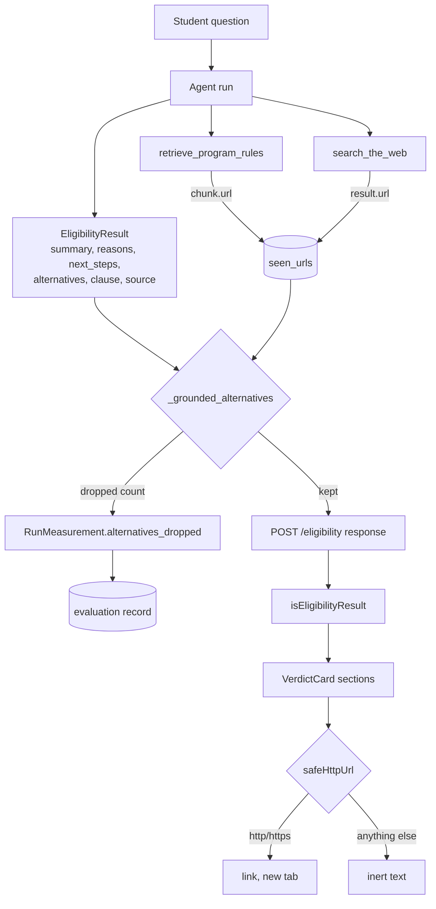

# 24b - Structured, readable results

## What

The eligibility answer used to carry one free-text field, `explanation`. It is
now split into typed sections:

- `summary`: one or two plain sentences that give the answer.
- `reasons`: a list, each entry tying one fact about the student to one rule.
- `next_steps`: a list of concrete actions.
- `alternatives`: other programs worth a look, each with a program name, why it
  may fit, and an official `source_url`.

The verdict, the quoted rule (`supporting_clause`), the `source`, and
`missing_info` work exactly as before. `/check` renders each new section as
real UI: a lead paragraph, a "Why" bullet list, a numbered "Next steps" list,
and "Other programs to look at" cards with an "Official page on ..." link.

The important part is invisible: the **server drops any alternative whose link
did not come from a tool in that same run**. The model cannot invent a
fellowship and a plausible-looking URL and have it reach the student.

## Why

Using the live checker after launch, an international PhD student asking about
the NSF GRFP got back one dense paragraph. It mixed the verdict, the reasoning,
and a list of other fellowships into a single block of text. Two problems:

1. **Hard to read.** A student scanning for "am I eligible, and what do I do
   now" had to parse a wall of prose.
2. **Uncited claims.** The list of other fellowships had no sources. The whole
   promise of ScholarLens is "we cite the exact rule behind each result". A
   paragraph that slips in uncited program suggestions quietly breaks that
   promise, and in a financial-aid context a confidently wrong suggestion can
   cost a student a deadline or an application fee.

Structure fixes the first problem. Server-side grounding fixes the second.

## Key concepts

### Structured output

A language model naturally produces text. **Structured output** means asking it
to produce data that fits a schema instead: a JSON object with known fields and
types. In Pydantic AI you do this by giving the agent an `output_type`, a
Pydantic model. Under the hood the model is offered a special "final result"
tool whose parameters are that schema; the model "calls" it with its answer,
and Pydantic validates the arguments. If validation fails, Pydantic AI tells
the model what was wrong and lets it try again.

Analogy: instead of asking someone to "write up what you found", you hand them
a form with labeled boxes. You get the same information, but every piece lands
in a predictable place.

### The schema is part of the prompt

The model sees the field names (and any descriptions). `why_it_may_fit` and
`source_url` tell the model what to put there far better than `text` and
`link` would. Choosing field names for a structured output is a small piece of
prompt design.

### A prompt is a request, validation is enforcement

The system prompt says: only list alternatives when a tool result gave their
official URL, and copy that URL exactly. Models usually follow instructions
like that. *Usually* is the problem. So the rule is enforced twice:

- **Prompt**: ask for the right behavior, so most answers are right the first
  time.
- **Server-side filter**: after the run, check the rule in code and drop
  anything that breaks it.

This layering is called **defense in depth**. The prompt keeps the drop rate
low; the code guarantees the outcome.

### Grounding and provenance

**Grounding** means tying a model's claim to evidence it was actually given.
**Provenance** is the record of where a piece of data came from. Here, a link
counts as a source only if retrieval (the program documents) or web search
(Tavily) returned that URL during this run. The agent keeps a set of every URL
its tools returned, and an alternative survives only if its `source_url` is in
that set.

This does not prove the program is a good fit. It proves the link is something
the system actually looked at, not something the model remembered or made up.

### Normalizing before comparing

Models copy URLs imperfectly. `https://example.org/stars/`,
`https://example.org/stars#rules` and `https://EXAMPLE.org/stars` all point at
the same page. Before comparing, both sides are normalized: lowercase the host,
drop the `#fragment`, drop one trailing `/`. Anything that is not `http` or
`https` with a host is rejected outright, which also blocks `javascript:` and
`data:` URLs.

### Untrusted text in the UI

Everything the model writes is **untrusted input**: it was shaped by web pages
the agent read, and a web page can contain anything. Two rules keep the UI
safe:

- **Text is rendered as text.** React escapes strings passed as children, so a
  summary containing `<script>` shows those characters instead of running
  them. The card never uses `dangerouslySetInnerHTML`.
- **Links are checked before they become links.** `safeHttpUrl` parses the URL
  and only returns it for `http:`/`https:`. Anything else is shown as inert
  text. A `javascript:alert(1)` "link" would otherwise run code when clicked.

### Runtime type checks on the frontend

TypeScript types disappear when the code runs, so `response.json()` really
returns `unknown`. The frontend therefore validates the shape before trusting
it (`isEligibilityResult`, now with `isAlternative`). A response missing
`summary`, or an old-format response that still has `explanation`, fails the
check and shows the existing "unexpected response" error instead of rendering
`undefined` or crashing.

### Changing an API contract

`explanation` was removed, not kept alongside. That is a **breaking change**:
an old client cannot read a new response. ScholarLens owns both ends and
deploys them together, so the cost is a short **deploy skew** window. Railway
(backend) and Vercel (frontend) each deploy from `main` on their own schedule,
so for a few minutes one side may expect the other shape. That was accepted on
purpose instead of building a compatibility layer for a single-user portfolio
app.

## Architecture



There are two independent gates on the way to a clickable link: the server's
grounding filter and the browser's scheme check.

## What we actually built

### The model

[`../backend/app/agent/models.py`](../backend/app/agent/models.py):

```python
class Alternative(BaseModel):
    program: str
    why_it_may_fit: str
    # Kept only when a tool returned this URL in the same run, so it is a source, not a guess.
    source_url: str


class EligibilityResult(BaseModel):
    status: EligibilityStatus
    summary: str
    reasons: list[str] = Field(default_factory=list)
    next_steps: list[str] = Field(default_factory=list)
    alternatives: list[Alternative] = Field(default_factory=list)
    ...
```

The lists default to empty, so an answer with nothing to add for a section
stays valid, and the UI hides empty sections.

### Recording what the tools returned

[`../backend/app/agent/agent.py`](../backend/app/agent/agent.py): the per-run
deps gained `seen_urls: set[str]`, filled by both tools after they return:

```python
ctx.deps.seen_urls.update(chunk.url for chunk in chunks)
...
ctx.deps.seen_urls.update(result.url for result in results)
```

Deps are rebuilt for each attempt (from the rate-limit retry in feature 22), so
a URL seen in an abandoned attempt cannot ground an alternative in the answer
that is returned.

### The filter

Also in `agent.py`:

```python
def _comparable_url(url: str) -> str | None:
    """The URL with a lowercase host and no fragment or trailing slash; None if not a web link."""
    ...
    if parts.scheme not in ("http", "https") or not parts.hostname:
        return None
    return parts._replace(netloc=parts.netloc.lower(), fragment="").geturl().removesuffix("/")


def _grounded_alternatives(alternatives, source, seen_urls):
    """Keep alternatives that link to a URL a tool returned and name another program."""
```

It keeps an alternative only when its URL matches a seen URL after
normalization, its `program` is not blank, and it is not the same program as
the verdict's own `source` (an "alternative" to the Pell Grant should not be
the Pell Grant). It runs right where the agent already overwrites `tool_trace`
with its own labels: the last step before the result leaves the agent. Only
the *count* of dropped entries is recorded (`RunMeasurement.alternatives_dropped`);
no URLs or program names are logged, in line with the project's rule against
logging prompts or provider payloads.

### The prompt, and what the live check taught it

The system prompt gained a description of each section. The first live check
with the NSF GRFP question showed the verdict and citation were right, but
`next_steps` said to look at "IBM, Microsoft, Google PhD Fellowships". The
uncited list had simply moved from the old paragraph into the new next-steps
field, which the filter does not inspect. The fix was in the prompt:

```
next_steps are concrete actions, such as applying, confirming a detail, or
providing missing information; they never name a program. Name other programs
only in alternatives, and only when a tool result in this run gave their
official URL ...
```

It also asks the model to address the student as "you"; the first answers said
"The student is ...". A re-run of the same query came back clean. The lesson:
structure moves where a problem can appear, so after restructuring you have to
look again at every free-text field, not just the one you designed the check
for.

### The evaluation

[`../backend/app/evaluation/models.py`](../backend/app/evaluation/models.py) and
[`../backend/app/evaluation/scoring.py`](../backend/app/evaluation/scoring.py):
each attempt records `alternative_count` and `alternatives_dropped`, and the run
records the total dropped. Any nonzero total says the prompt let an uncited
alternative through and the filter caught it. That is worth knowing even though
students never see those entries. Like 24a's fields, they are optional, so older
run records still load in `/ops`.

### The frontend

- [`../frontend/src/lib/eligibility.ts`](../frontend/src/lib/eligibility.ts):
  the `Alternative` type, the new `EligibilityResult` fields, and the runtime
  checks. (In 24c, `safeHttpUrl` moved here too, so every model-supplied URL
  goes through one shared check.)
- [`../frontend/src/components/check/VerdictCard.tsx`](../frontend/src/components/check/VerdictCard.tsx):
  `VerdictList` renders "Why" (`ul`) and "Next steps" (`ol`).
  `VerdictAlternatives` renders the cards. `SourceLink` either renders a
  new-tab link with screen-reader text "(opens in a new tab)" or falls back to
  plain text, and the Source section uses the same component. Each section is a
  `<section aria-labelledby>` with an `h3`, so screen-reader users can jump
  between "Why", "Next steps" and the rest. List keys combine index and text,
  because the model can repeat an entry and React keys must be unique.

### Checks that proved it

- `pytest` (230 tests) and `ruff check .`. The agent tests drive a fake model
  through real tool calls and assert that an alternative with a returned URL is
  kept, and that unseen URLs, `javascript:` URLs, empty URLs, blank programs,
  and repeats of the verdict's program are dropped and counted. Trailing slash,
  fragment, and host-case variants still match. An API test asserts that the
  response has the new keys and no `explanation`.
- `npm run lint`, `npm run build`, `npm run test:e2e` (41 tests): all sections
  render, a `javascript:` alternative stays inert, empty sections are hidden,
  an old-shape response takes the error path, and the accessibility checks run
  against a card with every section filled.
- Live: a Pell Grant question (all sections, an FSEOG alternative linked to
  studentaid.gov) and the NSF GRFP question before and after the prompt fix.
- The full paid evaluation (about Rs 35) was skipped by choice; the live checks
  showed the verdict, clause, and citation behavior unchanged.

## What's next

- **24c** decided how the finished answer appears: real streaming would have
  shown the summary before the clause, source and this alternative filter were
  final, so it chose a word-by-word reveal of the finished summary instead.
- **F-13** in the findings ledger stays open: alternatives are now checked on
  the server, but the primary `source.url` is still only guarded in the
  browser. Moving the same scheme check onto `Source` in the backend would
  close it.
- A future evaluation run will show the real `alternatives_dropped` rate, which
  says how well the prompt alone is doing.
