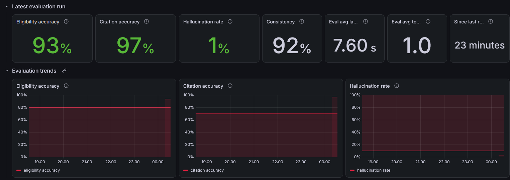
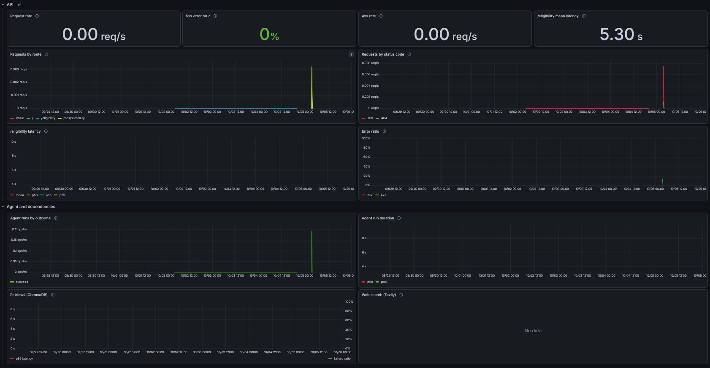

# ScholarLens

> Technical README as of 2026-10-09 (main at `35eecd4`), kept as a version. It
> covers local setup, deployment on Google Cloud Run and Vercel, Grafana Cloud telemetry,
> dashboards and alerts. The project overview is in the [main README](../../README.md).

**Live:** <https://scholarlens.arkaslittlemind.com>

Students often don't know which scholarships or grants they actually qualify
for: eligibility rules are buried in long PDFs and program pages, and keyword
search either misses real matches or confidently returns wrong ones.
ScholarLens takes a student's basic information (income, state, GPA, major,
and so on) and determines which programs they may qualify for, showing the
exact rule behind each result, so the answer is auditable rather than a
black box.

## Evaluation results

The agent is scored against 25 hand-labeled student profiles, each with the
expected verdict, program, and rule. This run used the deployed production
backend on 2026-10-05 (UTC), `gemini-3.8-flash` with `gemini-embedding-001`,
each profile answered 3 times (75 answers):

| Metric | Result | Target | Status |
| --- | --- | --- | --- |
| Eligibility accuracy: the verdict matches the label | 93.3% | above 80% | met |
| Citation accuracy: the quoted rule and program match the knowledge base | 97.0% | above 70% | met |
| Hallucination rate: of the answers scored, the share that claim eligibility without a citation or quote a rule found nowhere in the knowledge base | 1.4% | below 10% | met |
| Consistency: the same verdict across the 3 repeats | 92.0% | no target | not applicable |

Mean latency was 7.6 s per answer with 1.01 tool calls. 5 of the 75 verdicts
were wrong: 3 were `calgrant-a-meets-gpa` returning "partial" instead of
"eligible", and 2 were Gemini requests that ran past their deadline and
returned no answer. One more answer had the right verdict but quoted a rule
found nowhere in the knowledge base. Rerun it with
`python -m app.evaluation` (see Deploy for running it and promoting a run to production).



## Repo layout

```
frontend/   Next.js (App Router, TypeScript, Tailwind), the SaaS client
backend/    FastAPI + Pydantic AI, the API and Agentic RAG engine
infra/      Deployment / observability config (Docker Compose, env templates)
```

## Quickstart

### Frontend
```bash
cd frontend
npm install
npm run dev            # http://localhost:3000
```

### Backend
```bash
cd backend
python -m venv .venv
# Windows: .venv\Scripts\Activate.ps1   |   macOS/Linux: source .venv/bin/activate
pip install -e ".[dev]"
uvicorn app.main:app --reload   # http://localhost:8000  (docs at /docs)
```

### Operations view (`/ops`)

`/ops` is a password-protected page for maintainers. It shows traffic trends for
the last 6 hours (request rate, 5xx ratio, `/eligibility` latency, tool calls),
the latest and recent evaluation runs against their targets, and ingestion
health. The evaluation and ingestion sections read the backend's own status
files. The trends come from Grafana Cloud.

To enable it:

1. Generate one long random token and set it as `OPS_API_TOKEN` in both
   `backend/.env` and `frontend/.env.local`. The frontend sends it server-side
   only, so the browser never sees it.
2. Set `OPS_USERNAME` and `OPS_PASSWORD` in `frontend/.env.local`. `/ops` asks
   for them through the browser's login prompt, and returns 503 while either is
   unset.
3. Optional, for the trend charts: set `GRAFANA_PROMETHEUS_URL`,
   `GRAFANA_PROMETHEUS_USER`, and `GRAFANA_PROMETHEUS_TOKEN` in `backend/.env`.
   The comments in `backend/.env.example` say where to find them. Without
   them, the page says the trends are not configured and shows everything else.

The shared password has no rate limiting or lockout yet (feature 18), so use a
long one.

### Deploy

The backend runs on Google Cloud Run in `asia-south1`, and the frontend runs on
Vercel. Both serve HTTPS. Cloud Run scales the backend to zero when idle and
runs at most one instance. The ChromaDB index is built into the container
image, because Cloud Run has no persistent disk. Every secret lives in Secret
Manager, never in the repo, the image, or a plain env var.

`backend/cloudbuild.yaml` defines the build: bake the index, push the image to
Artifact Registry, deploy to Cloud Run. The trigger from step 3 runs it on
every push to `main` that changes a file under `backend/`, so merging a backend
change is the deploy. Step 2 deploys by hand when you need to.

**1. One-time Google Cloud setup.** Install the gcloud CLI
(`winget install Google.CloudSDK` on Windows), run `gcloud auth login`, and run
the commands below in Git Bash from the repository root.

1. In the console, create a project and link a billing account. Under
   Billing > Budgets & alerts, create a budget for the project with alerts at
   50%, 90%, and 100%.
2. Enable the services and create the image repository. The cleanup policy
   keeps the 2 newest images, which keeps storage near Artifact Registry's free
   allowance.

   ```bash
   PROJECT_ID=<your-project-id>
   REGION=asia-south1
   gcloud config set project $PROJECT_ID
   gcloud services enable run.googleapis.com cloudbuild.googleapis.com \
     artifactregistry.googleapis.com secretmanager.googleapis.com
   gcloud artifacts repositories create scholarlens --repository-format=docker --location=$REGION
   gcloud artifacts repositories set-cleanup-policies scholarlens --location=$REGION \
     --policy=infra/gcp/artifact-cleanup-policy.json --no-dry-run
   ```

3. Create the 3 required secrets. `read -rs` keeps each value out of the shell
   history and off the screen, and `printf` adds no trailing newline:

   ```bash
   for s in GOOGLE_API_KEY TAVILY_API_KEY OPS_API_TOKEN; do
     read -rsp "$s: " v; echo
     printf '%s' "$v" | gcloud secrets create $s --replication-policy=automatic --data-file=-
   done; unset v
   ```

   `OPS_API_TOKEN` must equal the frontend's. The two optional secrets,
   `OTEL_EXPORTER_OTLP_HEADERS` and `GRAFANA_PROMETHEUS_TOKEN`, are added in
   step 7 with the same loop. Secret Manager's free allowance covers 6 active secret
   versions, so when you rotate one, disable its old version.
4. Create two service accounts. The deployer runs the build and can read only
   the Gemini key, which the build needs to embed the corpus. The runtime
   account runs the service and can only read its secrets.

   ```bash
   gcloud iam service-accounts create scholarlens-deployer --display-name="ScholarLens deployer"
   gcloud iam service-accounts create scholarlens-runtime --display-name="ScholarLens runtime"
   DEPLOYER=scholarlens-deployer@$PROJECT_ID.iam.gserviceaccount.com
   RUNTIME=scholarlens-runtime@$PROJECT_ID.iam.gserviceaccount.com
   for role in roles/cloudbuild.builds.builder roles/run.admin; do
     gcloud projects add-iam-policy-binding $PROJECT_ID --member=serviceAccount:$DEPLOYER --role=$role --condition=None
   done
   gcloud iam service-accounts add-iam-policy-binding $RUNTIME \
     --member=serviceAccount:$DEPLOYER --role=roles/iam.serviceAccountUser
   gcloud secrets add-iam-policy-binding GOOGLE_API_KEY \
     --member=serviceAccount:$DEPLOYER --role=roles/secretmanager.secretAccessor
   for s in GOOGLE_API_KEY TAVILY_API_KEY OPS_API_TOKEN; do
     gcloud secrets add-iam-policy-binding $s \
       --member=serviceAccount:$RUNTIME --role=roles/secretmanager.secretAccessor
   done
   ```

**2. Deploy by hand (first deploy, and the fallback).** From the repository
root. The `.gcloudignore` uploads only `backend/`. Substitutions carry the
values that differ per account; none of them is a secret. Only
`_FRONTEND_ORIGIN` is required (the build stops without it); leave the Grafana
ones out until step 7. It lists every frontend origin, separated by commas, so
the `^;^` prefix makes `;` the separator between substitutions instead.

```bash
SUBS="^;^_FRONTEND_ORIGIN=https://scholar-lens-kappa.vercel.app,https://scholarlens.arkaslittlemind.com"
# With telemetry (step 7), append:
# ;_OTEL_EXPORTER_OTLP_ENDPOINT=<otlp-gateway-url>;_GRAFANA_PROMETHEUS_URL=<prometheus-query-url>;_GRAFANA_PROMETHEUS_USER=<numeric-user-id>
gcloud builds submit . --config backend/cloudbuild.yaml --region=$REGION \
  --service-account=projects/$PROJECT_ID/serviceAccounts/$DEPLOYER \
  --substitutions="$SUBS"
gcloud run services describe scholarlens-backend --region=$REGION --format='value(status.url)'
```

The build logs go to Cloud Logging (open the link the command prints). Check
the deploy with `curl <service-url>/health`, which returns
`{"status":"healthy"}`.

**3. Deploy on push.** The trigger `scholarlens-backend-deploy` in
`asia-south1` runs `backend/cloudbuild.yaml` as the deployer account. It reaches
GitHub through a Cloud Build 2nd gen host connection named `Github-ScholarLens`,
with the repository linked as `ScholarLens`. To set it up again, open Cloud
Build > Repositories in the console, choose the 2nd gen tab, and create a host
connection: provider GitHub, region `asia-south1`, name `Github-ScholarLens`.
When the console asks, grant the Cloud Build service agent the Secret Manager
role (the connection keeps its GitHub token there), install the Cloud Build
GitHub App on this repository only, then use "Link repository" and name it
`ScholarLens`. Then create the trigger
with the same substitutions as step 2:

```bash
gcloud builds triggers create github --name=scholarlens-backend-deploy --region=$REGION \
  --repository=projects/$PROJECT_ID/locations/$REGION/connections/Github-ScholarLens/repositories/ScholarLens \
  --branch-pattern='^main$' --included-files='backend/**' \
  --build-config=backend/cloudbuild.yaml \
  --service-account=projects/$PROJECT_ID/serviceAccounts/$DEPLOYER \
  --substitutions="$SUBS"
```

- Only pushes to `main` that change `backend/**` deploy. Frontend, docs, and
  infra-only pushes do not start a build. Merging a backend pull request is the
  deploy.
- A failed build leaves the previous revision serving. Re-run it from Cloud
  Build > History (Retry), or with
  `gcloud builds triggers run scholarlens-backend-deploy --region=$REGION --branch=main`.
- To change a substitution such as the frontend origin, edit the trigger in the
  console (Cloud Build > Triggers), then re-run it.

**4. Changing the corpus.** Edit `backend/data/programs/` and merge. The
triggered build ingests the corpus again into the new image, so the index and
the ingestion status `/ops` shows always match the code that is serving.

**5. Evaluating the agent.** The deployed service has no shell, so run the
evaluation locally against the same model and corpus, with the stack from
Docker (local dev) below:

```bash
docker compose -f infra/docker-compose.yml run --rm backend python -m app.ingestion
docker compose -f infra/docker-compose.yml run --rm -e EVALUATION_REPEATS=3 backend python -m app.evaluation
```

It appends to `backend/data/evaluation-runs.jsonl`, which stays local. Three
repeats of the profiles make about 84 agent runs, all billed to the Gemini key.
To show a run on production `/ops` and the AI quality dashboard, append its line
to the committed `backend/data/evaluation/production-runs.jsonl`, never editing
earlier lines, and merge. Production reads that file through
`EVALUATION_RUNS_PATH`.

```bash
tail -n 1 backend/data/evaluation-runs.jsonl >> backend/data/evaluation/production-runs.jsonl
```

**6. Frontend on Vercel.** Import the repo with root directory `frontend` and
set these variables:

- `NEXT_PUBLIC_API_URL`: the full Cloud Run service URL from step 2 including
  the scheme, such as `https://scholarlens-backend-<hash>.asia-south1.run.app`.
  Without `https://` the browser treats it as a relative path and every check
  404s on Vercel. It is inlined at build time, so a change needs a redeploy.
- `OPS_USERNAME`, `OPS_PASSWORD`, `OPS_API_TOKEN`: the token must equal the
  backend's.

The backend's `_FRONTEND_ORIGIN` substitution lists every origin the frontend
is served from, exactly and comma-separated, with no trailing slash: today
`https://scholar-lens-kappa.vercel.app,https://scholarlens.arkaslittlemind.com`.
Vercel preview deployments are not allowed by CORS.

**7. Production telemetry (Grafana Cloud).** Not set up yet. It is an
unscheduled item in the build plan, which also covers checking that the export
still arrives when Cloud Run throttles the CPU between requests. The backend
sends traces, metrics, and logs straight to Grafana Cloud's OTLP gateway, with
no collector in production. In Grafana Cloud, open your stack, then the
OpenTelemetry tile, and generate a token; the tile shows the values below.

- `_OTEL_EXPORTER_OTLP_ENDPOINT` (substitution): the gateway URL ending in
  `/otlp`, such as `https://otlp-gateway-prod-us-east-0.grafana.net/otlp`. The
  app adds `/v1/traces`, `/v1/metrics`, and `/v1/logs`.
- `OTEL_EXPORTER_OTLP_HEADERS` (secret):
  `Authorization=Basic%20<base64 of instanceID:token>`. Use `%20`, not a space,
  after `Basic`. To build it:
  `python -c "import base64,getpass; i=input('Instance ID: '); t=getpass.getpass('Token: '); print('Authorization=Basic%20' + base64.b64encode(f'{i}:{t}'.encode()).decode())"`
- `OTEL_RESOURCE_ATTRIBUTES=deployment.environment=production` is set by
  `cloudbuild.yaml`, which tells production data apart in Grafana.
- Optional: `_GRAFANA_PROMETHEUS_URL`, `_GRAFANA_PROMETHEUS_USER`, and the
  `GRAFANA_PROMETHEUS_TOKEN` secret for the `/ops` trend charts (see Operations
  view above). These are a separate read-only login.

Telemetry is optional. Until `_OTEL_EXPORTER_OTLP_ENDPOINT` is set, the build
attaches only the 3 required secrets and the service exports nothing; the same
goes for `_GRAFANA_PROMETHEUS_URL` and the trend charts. To turn them on, create
each secret with the step 1 loop, grant the runtime account access the same
way, set the substitutions on the trigger (or pass them to a manual build), and
deploy again.

Spans, metrics, and logs are scrubbed the same way as locally. If Grafana
Cloud is unreachable or the token is wrong, requests are unaffected; the
backend only logs OTel's "Failed to export" warnings, which appear in Cloud
Run's logs.

**Client IP and rate limits.** The per-IP limits need the real client address.
Cloud Run's front end appends it to any `X-Forwarded-For` the client sent, and
the request reaches the container from Cloud Run's internal proxy.
`FORWARDED_ALLOW_IPS=169.254.0.0/16` (the `_FORWARDED_ALLOW_IPS` default in
`cloudbuild.yaml`) makes uvicorn trust only that proxy, so it takes the
right-most entry it does not trust, which a client cannot forge. `*` would take
the left-most entry, which a client controls, and anyone could reset their own
limit with a made-up header. Checked on the live service on 2026-11-05: 6
parallel checks, each with a different made-up `X-Forwarded-For`, still hit
the 5-per-minute limit, and a check from the same machine's other address
(IPv4 after IPv6) was accepted in the same minute, so each real client gets its
own limit.

**Trade-offs and costs.**

- A request after an idle period waits for a cold start while Cloud Run starts
  the container and opens the index.
- The rate-limit counters live in process memory, so they reset whenever the
  instance starts, including after idle periods. The per-minute limit and the
  budget alert still bound spending.
- CPU is allocated only while a request is handled, which keeps the service
  inside Cloud Run's free tier. `asia-south1` is a Tier 1 (cheaper) Cloud Run
  region (Cloud Run locations page, checked 2026-11-05).
- Changing the corpus or promoting an evaluation run needs a merge, because the
  image is the only storage the service has.

### Docker (local dev)
```bash
docker compose -f infra/docker-compose.yml up
```
Brings up the FastAPI backend, ChromaDB (persistent volume), and an
OpenTelemetry Collector together. The frontend still runs separately via
`next dev`.

The backend traces each request (API, agent, LLM calls, retrieval, web search)
and sends spans to the collector, which prints them
(`docker compose -f infra/docker-compose.yml logs otel-collector`). Spans carry
timings, models, token counts, and error types, never student input.

Metrics go to the same collector, which serves them in Prometheus format at
<http://localhost:8889/metrics>. The backend exports every 60 seconds; set
`OTEL_METRIC_EXPORT_INTERVAL=5000` (milliseconds) on the backend for faster
local checks. Metric labels only ever take fixed values, never student input.

The backend's own log lines also go to the collector, which prints them next to
the spans. Each one carries the same allowlisted fields and correlation ID as the
stdout JSON line, plus the code location and the trace ID of its request. An
exception is recorded by type only, never its message or stacktrace; the stdout
line also keeps the traceback frames, which the export leaves out.

Compose points the backend at the collector's OTLP/HTTP receiver
(`http://otel-collector:4318`). For a backend you run on the host, set
`OTEL_EXPORTER_OTLP_ENDPOINT=http://localhost:4318`. An older `:4317` (gRPC)
value no longer works.

| Metric (Prometheus name) | What it measures |
| --- | --- |
| `http_server_duration_milliseconds` | Request count, latency, and status code per route (`/health` excluded) |
| `scholarlens_agent_duration_seconds` | Agent run duration by outcome: `success`, `rate_limited`, `timeout`, `tool_unavailable`, `error` |
| `scholarlens_llm_requests_total` | Model requests made by completed agent runs |
| `gen_ai_client_token_usage` | Input and output tokens per model response (from Pydantic AI) |
| `scholarlens_tool_calls_total` | Tool calls by tool name |
| `scholarlens_retrieval_duration_seconds` | ChromaDB retrieval latency by outcome |
| `scholarlens_web_search_duration_seconds` | Tavily search latency by outcome |
| `scholarlens_ingestion_*` | Last ingestion run: success, finish time, chunk count |
| `scholarlens_evaluation_*` | Latest evaluation run: accuracy, citation accuracy, hallucination rate, consistency, latency, tool calls, run time |

The ingestion and evaluation gauges are read from `data/ingestion-status.json`
and `data/evaluation-runs.jsonl`; a gauge is absent until its file exists.

To also send a local backend's traces to Grafana Cloud Tempo, its metrics to
Grafana Cloud's Prometheus, and its logs to Loki, copy `infra/.env.example` to
`infra/.env`, fill in your stack's OTLP credentials, and add the override.
Production sends its own telemetry directly (Deploy, step 4).

```bash
docker compose -f infra/docker-compose.yml -f infra/docker-compose.grafana.yml up
```

#### Dashboards

Two Grafana dashboards live in `infra/grafana/dashboards/`:

- `service-health.json`: request rate, 5xx ratio and 4xx rate, `/eligibility`
  latency, agent outcomes and duration, and ChromaDB and Tavily latency and
  failures.
- `ai-quality.json`: the latest evaluation run, evaluation trends against the
  targets (eligibility above 80%, citation above 70%, hallucination below 10%),
  tool calls, LLM requests, and token usage.



The AI quality dashboard for the latest production run is shown under
Evaluation results at the top of this file.

To import one, open Grafana Cloud, go to Dashboards > New > Import, and upload
the file. Pick your stack's Prometheus data source in the "Data source" drop-down
at the top of the dashboard. Importing a file again replaces the existing copy.
The panels fill from production (Deploy, step 4), or while a local backend runs
with the Grafana override above. Use the "Environment" drop-down to choose
which: `production` (the default), `local`, or All. Production sets
`deployment.environment=production` itself; the Grafana override's collector
labels everything else `local`.

A few things to know when reading them:

- The evaluation panels show the latest run. The backend re-reads it at every
  metric export and Grafana Cloud's Prometheus (Mimir) stores each sample, so a
  trend line is flat between runs, steps when
  `python -m app.evaluation` finishes, and has gaps while the backend is down. A
  quality stat with no value means the run could not measure it (for example, no
  hallucination judgement); it is never shown as 0.
- Prometheus `rate()` cannot see the first sample of a new series, so the first
  request with a new status code or failure outcome after a backend start does
  not show up in rate panels. Later ones do.
- The dashed line on `/eligibility latency` marks 30 s, where the slow-latency
  alert below fires on p95.

#### Alerts and operations

`infra/grafana/alerts/scholarlens-alerts.yaml` holds the production alert rules
in Prometheus rule format. Every rule only looks at
`deployment_environment="production"`, so local runs never alert.

To load them, open Grafana Cloud, go to Alerting > Alert rules, and use "Import
to Grafana-managed rules" with the YAML file. If your stack does not offer a
file import, create each rule by hand with its query, pending period ("for"),
and severity label from the file. Grafana-managed rules notify the stack's
default contact point, which emails the stack owner; use "Test" on the contact
point to check delivery. Every rule returns no data while things are healthy,
so if a rule shows "No Data", set its "Alert state if no data" to Normal.

| Alert | Fires when | First checks |
| --- | --- | --- |
| `ScholarLensServerErrors` | 3 or more 5xx responses in 15 minutes | Requests by status code, then the failing trace in Tempo and its Loki lines |
| `ScholarLensAgentFailures` | 3 or more agent runs end in `timeout`, `tool_unavailable`, or `error` in 15 minutes | Agent runs by outcome, Retrieval and Web search panels, a failing trace |
| `ScholarLensProviderRateLimited` | Gemini refuses a run with a rate limit or quota error | Gemini quota and billing in Google AI Studio |
| `ScholarLensSlowEligibility` | p95 `/eligibility` latency above 30 s for 15 minutes | The LLM, retrieval, and web search spans of a slow trace |
| `ScholarLensEligibilityAccuracyLow`, `ScholarLensCitationAccuracyLow`, `ScholarLensHallucinationRateHigh` | The latest production evaluation run misses its target | The failure categories and failing attempts printed by `python -m app.evaluation`, then rerun it |

Errors are counted rather than taken as a ratio, because at low traffic one
failed request out of three would trip any ratio. There is no alert for
missing production metrics: Cloud Run scales the backend to zero when idle, so
an absence of metrics is the normal state. The quality alerts
keep firing until a passing evaluation run replaces the failing one. Like the
rate panels, the count alerts miss the first failure of a new kind after a
backend start.
